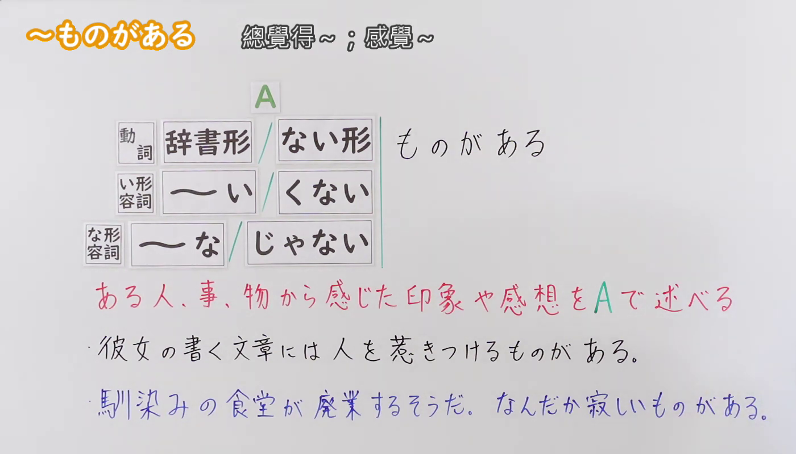
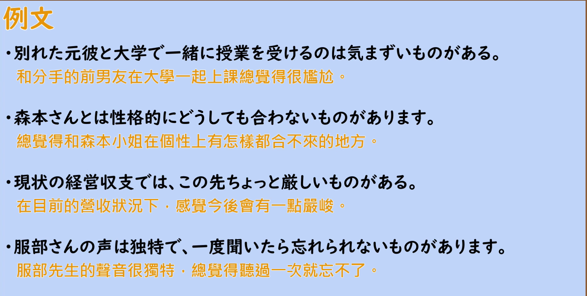

---
{
  "id": "N2-G-0082",
  "kind": "grammar",
  "level": "N2",
  "title": "ものがある：總覺得～；感覺～",
  "card_revision": 1,
  "schema_version": 1,
  "source": {
    "lesson": "N2 第82个语法",
    "material": "出口日語原视频板书、日语自动字幕与Hagoromo正文",
    "video": "https://www.youtube.com/watch?v=dD2vDGxWcEM",
    "screenshot": "assets/grammar/n2/N2-G-0082-connection.png",
    "screenshot_seconds": 100,
    "screenshot_crop": {
      "x": 0,
      "y": 0,
      "width": 1400,
      "height": 800
    }
  },
  "tags": [
    "ものがある",
    "N2"
  ],
  "confusions": [
    "〜ことがある（表示经验或「有时会发生」，与本语法「总觉得…」不同）",
    "〜ところがある（用于指出具体的特点或缺点，语气比本语法直接）"
  ]
}
---

# N2 第82個語法：ものがある —— 總覺得～；感覺～

# 视频学习资料整理

- 原视频：[出口日語 N2 第82個語法～ものがある](https://www.youtube.com/watch?v=dD2vDGxWcEM)
- 视频中讲到的接续：動詞（辞書形／ない形）、い形容詞（～い／くない）、な形容詞（～な／じゃない）＋ものがある。也就是只接现在肯定形和现在否定形；讲解中明确说过去形不接，板书中也没有列名词。
- 板书把句式写作「A ものがある」，并用红色标出含义说明「ある人、事、物から感じた印象や感想を A で述べる」。
- 讲解补充：本语法用于说不出具体理由、只是「なんとなくそう感じる」的间接感想；遇到「とても美味しい」「今日はとても楽しい」这种直接感想时不用它。

0:01 画面中第二条例句的后半被人物遮住，因此接续图改用板书完整、人物让开板书的 1:40 画面。

**接续图（视频 1:40 画面，原图 1920×1080，裁切区域 x=0, y=0, width=1400, height=800）**

**例句图（视频 2:55 例句页，原图 1920×1080，裁切区域 x=50, y=18, width=1826, height=922）**

# 核心

## 功能一：（陈述）从某人、事、物感受到的印象或感想

**最上位意味カテゴリー：**

- **ものがある：** 考え・感情（思考与感情）

**中位意味カテゴリー：**

- **ものがある：** 主張・断定的評価（主张・断定性的评价）

**意味：**

- **ものがある：** 評価（评价）

**くわしい意味記述：**

- **ものがある：** ある物事にある特徴が感じられるという意味。ある物事から受ける話し手の印象，気持ちを言うときに使う。書きことばで多く使う。（表示能感受到某事物具有某种特征之意。用于表达说话人从某事物那里得到的印象、感受。多用于书面语。）

**派生語：** 未列出

### 例句

1. 彼の音楽の才能には素晴らしいものがある。

   （他的音乐才能里有让人觉得很了不起的地方。）

2. 女性は男性よりも子どもに近いものがある。

   （女性总觉得比男性更接近孩子。）

3. しかし、その感覚は粘膜から受ける感覚として、ひじょうにデリケートなものがある。

   （不过，那种感觉作为黏膜受到的感觉，显得极为细腻。）

4. これが国内ならまだしも、文化の異なる外国に現場がある場合は、その弊害ははかりしれないものがある。

   （如果是在国内倒还好，一旦现场在文化不同的外国，其弊害之深让人觉得难以估量。）

# 来源

- [出口日語原视频](https://www.youtube.com/watch?v=dD2vDGxWcEM)
- [Hagoromo 文型检索「ものがある」](https://www.hagoromo-text.work/lookup?vid=1620)（查询日期：2026-09-23，用于最上位・中位意味カテゴリー、意味、くわしい意味記述及例句4条）
