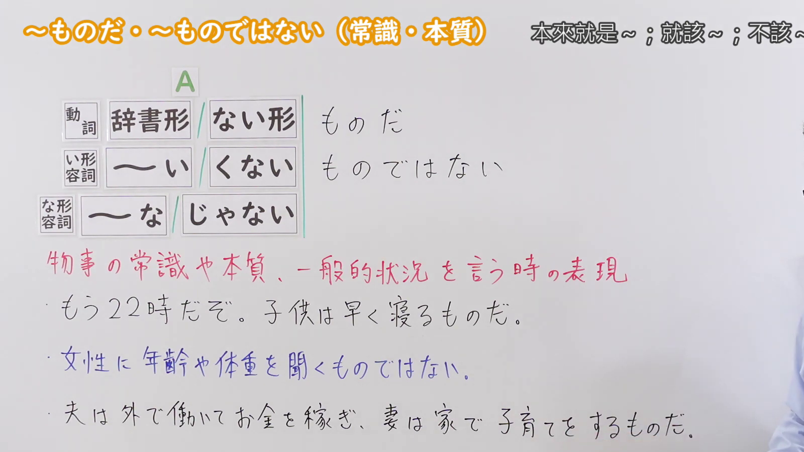
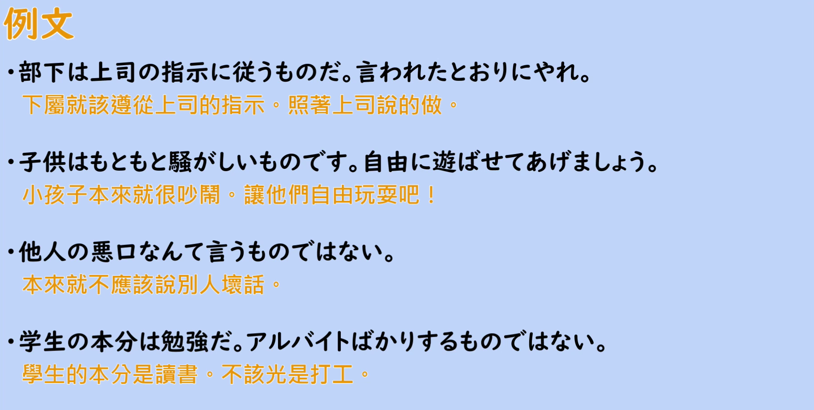

---
{
  "id": "N2-G-0083",
  "kind": "grammar",
  "level": "N2",
  "title": "ものだ・ものではない（常識・本質）：本來就是～；就該～；不該～",
  "card_revision": 1,
  "schema_version": 1,
  "source": {
    "lesson": "N2 第83个语法",
    "material": "出口日語原视频板书、日语自动字幕与Hagoromo正文",
    "video": "https://www.youtube.com/watch?v=qFA_eswZgGg",
    "screenshot": "assets/grammar/n2/N2-G-0083-connection.png",
    "screenshot_seconds": 130,
    "screenshot_crop": {
      "x": 0,
      "y": 0,
      "width": 1600,
      "height": 900
    }
  },
  "tags": [
    "ものだ",
    "ものではない",
    "N2"
  ],
  "confusions": [
    "〜たいものだ（表示强烈的愿望，与本课「常識・本質」的用法不同）",
    "〜たものだ／よく（も）〜ものだ（分别表示回忆与感叹，与本课用法不同）",
    "〜というものだ（对某个事实作断定性的评价，不是陈述一般常识）"
  ]
}
---

# N2 第83個語法：ものだ・ものではない（常識・本質）—— 本來就是～；就該～；不該～

# 视频学习资料整理

- 原视频：[出口日語 N2 第83個語法～ものだ・～ものではない（常識・本質）](https://www.youtube.com/watch?v=qFA_eswZgGg)
- 视频中讲到的接续：動詞（辞書形／ない形）、い形容詞（～い／くない）、な形容詞（～な／じゃない）＋ものだ／ものではない。讲解中明确说只接现在肯定形和现在否定形，过去形不接。
- 板书把句式写作「A ものだ／ものではない」，并用红色标出含义说明「物事の常識や本質、一般的状況を言う時の表現」。
- 讲解补充：除了社会常识，主观上认为「这就是一般情况、这就是本质」时也可以使用（例如「夫は外で働いてお金を稼ぎ、妻は家で子育てをするものだ」），这种内容在语法上没有错误。

0:01 画面中第三条例句的后半被人物遮住，板书不完整，因此接续图改用板书完整、人物让开板书的 1:30 画面。

**接续图（视频 1:30 画面，原图 1920×1080，裁切区域 x=0, y=0, width=1600, height=900）**

**例句图（视频 2:29 例句页，原图 1920×1080，裁切区域 x=52, y=22, width=1818, height=918）**

# 核心

## 功能一：（陈述）事物的常识、本质或一般状况

**最上位意味カテゴリー：**

- **ものだ：** 考え・感情（思考与感情）
- **もので（は）ない：** 考え・感情（思考与感情）

**中位意味カテゴリー：**

- **ものだ：** 主張・断定的評価（主张・断定性的评价）
- **もので（は）ない：** 許可・禁止・義務・不必要（许可・禁止・义务・不必要）

**意味：**

- **ものだ：** 評価（评价）
- **もので（は）ない：** 禁止（禁止）

**くわしい意味記述：**

- **ものだ：** 一般的・社会的に正しいとされていることを述べ，聞き手に忠告するとき使う。かたい表現。（陈述一般、社会上被认为正确的事，或在向听话人提出忠告时使用。属于比较生硬的表达。）
- **もので（は）ない：** 「Vる」を伴う形式で，「そのようなことをするのはよくない」という忠告の意味を持つ。（与「Vる」搭配的形式，带有「做那种事不好」的忠告之意。）

**派生語：**

- **ものだ：** 未列出
- **もので（は）ない：** ものでない，ものではない，もんじゃない

### 例句

1. 子供は早く寝るものだ。

   （小孩子本来就该早点睡。）

2. 所が変われば、風習も、物の考え方もみなちがうようになるものだ。

   （地方一变，风俗和思考方式都会随之变得不一样。）

3. 知識は少しずつ蓄積されるものだ。

   （知识本来就是一点点积累起来的。）

4. そんなことをするものではない。

   （不该做那种事。）

5. それはたいせつな社会的財産であって、その保持は秘密ではないが、決して他人に見せびらかせるものではない。

   （那是重要的社会财产，保管它并不是秘密，但绝不是可以拿来向别人炫耀的东西。）

# 来源

- [出口日語原视频](https://www.youtube.com/watch?v=qFA_eswZgGg)
- [Hagoromo 文型检索「ものだ」](https://www.hagoromo-text.work/lookup?vid=1622)（查询日期：2026-09-23，用于肯定形的各字段及例句3条）
- [Hagoromo 文型检索「もので（は）ない」](https://www.hagoromo-text.work/lookup?vid=1626)（查询日期：2026-09-23，用于否定形的各字段及例句2条）
