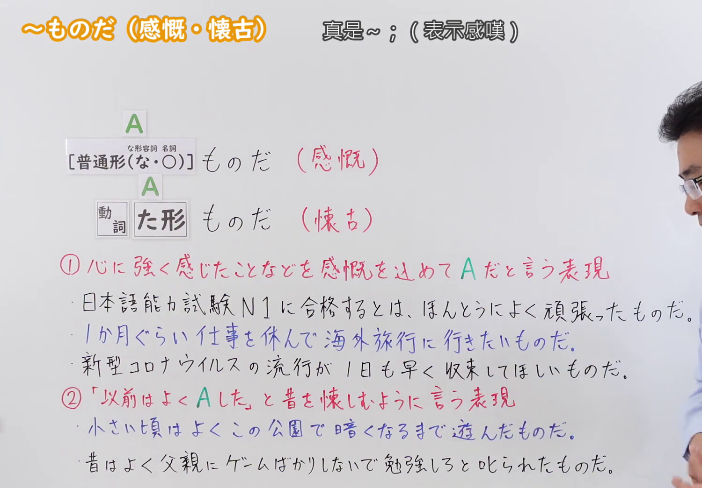
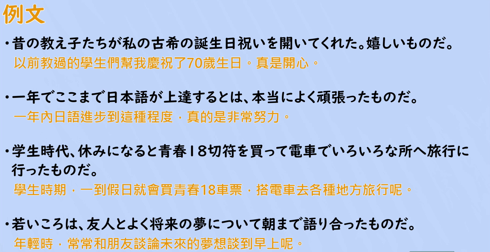

---
{
  "id": "N2-G-0084",
  "kind": "grammar",
  "level": "N2",
  "title": "ものだ（感慨・懐古）：真是～；（表示感嘆）／以前常～",
  "card_revision": 1,
  "schema_version": 1,
  "source": {
    "lesson": "N2 第84个语法",
    "material": "出口日語原视频板书、日语自动字幕与Hagoromo正文",
    "video": "https://www.youtube.com/watch?v=dFDy7orbvJM",
    "screenshot": "assets/grammar/n2/N2-G-0084-connection.png",
    "screenshot_seconds": 150,
    "screenshot_crop": {
      "x": 0,
      "y": 0,
      "width": 1500,
      "height": 1045
    }
  },
  "tags": [
    "ものだ",
    "N2"
  ],
  "confusions": [
    "〜ものだ（常識・本質，第83课）：陈述一般常识或本质，不表示个人的感慨或怀旧",
    "〜というものだ：对某个事实作断定性的评价，与本课的两种用法都不同",
    "〜ものか：表示强烈的否定（绝不～），形式相近但意思相反"
  ]
}
---

# N2 第84個語法：ものだ（感慨・懐古）—— 真是～；（表示感嘆）／以前常～

# 视频学习资料整理

- 原视频：[出口日語 N2 第84個語法～ものだ（感慨・懐古）](https://www.youtube.com/watch?v=dFDy7orbvJM)
- 视频中讲到的两组接续：表示感慨时用「[普通形(な・○)]＋ものだ」，即な形容词接「な」、名词不接；表示怀古时用「動詞た形＋ものだ」。
- 板书的红色说明分为两条：①「心に強く感じたことなどを感慨を込めて A だと言う表現」；②「『以前はよく A した』と昔を懐しむように言う表現」。
- 讲解补充：本课只讲感慨与怀古两种用法，此外还有以前讲过的「本质」用法（如「子どもは早く寝るものだ」），使用时需要区分。

0:01 画面中①的第一条例句和②的最后一条例句后半被人物遮住，板书不完整，因此接续图改用板书完整、人物让开板书的 2:30 画面。

**接续图（视频 2:30 画面，原图 1920×1080，裁切区域 x=0, y=0, width=1500, height=1045）**

**例句图（视频 3:08 例句页，原图 1920×1080，裁切区域 x=50, y=22, width=1820, height=940）**

# 核心

## 功能一：（把心里强烈感受到的事，）带着感慨说成 A 的表达

**最上位意味カテゴリー：**

- **ものだ：** 考え・感情（思考与感情）

**中位意味カテゴリー：**

- **ものだ：** 主張・断定的評価（主张・断定性的评价）

**意味：**

- **ものだ：** 評価（评价）

**くわしい意味記述：**

- **ものだ：** 「本当に〜だと感じる」という意味。話し手が感じたことを強調して言うときに使う。（意为「真的觉得〜」，用于强调说话人内心感受到的事。）

**派生語：** 未列出

### 例句

1. 一度行ってみたいものだ。

   （真想去一次啊。）

2. よくもそんなことが言えたものだ。

   （居然能说出那种话，真是的。）

3. 不思議なものです。

   （真是不可思议啊。）

4. その万年筆がだめになったり、なくしたときはみじめなものです。

   （那支钢笔坏掉或者弄丢的时候，真是狼狈啊。）

## 功能二：（像「以前经常做 A」那样，）怀念地说出过去的表达

**最上位意味カテゴリー：**

- **ものだ：** 考え・感情（思考与感情）

**中位意味カテゴリー：**

- **ものだ：** 主張・断定的評価（主张・断定性的评价）

**意味：**

- **ものだ：** 評価（评价）

**くわしい意味記述：**

- **ものだ：** 話し手が過去に何度もしたことを思い出して，懐かしく思う気持ちを表す。「よく〜ものだ」という表現で使うことが多い。（表示说话人回想起过去多次做过的事，怀有怀念之情。多用于「よく〜ものだ」这一说法。）

**派生語：** 未列出

### 例句

1. 子どものころは、暗くなるまでよく遊んだものだ。

   （小时候经常玩到天黑呢。）

2. 小さい頃、さくらんぼや夏みかん、りんごなどを食べながら、残った種をみてよく聞いたものです。

   （小时候一边吃着樱桃、夏橘、苹果，一边看着剩下的种子经常这样问呢。）

3. 今は夜になればホテルに泊るか、夜行列車に揺られるかだが、当時は旅籠に泊ったものだ。

   （现在到了晚上不是住旅馆就是坐夜车摇晃，可当时都是住客栈的呢。）

# 来源

- [出口日語原视频](https://www.youtube.com/watch?v=dFDy7orbvJM)
- [Hagoromo 文型検索「ものだ」（感慨の用法）](https://www.hagoromo-text.work/lookup?vid=1621)（查询日期：2026-09-23，用于功能一各字段及例句4条）
- [Hagoromo 文型検索「ものだ」（懐古の用法）](https://www.hagoromo-text.work/lookup?vid=1623)（查询日期：2026-09-23，用于功能二各字段及例句3条）
