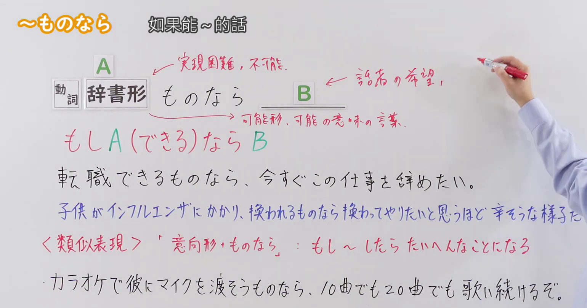
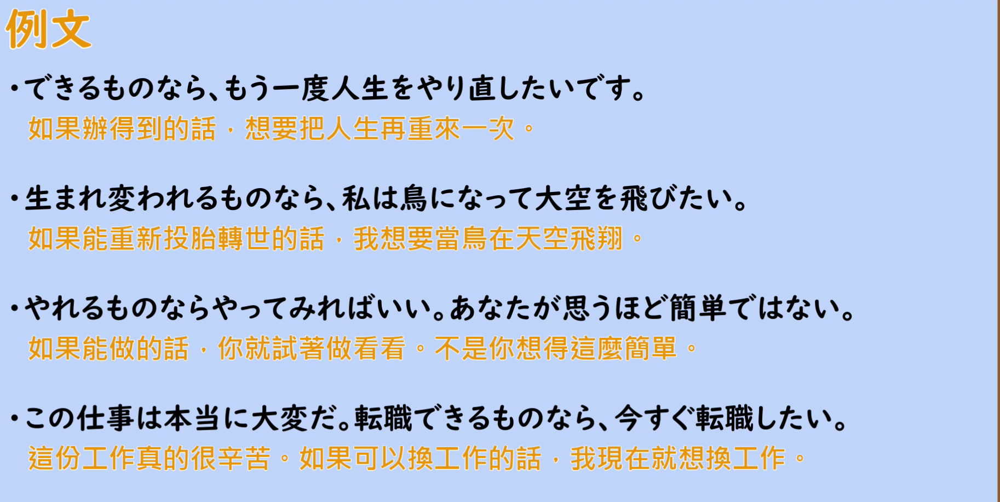

---
{
  "id": "N2-G-0085",
  "kind": "grammar",
  "level": "N2",
  "title": "ものなら：如果能～的话；要是能～就～",
  "card_revision": 1,
  "schema_version": 1,
  "source": {
    "lesson": "N2 第85个语法",
    "material": "出口日語原视频板书、日语自动字幕与Hagoromo正文",
    "video": "https://www.youtube.com/watch?v=gjd5rETgrbE",
    "screenshot": "assets/grammar/n2/N2-G-0085-connection.png",
    "screenshot_seconds": 114,
    "screenshot_crop": {
      "x": 0,
      "y": 0,
      "width": 1540,
      "height": 810
    }
  },
  "tags": [
    "ものなら",
    "N2"
  ],
  "confusions": [
    "Vようものなら（意向形＋ものなら）：表示「万一做了～就会出大事」，与本课「如果能～就～」的用法不同",
    "〜なら：单纯的假定条件，可接各种词，也不含「实际上难以实现」的语感",
    "〜たら／〜ば：一般假定条件，接续不限于可能形"
  ]
}
---

# N2 第85個語法：ものなら —— 如果能～的話；要是能～就～

# 视频学习资料整理

- 原视频：[出口日語 N2 第85個語法～ものなら](https://www.youtube.com/watch?v=gjd5rETgrbE)
- 视频中讲到的接续：動詞辞書形＋ものなら，但实际进入这个位置的词多是可能形或带有「可能」含义的词（如「できる」）。
- 板书把句式写作「A ものなら B」，并用红色标出含义说明「もし A（できる）なら B」；板书还在 A 旁标注「実現困難、不可能」、在 B 旁标注「話者の希望、意志」。
- 讲解补充：A 部分表示难以实现或根本不可能实现的事，B 部分多表示说话人的希望或意志，整体用来表达愿望（例如「鳥になれるものなら空を飛びたい」）。
- 板书另有类似表现「意向形＋ものなら」（表示「もし～したらたいへんなことになる」）。讲解明确说明这与本课用法不同，本课只介绍「可能形＋ものなら」，因此不作为本卡的功能。

0:01 画面中板书的例句、类似表现示例的后半被人物遮住，板书不完整，因此接续图改用板书完整的 1:54 画面。该画面中人物手臂位于右上方空白区域，没有遮挡任何板书文字。

**接续图（视频 1:54 画面，原图 1920×1080，裁切区域 x=0, y=0, width=1540, height=810）**

**例句图（视频 5:20 例句页，原图 1920×1080，裁切区域 x=50, y=22, width=1826, height=918）**

# 核心

## 功能一：如果能做 A 的话，就（想）做 B

**最上位意味カテゴリー：**

- **ものなら：** ものごとの関係（事物的关系）

**中位意味カテゴリー：**

- **ものなら：** 条件（条件）

**意味：**

- **ものなら：** 仮定条件（実現の可能性低い）（实现可能性低的假定条件）

**くわしい意味記述：**

- **ものなら：** 可能を表す動詞に接続し，「もし〜できるなら，〜したい」という意味を表す。ただし，不可能な内容に接続にすることも多く，「実際は無理だが，こうなったらいいのに」という反実仮想の用法として使われることも多い。（接在表示可能的动词后，表示「如果能〜的话，就想〜」。不过也经常接在不可能实现的内容后，多用作反实假想，即「实际上办不到，但要是能这样就好了」。）

**派生語：** 未列出

### 例句

1. 若いころに戻れるものならもどりたい。

   （要是能回到年轻的时候，真想回去。）

2. 子供たちも縁づいて暇ができたから、なおせるものならなおそうと思ってはじめて病院へ来てみたのだといわれる。

   （据说因为孩子们都成家了、自己有了空闲，所以想着能治好就治一治，才第一次到医院来看看。）

3. どうしていいかわからぬような気持ちに襲われ、不安のために身体が小刻みに震え出しさえした。帰れるものなら、すぐにでも東京に帰ってしまいたかった。

   （被一种不知如何是好的心情笼罩，甚至因为不安身体开始微微发抖。要是能回去的话，真想马上回东京去。）

4. 首都圏に在住する５０〜６０歳の就業者５００人のうち、回答のあった１４９人の過半数が、企業での経験や現在保有する技能、資格をＮＰＯの活動の中で「生かせるものならば、生かしてみたい」と考えている。

   （居住在首都圈的50〜60岁就业者500人当中，作出回答的149人里过半数认为，在企业积累的经验以及目前拥有的技能、资格「如果能用在NPO的活动中，就想试着发挥一下」。）

# 来源

- [出口日語原视频](https://www.youtube.com/watch?v=gjd5rETgrbE)
- [Hagoromo 文型検索「ものなら」](https://www.hagoromo-text.work/lookup?vid=1632)（查询日期：2026-09-23，用于各个字段及例句4条）
