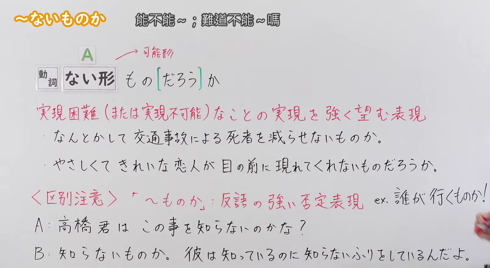
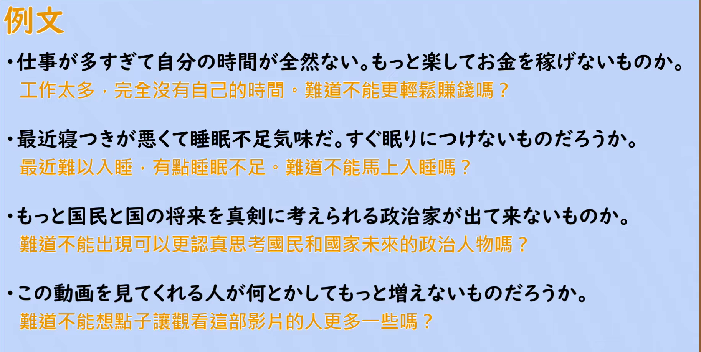

---
{
  "id": "N2-G-0086",
  "kind": "grammar",
  "level": "N2",
  "title": "ないものか・ないものだろうか：能不能～；難道不能～嗎",
  "card_revision": 1,
  "schema_version": 1,
  "source": {
    "lesson": "N2 第86个语法",
    "material": "出口日語原视频板书、日语自动字幕与Hagoromo正文",
    "video": "https://www.youtube.com/watch?v=5e8WVUcifSY",
    "screenshot": "assets/grammar/n2/N2-G-0086-connection.png",
    "screenshot_seconds": 195,
    "screenshot_crop": {
      "x": 0,
      "y": 0,
      "width": 1610,
      "height": 880
    }
  },
  "tags": [
    "ないものか",
    "N2"
  ],
  "confusions": [
    "〜ものか（反語的强烈否定）：如「誰が行くものか」意为「谁会去啊＝谁都不去」，接续多为肯定形",
    "〜のではないか：表示推测或委婉的判断，不是表达愿望",
    "〜てほしい／〜たい：直接表达愿望，不含「能不能实现」这种呼吁式的疑问"
  ]
}
---

# N2 第86個語法：ないものか・ないものだろうか —— 能不能～；難道不能～嗎

# 视频学习资料整理

- 原视频：[出口日語 N2 第86個語法～ないものか](https://www.youtube.com/watch?v=5e8WVUcifSY)
- 视频中讲到的接续：動詞ない形＋もの（だろう）か。「だろう」可以省略也可以出现，两者意思相同；前项多为可能形的ない形（先变可能形，再变ない形）。
- 板书把句式写作「A もの[だろう]か」，并用红色标出含义说明「実現困難（または実現不可能）なことの実現を強く望む表現」；板书在 A 旁标注「→可能形」。
- 讲解补充：与以前学过的「〜ものか」（反語的强烈否定）形式相近，需要注意区分。反語的「ものか」基本接肯定形，只是偶尔接否定形，若又省略「だろう」就会与本课形式相同。本课只介绍「実現を強く望む」这一用法。
- Hagoromo 未单独收录「ないものか」，只收录「ないものだろうか」（vid=1112），本卡按该条目取用。

0:01 画面中红色说明、第二条例句与「区別注意」B 行的后半被人物遮住，板书不完整，因此接续图改用板书完整的 3:15 画面。该画面包含后来补充的「ex. 誰が行くものか!」注释，板书内容完整。

**接续图（视频 3:15 画面，原图 1920×1080，裁切区域 x=0, y=0, width=1610, height=880）**

**例句图（视频 4:55 例句页，原图 1920×1080，裁切区域 x=50, y=22, width=1826, height=918）**

# 核心

## 功能一：（强烈希望）难以实现或无法实现的事得以实现

**最上位意味カテゴリー：**

- **ないものだろうか：** 考え・感情（思考与感情）

**中位意味カテゴリー：**

- **ないものだろうか：** 願望（愿望）

**意味：**

- **ないものだろうか：** 願望（愿望）

**くわしい意味記述：**

- **ないものだろうか：** 実現が難しいことが，実現してほしいという話し手の気持ちを表す。（表示说话人希望难以实现的事能够实现的心情。）

**派生語：** 未列出

### 例句

1. 宗教間の対立をなくすよい方法はないものだろうか。

   （难道没有什么消除宗教间对立的好办法吗。）

2. だから、行動からみて、下等動物には睡眠ににた状態がある、というようないいまわしをするわけだ。では、「睡眠ににた状態」と「睡眠」とをつなぐ鎖の輪はないものだろうか。

   （所以从行为上才会说低等动物有类似睡眠的状态。那么，难道没有能把「类似睡眠的状态」和「睡眠」连接起来的那一环吗。）

3. その時、メンバーの一人から「これだけ医学も進歩した時代なのだから、われわれ酒害者でも、少量であれば酒を楽しめるという薬が、将来発明される可能性はないものだろうか」という切実な質問を受けた。

   （当时，成员中的一位提出了一个恳切的疑问：「医学已经进步到这个时代了，难道将来没有可能发明一种药，让我们这些酒精成瘾者也能少量享受酒吗。」）

# 来源

- [出口日語原视频](https://www.youtube.com/watch?v=5e8WVUcifSY)
- [Hagoromo 文型検索「ないものだろうか」](https://www.hagoromo-text.work/lookup?vid=1112)（查询日期：2026-09-23，用于各个字段及例句3条）
