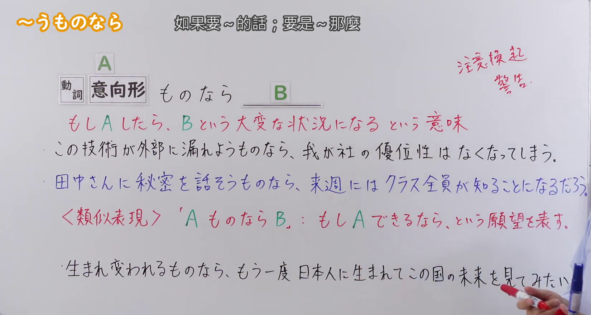
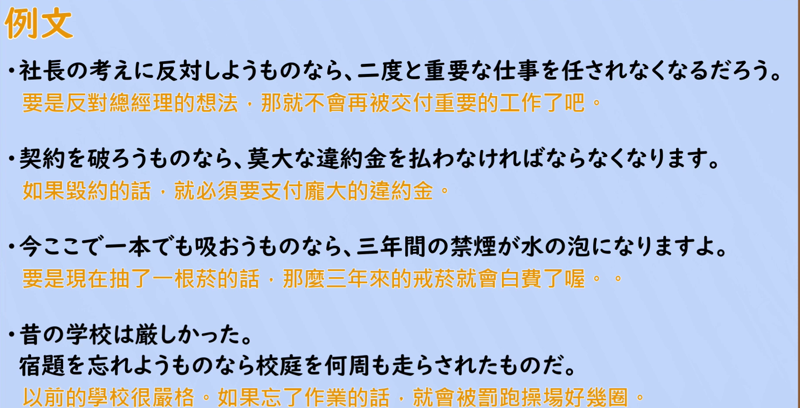

---
{
  "id": "N2-G-0087",
  "kind": "grammar",
  "level": "N2",
  "title": "Vようものなら：如果要～的話；要是～那（就糟了）",
  "card_revision": 1,
  "schema_version": 1,
  "source": {
    "lesson": "N2 第87个语法",
    "material": "出口日語原视频板书、日语自动字幕与Hagoromo正文",
    "video": "https://www.youtube.com/watch?v=SVqXXbe9ldU",
    "screenshot": "assets/grammar/n2/N2-G-0087-connection.png",
    "screenshot_seconds": 55,
    "screenshot_crop": {
      "x": 0,
      "y": 0,
      "width": 1650,
      "height": 880
    }
  },
  "tags": [
    "Vようものなら",
    "N2"
  ],
  "confusions": [
    "〜ものなら（可能形・辞書形＋ものなら，第85课）：表示「如果能～就～」的愿望，接续和含义都与本课不同",
    "〜ないものか／〜ないものだろうか（第86课）：表示希望难以实现的事得以实现，不是警告",
    "〜ば／〜たら：一般的假定条件，后项不限于坏结果，也没有「绝对不能做」的警告语气"
  ]
}
---

# N2 第87個語法：Vようものなら —— 如果要～的話；要是～那（就糟了）

# 视频学习资料整理

- 原视频：[出口日語 N2 第87個語法～うものなら](https://www.youtube.com/watch?v=SVqXXbe9ldU)
- 视频中讲到的接续：動詞意向形＋ものなら。
- 板书把句式写作「A ものなら B」，并用红色标出含义说明「もし A したら、B という大変な状況になる という意味」；板书右上角另用红色标注「注意喚起／警告」。
- 讲解补充：A 是不能做或绝对不能做的事，B 是不好的结果，整体用来提醒、警告对方不要做 A（例如「…てしまう」「…ことになる」「…なければならなくなる」）。
- 板书另有类似表现「A ものなら B」（A 为可能形／辞書形），表示「もし A できるなら」的愿望。讲解明确说这与本课接续不同、意思也不同（即第85课的内容），因此不作为本卡的功能。

0:01 画面中「注意喚起／警告」注释尚未写出，且多处例句后半被人像遮住，板书不完整，因此接续图改用板书完整的 0:55 画面。该画面人物站在右侧，没有遮挡任何板书文字。

**接续图（视频 0:55 画面，原图 1920×1080，裁切区域 x=0, y=0, width=1650, height=880）**

**例句图（视频 4:04 例句页，原图 1920×1080，裁切区域 x=50, y=22, width=1826, height=933）**

# 核心

## 功能一：（警告、提醒）万一做 A，就会陷入 B 这种糟糕的状况

**最上位意味カテゴリー：**

- **Vようものなら：** ものごとの関係（事物的关系）

**中位意味カテゴリー：**

- **Vようものなら：** 条件（条件）

**意味：**

- **Vようものなら：** 条件：仮定条件（条件：假定条件）

**くわしい意味記述：**

- **Vようものなら：** 「万が一、〜した場合は」の意味。後には否定的な内容が続き、大変なことになるという意味を表す。（意为「万一做了～的话」。后面接否定的内容，表示会酿成大麻烦。）

**派生語：** 未列出

### 例句

1. 母は厳しい人で、私が勉強を少しでも怠けようものなら、きつく叱った。

   （母亲是个严格的人，我哪怕稍微偷懒不学习，她就会严厉地训斥我。）

2. こちらから『またね♪』などと切り出そうものなら、たちまち険悪なムードになってしまう。

   （要是从这边主动说声「再见啦♪」之类的话，气氛立刻就会变得很僵。）

3. しかし、戦争中、「もし日本が負けたら．．．．．」と口にしようものなら「きさまは日本が負けることを望んでいるのか」と一喝する人間はつきあいにくかった。

   （但是在战争期间，万一嘴上说出「如果日本战败了……」，就会有人大喝一声「你小子是盼着日本战败吗」，这样的人很难相处。）

4. 理屈を通せば、どちらの目も自分であるし、仮に「いい天気でございます」などと挨拶しようものなら、これはひとりごとの部類に入るかもしれない。

   （讲道理的话，哪只眼睛都是自己，假如说出「天气真好啊」之类的话来打招呼，这或许就要算进自言自语的范畴了。）

# 来源

- [出口日語原视频](https://www.youtube.com/watch?v=SVqXXbe9ldU)
- [Hagoromo 文型検索「Vようものなら」](https://www.hagoromo-text.work/lookup?vid=1703)（查询日期：2026-09-23，用于各个字段及例句4条）
