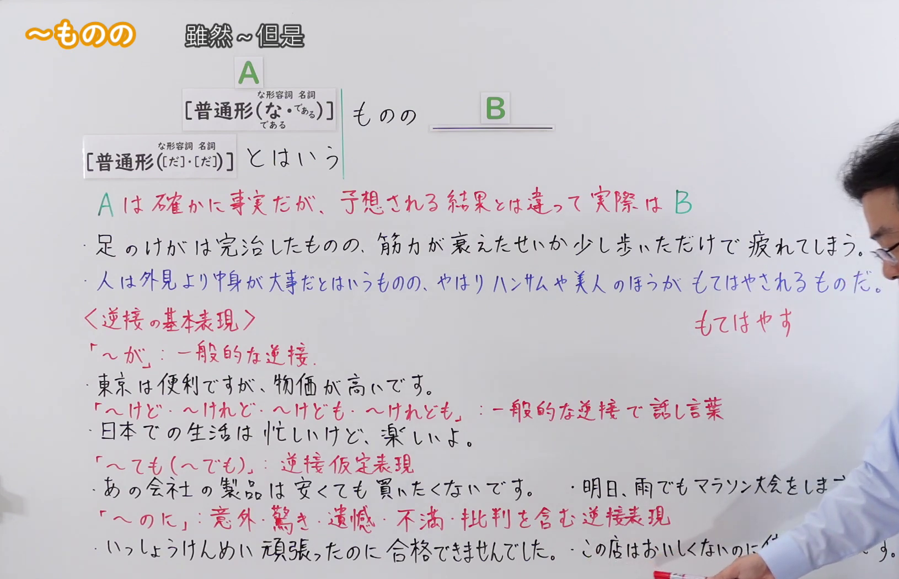
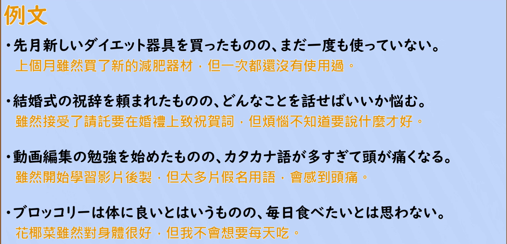

---
{
  "id": "N2-G-0088",
  "kind": "grammar",
  "level": "N2",
  "title": "ものの／とはいうものの：虽然～但是（承认前项是事实，实际却与预想不同）",
  "card_revision": 1,
  "schema_version": 1,
  "source": {
    "lesson": "N2 第88个语法",
    "material": "出口日語原视频板书、日语自动字幕与Hagoromo正文",
    "video": "https://www.youtube.com/watch?v=2qENY0IetZE",
    "screenshot": "assets/grammar/n2/N2-G-0088-connection.png",
    "screenshot_seconds": 320,
    "screenshot_crop": {
      "x": 0,
      "y": 0,
      "width": 1630,
      "height": 1050
    }
  },
  "tags": [
    "ものの",
    "とはいうものの",
    "N2"
  ],
  "confusions": [
    "〜ものなら（第85课，可能形・辞書形＋ものなら）：表示「如果能～就～」的愿望，接续和含义都与本课不同",
    "〜のに：同样表示逆接，但带有意外、不满、批判的语气；「ものの」只是承认前项后客观指出实际与预想不同，语气生硬、多用于书面",
    "〜ものだ（第83・84课）：表示常识、本质或感慨、怀旧，与「ものの」的逆接关系不同"
  ]
}
---

# N2 第88個語法：ものの／とはいうものの —— 雖然～但是

# 视频学习资料整理

- 原视频：[出口日語 N2 第88個語法～ものの](https://www.youtube.com/watch?v=2qENY0IetZE)
- 视频中讲到的接续：A ものの B。A 接普通形，ナ形容詞・名詞的現在肯定用「なものの／であるものの」；板书另写出【普通形(だ・(だ))】とはいうものの，即「〜だとはいうものの」也可以说，含义相同。
- 板书用红色标出含义说明「A は 確かに事実だが、予想される結果とは違って実際は B」。
- 板书另有〈逆説の基本表現〉整理：「が」（一般的な逆説）、「けど・けれど・けれども」（一般的な逆説で話し言葉）、「ても（でも）」（逆説仮定表現）、「のに」（意外・驚き・遺憾・不満・批判を含む逆説表現）。讲解说这是「N4ぐらいで勉強するべき基本中の基本」，属背景整理，不是本课语法。

0:01 画面中人物位于板书中央偏右，两句例句的后半被人像遮住，因此接续图改用板书完整、人物让开板书停在画面右侧的 5:20 画面。

**接续图（视频 5:20 画面，原图 1920×1080，裁切区域 x=0, y=0, width=1630, height=1050）**

该画面中人物站在画面右侧，板上内容全部可见；仅〈逆説の基本表現〉里两条补充例句（「明日、雨でもマラソン大会をします」「この店はおいしくないのに値段が高くて」）的末尾被人物手臂遮住。

**例句图（视频 6:22 例句页，原图 1920×1080，裁切区域 x=46, y=20, width=1828, height=880）**

# 核心

## 功能一：A 确实是事实，但实际与预想的结果不同，而是 B

**最上位意味カテゴリー：**

- **ものの：** ものごとの関係（事物的关系）
- **とはいうものの：** ものごとの関係（事物的关系）

**中位意味カテゴリー：**

- **ものの：** 逆接・譲歩（逆接・让步）
- **とはいうものの：** 逆接・譲歩（逆接・让步）

**意味：**

- **ものの：** 逆接（逆接）
- **とはいうものの：** 逆接（逆接）

**くわしい意味記述：**

- **ものの：** 「一応〜だが」の意味。前の状況は認めたうえで，まだ十分ではないということを表す。（意为「虽然姑且算是～，但是」。在承认前项状况的基础上，表示还并不充分。）
- **とはいうものの：** 「〜ではあるが，しかし」の意味。全体的にはそうではあるが，細かいところでは，違いがあり，典型的な状態ではないことを表す。（意为「虽说确实是～，但是」。整体上虽然如此，但在细处存在差异，表示并非典型的状态。）

**派生語：** 未列出

### 例句

1. 新しい事業をやってはみたものの、うまくいかなかった。

   （虽然试着做了新的事业，但并不顺利。）

2. 大学合格したものの、行くかどうか、まだ迷っている。

   （虽然考上了大学，但是否去还在犹豫。）

3. あの掃除機は小さいものの、ちからが強い。

   （那台吸尘器虽然小，但吸力很强。）

4. 勝ったとはいうものの、苦しい戦いだった。

   （虽说是赢了，但那是一场艰苦的战斗。）

5. 週四〇時間とはいうものの、多くのサラリーマンは連日のように残業をつづける。

   （虽说一周四十小时，但许多上班族连日都在加班。）

# 来源

- [出口日語原视频](https://www.youtube.com/watch?v=2qENY0IetZE)
- [Hagoromo 文型検索「ものの」](https://www.hagoromo-text.work/lookup?vid=1633)（查询日期：2026-09-23，用于各字段及例句1～3）
- [Hagoromo 文型検索「とはいうものの」](https://www.hagoromo-text.work/lookup?vid=1058)（查询日期：2026-09-23，用于各字段及例句4～5）
