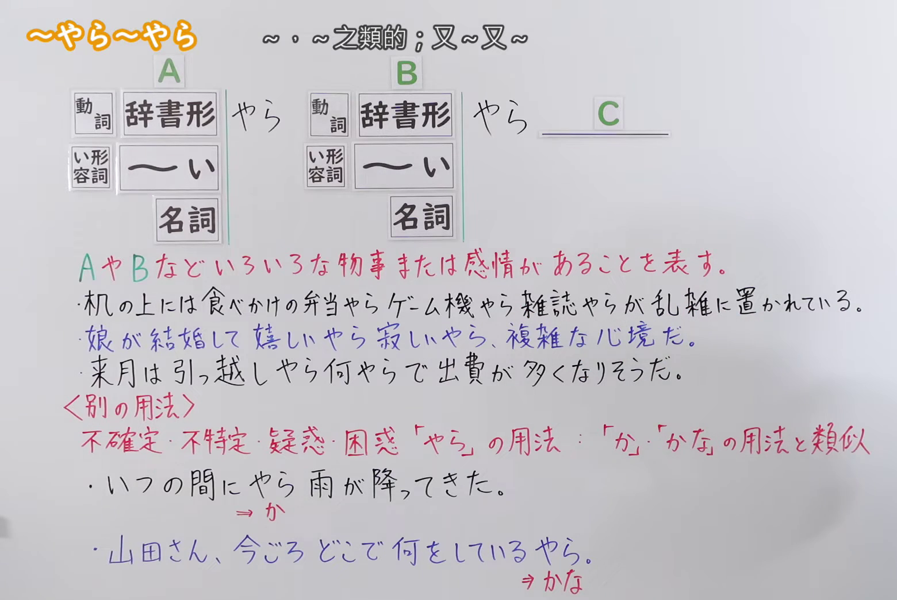
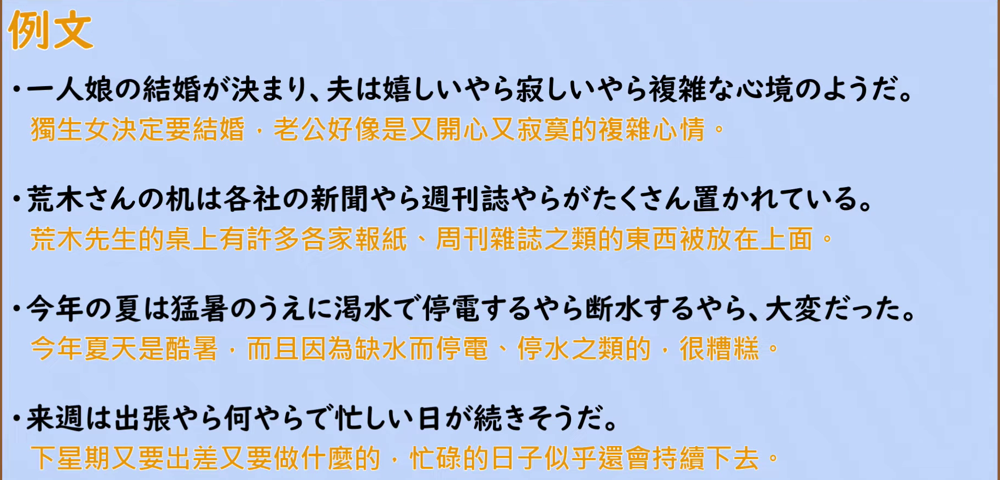

---
{
  "id": "N2-G-0089",
  "kind": "grammar",
  "level": "N2",
  "title": "やら〜やら：～呀～呀（列举各种各样的东西或感情）",
  "card_revision": 1,
  "schema_version": 1,
  "source": {
    "lesson": "N2 第89个语法",
    "material": "出口日語原视频板书、日语自动字幕与Hagoromo正文",
    "video": "https://www.youtube.com/watch?v=5_zRc3zuvQA",
    "screenshot": "assets/grammar/n2/N2-G-0089-connection.png",
    "screenshot_seconds": 100,
    "screenshot_crop": {
      "x": 0,
      "y": 0,
      "width": 1560,
      "height": 1045
    }
  },
  "tags": [
    "やら〜やら",
    "やらなにやら",
    "N2"
  ],
  "confusions": [
    "〜やら（別用法）：本课另行讲到的「不確定・不特定・疑惑・困惑」用法（いつの間にやら、何をしているやら），与「か」「かな」类似，不是列举",
    "〜とか〜とか：同样用于列举，但语气更口语、更随意；「やら〜やら」带有「还有很多、杂乱、处理起来麻烦」的语感",
    "〜たり〜たり：只列举动作，不含「东西很多、杂乱、麻烦」的语感"
  ]
}
---

# N2 第89個語法：やら〜やら —— ～呀～呀

# 视频学习资料整理

- 原视频：[出口日語 N2 第89個語法～やら～やら](https://www.youtube.com/watch?v=5_zRc3zuvQA)
- 视频中讲到的接续：A やら B やら C。A、B 前接動詞辞書形、イ形容詞（〜い）或名詞，板书用两个方框分别列出这三类，后面接「やら」。
- 板书用红色标出含义说明「A や B などいろいろな物事または感情があることを表す。」，右上角中文注释「〜や〜之類的；又〜又〜」。
- 讲解补充：列举之外还有很多（「ほかにもいろいろある」），带有「东西很多、整理や処理が大変」的语感；也可用于感情，如「嬉しいやら寂しいやら」表示两种心情同时存在、心情复杂；后面的部分还可以放疑问词（「引っ越しやら何やら」），表示不胜枚举。
- 板书另有〈別の用法〉：不確定・不特定・疑惑・困惑「やら」の用法：「か」「かな」の用法と類似（いつの間にやら雨が降ってきた。／山田さん、今ごろどこで何をしているやら。）。讲解说明这是完全不同的用法，因此不作为本卡的功能。

0:01 画面中人物站在板书右侧，挡住「…「か」「かな」の用法と類似」一行的右端文字，因此接续图改用人物完全离开板书区域、板书完整的 1:40 画面。

**接续图（视频 1:40 画面，原图 1920×1080，裁切区域 x=0, y=0, width=1560, height=1045）**

该画面内没有人像也没有片头水印，板上内容（接続方框、红色含义说明、三条例句、〈別の用法〉）全部可见。

**例句图（视频 5:02 例句页，原图 1920×1080，裁切区域 x=46, y=20, width=1830, height=880）**

# 核心

## 功能一：A 呀 B 呀等，表示有各种各样的东西或感情

**最上位意味カテゴリー：**

- **やら〜やら：** ものごとの関係（事物的关系）
- **やらなにやら：** ものごとの関係（事物的关系）

**中位意味カテゴリー：**

- **やら〜やら：** 例示（例示）
- **やらなにやら：** 例示（例示）

**意味：**

- **やら〜やら：** 例示（例示）
- **やらなにやら：** 例示（例示）

**くわしい意味記述：**

- **やら〜やら：** 例を示すときに使う。列挙したもの以外にもまだいろいろある，と言いたい時に使う。（用于举例。想表达除了列举出来的东西之外还有很多时使用。）
- **やらなにやら：** 完全に把握していない対象について，その一例を挙げる時の言い方。（对于没有完全掌握的对象，举出其中一例时的说法。）

**派生語：**

- **やら〜やら：** 未列出
- **やらなにやら：** やらなんやら

### 例句

1. 机の上には本やらノートやらが広げてある

   （桌上摊开着书呀笔记本呀之类的东西。）

2. 彼女は泣くやらわめくやら大騒ぎだった。

   （她又哭又喊，闹得天翻地覆。）

3. ピザやらサラダやらスパゲッティやら・・・。

   （披萨呀、沙拉呀、意大利面呀……）

4. 押し入れの中に、服やらなにやらいっぱい詰め込んでいる。

   （壁橱里塞满了衣服之类的东西。）

5. ＭＤやらなんやらをこまごまと持ち歩くより、携帯一つで済ませたい。

   （与其零零碎碎地带着 MD 之类的东西，不如一部手机搞定。）

# 来源

- [出口日語原视频](https://www.youtube.com/watch?v=5_zRc3zuvQA)
- [Hagoromo 文型検索「やら〜やら」](https://www.hagoromo-text.work/lookup?vid=43)（查询日期：2026-09-23，用于各字段及例句1～3）
- [Hagoromo 文型検索「やらなにやら」](https://www.hagoromo-text.work/lookup?vid=1657)（查询日期：2026-09-23，用于各字段及例句4～5）
