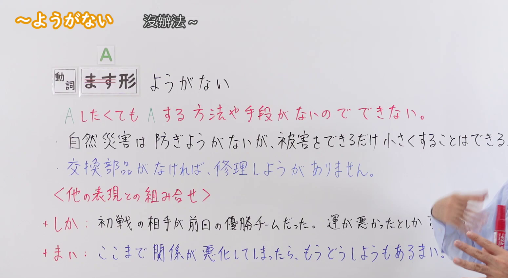
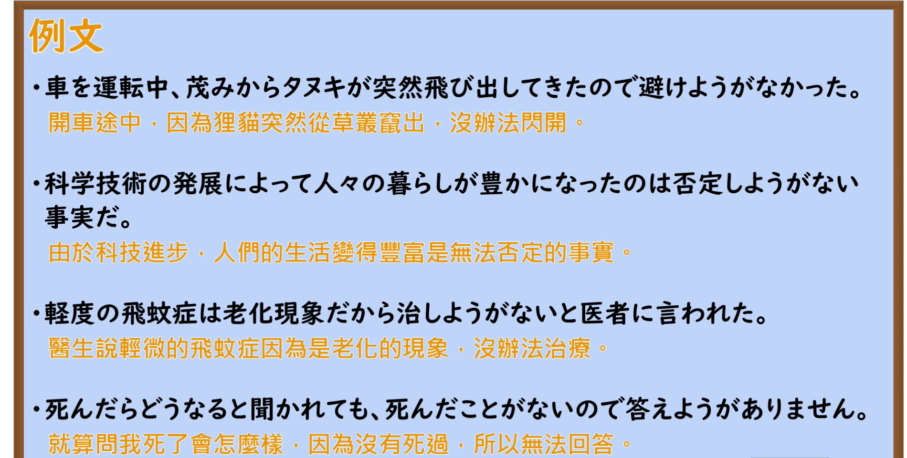

---
{
  "id": "N2-G-0090",
  "kind": "grammar",
  "level": "N2",
  "title": "～ようがない：想做某事也没有办法或手段，无法做到",
  "card_revision": 1,
  "schema_version": 1,
  "source": {
    "lesson": "N2 第90个语法",
    "material": "出口日語原视频板书、日语自动字幕与 Hagoromo 正文",
    "video": "https://www.youtube.com/watch?v=klGGgx_eC2w",
    "screenshot": "assets/grammar/n2/N2-G-0090-connection.png",
    "screenshot_seconds": 76.0,
    "screenshot_crop": {
      "x": 0,
      "y": 0,
      "width": 1550,
      "height": 850
    }
  },
  "tags": [
    "手段缺乏",
    "无法做到",
    "N2"
  ],
  "confusions": [
    "～（よ）うにも～ない：表示想做某事但因某种客观原因或障碍而无法做到，后多接可能动词否定形；本课文型表示缺乏实现某事的手段或方法，根本无从下手。"
  ]
}
---

# ～ようがない：想做某事也没有办法或手段，无法做到

# 视频学习资料整理

- [出口日語第90课原视频](https://www.youtube.com/watch?v=klGGgx_eC2w)；课程长度约 6 分 26 秒。
- 接续及讲解板书：原视频 **1:16.00**，原图 **1920 × 1080**，从左上角裁切 **(x=0, y=0, width=1550, height=850)**。保留左上角语法标题、接续、红色释义和板书例句；画面右下有教师手臂，微遮挡“+しか”例句末尾“言いようがない”后半截，其余板书完整。

- 例句页：原视频 **4:49.00**，原图 **1920 × 1080**，从左上角裁切 **(x=0, y=0, width=1900, height=960)**。保留四条例句及视频原有的中文译文。

# 核心

## 功能一：即使想做 A，也没有做 A 的方法或手段，所以无法做到

**最上位意味カテゴリー：**

- **～ようがない：** ものごとの様子（事物的状态）

**中位意味カテゴリー：**

- **～ようがない：** 可能・難易（可能与难易）

**意味：**

- **～ようがない：** 可能：不可能（可能：不可能）

**くわしい意味記述：**

- **～ようがない：** 「本当はあることをしたいが，それができない」という意味を表す。「ようもない」という表現もある。（表示“本来想做某事，却无法做到”的意思。也有“ようもない”这一表达形式。）

**派生語：** 未列出

### 例句

1. このテーマでは、論文は書きようがない。

   （选这个题目，根本没法写论文。）

2. 一つの商品を作り出してそれを消費者の手許に届けるまでの全過程のほんの一部にしか参加していない人間に、商品に対して全面的な責任などとりようがないだろう。

   （对于只参与了从制造一件商品到送达消费者手中的全过程中极小一部分的人来说，根本无法对商品承担全部责任吧。）

3. 情報を得ることができなければ表現のしようがないから、言論の自由の一環として「知る権利」が言われるようになった。

   （如果无法获取信息就无法进行表达，因此作为言论自由的一环，“知情权”开始被人们所提起。）

4. 中国およびソ連との話合いなしで、ヴェトナム問題打開の道はなく、ヴェトナム問題の打開なくして、アメリカ国内の不安は解消しようがなかったわけである。

   （如果不与中苏进行商谈，就没有打开越南问题局面的途径；而无法打破越南问题的僵局，美国国内的不安也就根本无法消除。）

# 来源

- [出口日語第90课原视频](https://www.youtube.com/watch?v=klGGgx_eC2w)
- [はごろも「V マス ようがない」](https://www.hagoromo-text.work/)（查询日期：2026-09-23）
