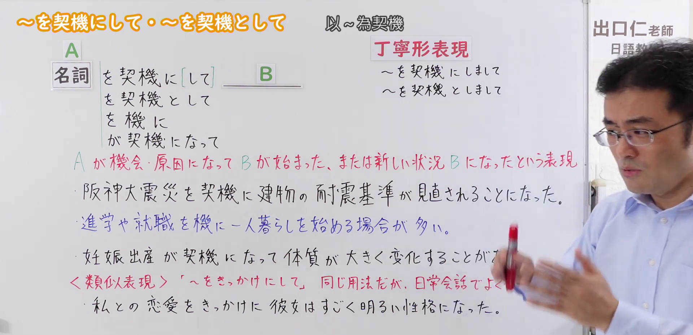
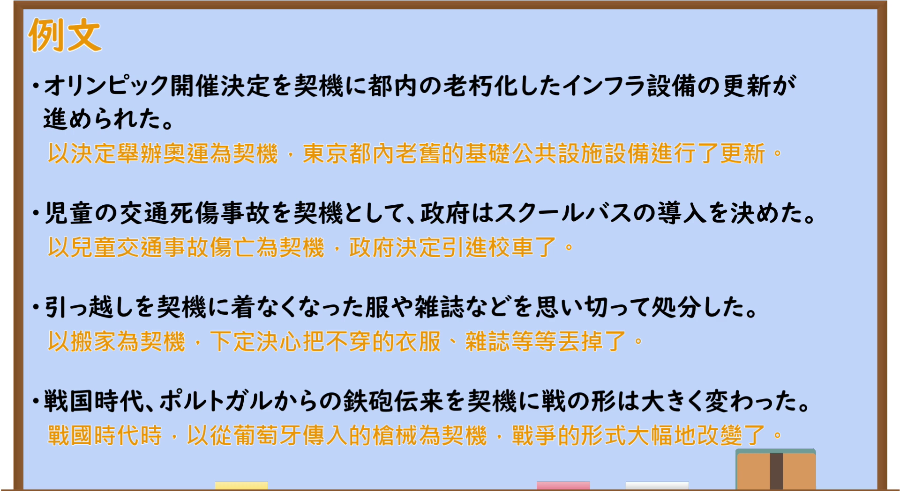

---
{
  "id": "N2-G-0091",
  "kind": "grammar",
  "level": "N2",
  "title": "をけいきにして(を契機にして)／をけいきとして(を契機として)：以某事为契机",
  "card_revision": 1,
  "schema_version": 1,
  "source": {
    "lesson": "N2 第91个语法",
    "material": "出口日語原视频板书、日语自动字幕与日本語NET正文",
    "video": "https://www.youtube.com/watch?v=HzOOmJF3y0s",
    "screenshot": "assets/grammar/n2/N2-G-0091-connection.png",
    "screenshot_seconds": 165,
    "screenshot_crop": {
      "x": 0,
      "y": 0,
      "width": 1920,
      "height": 930
    }
  },
  "tags": [
    "契机",
    "书面语",
    "N2"
  ],
  "confusions": [
    "をきっかけにして(を切っ掛けにして)"
  ]
}
---

# をけいきにして(を契機にして)／をけいきとして(を契機として)

# 视频学习资料整理

- 课程：[出口日語 N2 第91课](https://www.youtube.com/watch?v=HzOOmJF3y0s)，视频时长 7分24秒。
- 接续图：原视频 **2分45秒**，原图 **1920×1080**，从左上角裁切 **(0, 0, 1920, 930)**；保留接续、红字意义说明和板书例句。片头画面有人像遮挡，改用本时点；板书右侧少量类比说明仍有人像遮挡。

- 例句图：原视频 **5分50秒**，原图 **1920×1080**，从左上角裁切 **(0, 0, 1920, 1050)**；保留整页四条例句及原视频所附中文翻译。

# 核心

## 功能一：A 成为契机或原因后，B 开始发生，或出现新的状况 B

**くわしい意味記述：**

- **をけいきにして(を契機にして)／をけいきとして(を契機として)：** 〜をいい機会だと考えて / 〜をきっかけにして（把某事看作好机会／以某事为契机。）

### 例句

1. 転職を契機に、次の会社では自分らしく働こうと決意した。

   （借着换工作的契机，我决定在下一家公司按自己的方式工作。）

2. 入院を契機に、今後はできるだけ毎日運動しようと思った。

   （住院之后，我决定今后尽量每天运动。）

3. 震災を契機に、改めて防災対策をしっかりしようと家族で話し合った。

   （以地震灾害为契机，我们一家重新商量，决定认真做好防灾准备。）

4. スペイン人によるフィリピン支配は1521年マゼラン率いるスペイン艦隊がセブ島に到着したことを契機として行われた。

   （西班牙人对菲律宾的统治，始于1521年麦哲伦率领的西班牙舰队抵达宿务岛。）

# 来源

- [出口日語原视频「～を契機にして・～を契機として」](https://www.youtube.com/watch?v=HzOOmJF3y0s)
- [日本語NET「〜を契機に / 〜を契機として」](https://nihongokyoshi-net.com/2019/05/18/jlptn2-grammar-keiki/)（意义说明及四条例句；查询日期：2026-09-23）
