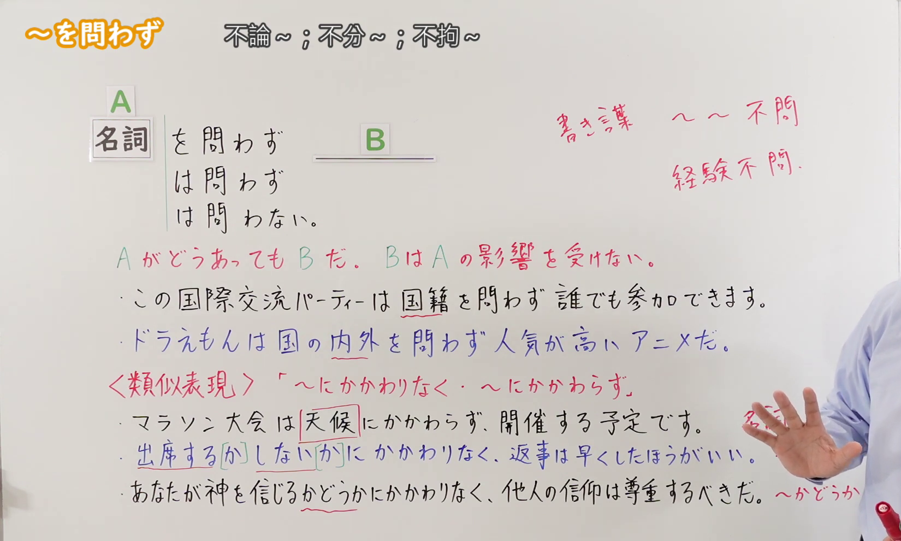
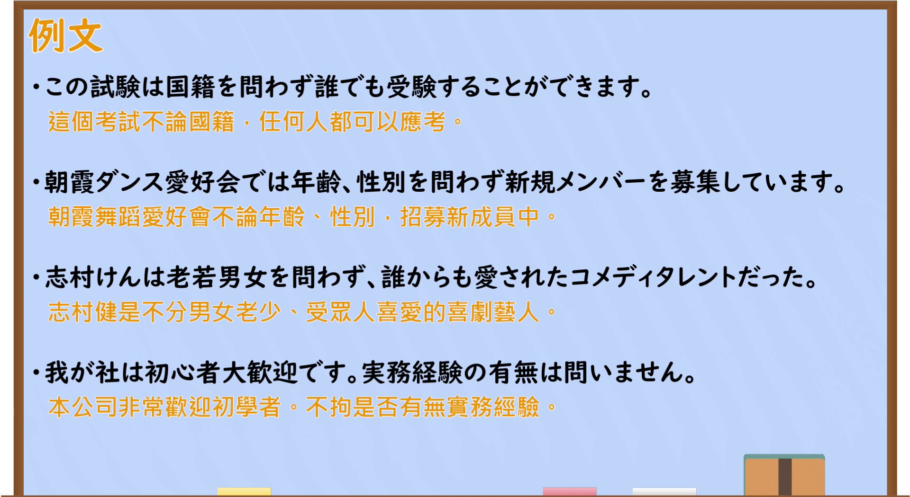

---
{
  "id": "N2-G-0092",
  "kind": "grammar",
  "level": "N2",
  "title": "をとわず(を問わず)／はとわず(は問わず)：不论、不分",
  "card_revision": 1,
  "schema_version": 1,
  "source": {
    "lesson": "N2 第92个语法",
    "material": "出口日語原视频板书、日语自动字幕与毎日のんびり日本語教師正文",
    "video": "https://www.youtube.com/watch?v=XJvSj85oImE",
    "screenshot": "assets/grammar/n2/N2-G-0092-connection.png",
    "screenshot_seconds": 330.7,
    "screenshot_crop": {
      "x": 0,
      "y": 0,
      "width": 1650,
      "height": 990
    }
  },
  "tags": [
    "不论",
    "N2"
  ],
  "confusions": [
    "にかかわらず(に関わらず)"
  ]
}
---

# をとわず(を問わず)／はとわず(は問わず)

# 视频学习资料整理

- 课程：[出口日語 N2 第92课](https://www.youtube.com/watch?v=XJvSj85oImE)，视频时长 7分21秒。
- 接续图：原视频 **5分30.70秒**，原图 **1920×1080**，从左上角裁切 **(0, 0, 1650, 990)**；保留接续、红字意义说明、板书例句和类似表达。片头人像遮挡较多，故选用本时点；板书右缘少量注释仍被讲师遮挡。

- 例句图：原视频 **6分14.80秒**，原图 **1920×1080**，从左上角裁切 **(0, 0, 1920, 1050)**；保留整页四条例句及原视频所附中文翻译。

# 核心

## 功能一：无论 A 如何，B 都成立；B 不受 A 影响

**くわしい意味記述：**

- **をとわず(を問わず)／はとわず(は問わず)：** 前件の結果や状態に左右されないことを表します。（表示不受前项的结果或状态左右。）

### 例句

1. 殺人というのは理由を問わず許されない行為だ。

   （杀人不论出于什么理由，都是不可容许的行为。）

2. 病気になっていなければ、国内外を問わず、いろんな場所に旅してみたかった。

   （要是没有生病，我本想不分国内国外，到各处旅行。）

3. 昼夜問わず救急車の音が鳴りやまない。

   （救护车的声音昼夜不停。）

4. ご予約の有無を問わずどなた様でもご自由にご購入が可能です。

   （无论是否预约，任何人都可以自由购买。）

# 来源

- [出口日語原视频「～を問わず」](https://www.youtube.com/watch?v=XJvSj85oImE)
- [毎日のんびり日本語教師「～を問わず／は問わず」](https://mainichi-nonbiri.com/grammar/n2-wotowazu/)（意义说明及四条例句；查询日期：2026-09-23）
