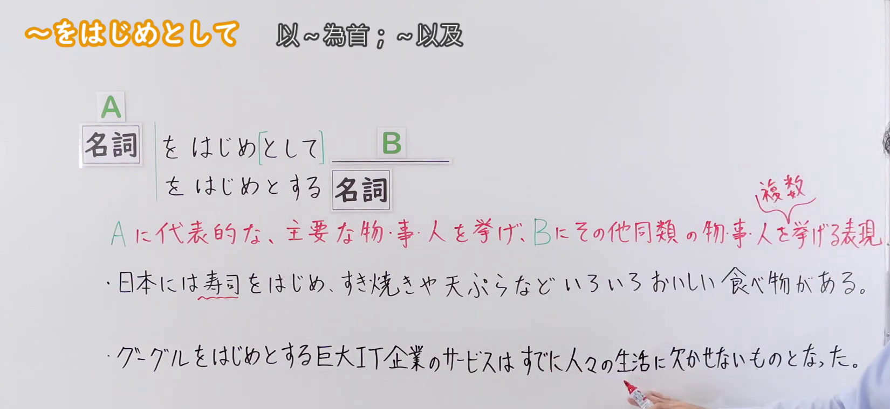
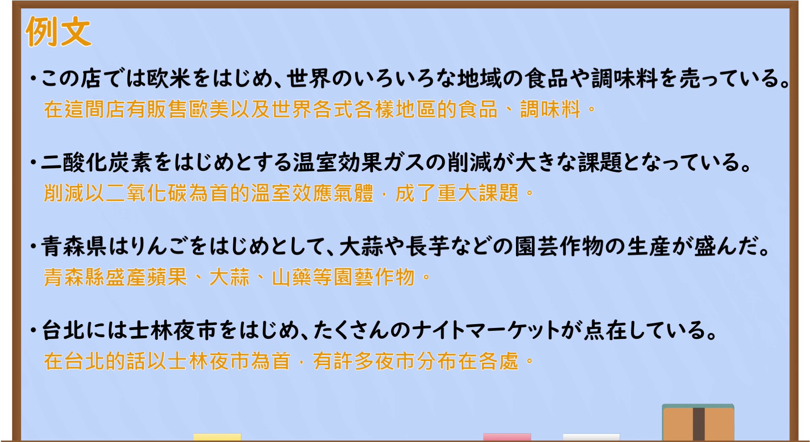

---
{
  "id": "N2-G-0093",
  "kind": "grammar",
  "level": "N2",
  "title": "をはじめとして(を始めとして)：以某项为代表，列举同类事物",
  "card_revision": 1,
  "schema_version": 1,
  "source": {
    "lesson": "N2 第93个语法",
    "material": "出口日語原视频板书、日语自动字幕与毎日のんびり日本語教師正文",
    "video": "https://www.youtube.com/watch?v=GkECoGyscZQ",
    "screenshot": "assets/grammar/n2/N2-G-0093-connection.png",
    "screenshot_seconds": 140,
    "screenshot_crop": {
      "x": 0,
      "y": 0,
      "width": 1650,
      "height": 760
    }
  },
  "tags": [
    "列举",
    "代表",
    "N2"
  ],
  "confusions": [
    "をちゅうしんに(を中心に)"
  ]
}
---

# をはじめとして(を始めとして)

# 视频学习资料整理

- 课程：[出口日語 N2 第93课](https://www.youtube.com/watch?v=GkECoGyscZQ)，视频时长 4分59秒。
- 接续图：原视频 **2分20秒**，原图 **1920×1080**，从左上角裁切 **(0, 0, 1650, 760)**；保留两种板书形式、红字意义说明和两个板书例句。片头的人像遮挡说明文字，改用本时点；右缘仍可见讲师少量影像。

- 例句图：原视频 **3分21.80秒**，原图 **1920×1080**，从左上角裁切 **(0, 0, 1920, 1050)**；保留整页四条例句及原视频所附中文翻译。

# 核心

## 功能一：举出 A 这一有代表性的重要事物，再列举与 A 同类的其他事物

**くわしい意味記述：**

- **をはじめ(を始め)／をはじめとして(を始めとして)／をはじめとする(を始めとする)：** 最も代表的かつ重要なものを１つ挙げ、後件にそれと同類のものを列挙する文法です。（举出最具代表性且重要的一项，并在后项列举与它同类的事物。）

### 例句

1. 地球を始めとした太陽系の惑星は太陽を中心に公転しているが、太陽はさらに天の川銀河を中心に公転している。

   （包括地球在内的太阳系行星绕太阳公转，而太阳又绕银河系中心公转。）

2. 日本は中国を始めとして色んな国から観光客が来る時代になった。

   （日本进入了游客从中国等各国到访的时代。）

3. 校長を始め、多くの先生方に褒められた。

   （校长和许多老师都表扬了我。）

4. 当店では本格ラーメンを始めとして、デザート、おつまみなども幅広くご提供しております。

   （本店提供正宗拉面，以及甜点、下酒菜等各类食品。）

5. 北陸地方を始めとして幅広い地域で大雪となっている。

   （包括北陆地区在内的广大地区都下起了大雪。）

# 来源

- [出口日語原视频「～をはじめとして」](https://www.youtube.com/watch?v=GkECoGyscZQ)
- [毎日のんびり日本語教師「～を始め／を始めとして／を始めとする」](https://mainichi-nonbiri.com/grammar/n3-wohajime/)（意义说明及五条例句；查询日期：2026-09-23）
