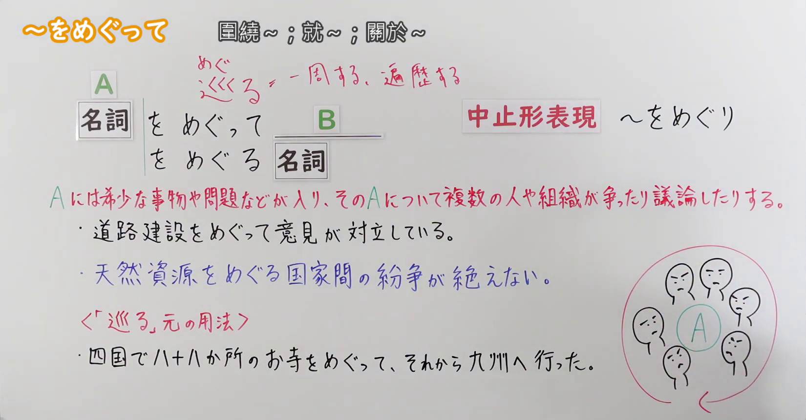
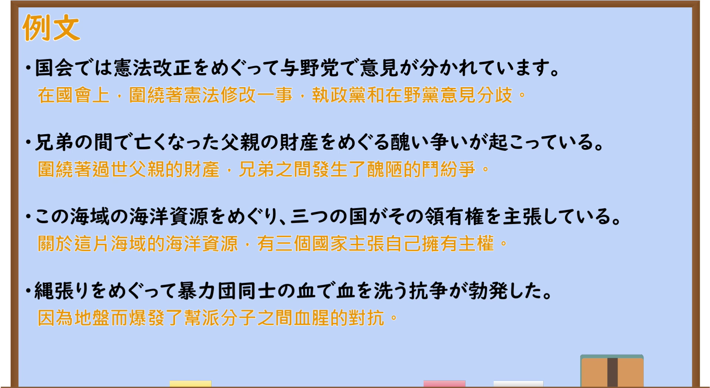

---
{
  "id": "N2-G-0094",
  "kind": "grammar",
  "level": "N2",
  "title": "をめぐって(を巡って)：围绕某事展开讨论或争执",
  "card_revision": 1,
  "schema_version": 1,
  "source": {
    "lesson": "N2 第94个语法",
    "material": "出口日語原视频板书、日语自动字幕与毎日のんびり日本語教師正文",
    "video": "https://www.youtube.com/watch?v=ZLRYC5TIoyU",
    "screenshot": "assets/grammar/n2/N2-G-0094-connection.png",
    "screenshot_seconds": 120,
    "screenshot_crop": {
      "x": 0,
      "y": 0,
      "width": 1650,
      "height": 860
    }
  },
  "tags": [
    "争论",
    "话题",
    "N2"
  ],
  "confusions": [
    "について",
    "にかんして(に関して)"
  ]
}
---

# をめぐって(を巡って)

# 视频学习资料整理

- 课程：[出口日語 N2 第94课](https://www.youtube.com/watch?v=ZLRYC5TIoyU)，视频时长 6分26秒。
- 接续图：原视频 **2分00秒**，原图 **1920×1080**，从左上角裁切 **(0, 0, 1650, 860)**；保留接续、红字意义说明、板书例句及示意图。0:01 时讲师遮挡部分说明，故改用本时点。

- 例句图：原视频 **4分49.40秒**，原图 **1920×1080**，从左上角裁切 **(0, 0, 1920, 1050)**；保留整页四条例句及原视频所附中文翻译。

# 核心

## 功能一：A 是稀缺事物或问题等，多个个人或组织围绕 A 争执、讨论

**くわしい意味記述：**

- **をめぐって(を巡って)／をめぐり(を巡り)／をめぐる(を巡る)：** 「～を巡って」はその事柄に対して多くの人が関心を持ち、それが人々の話題の中心に位置することを強調する表現です。後件には「話し合う」「議論する」「争う」のような、大人数で行われる動作の動詞がきます。（「～を巡って」强调许多人关心某事，而此事成为众人话题的中心；后项接「商谈」「讨论」「争执」等由多人参与的动作。）

### 例句

1. 取締役会では今後の経営方針を巡り意見が分かれているそうだ。

   （听说董事会围绕今后的经营方针意见不一。）

2. グレタさんの存在もあり、今世界中で環境問題を巡る論争が過熱している。

   （也因为格蕾塔的影响，如今全球围绕环境问题的争论愈演愈烈。）

3. 彼の処分を巡り、話し合いが進められている。

   （围绕对他的处分，相关讨论正在进行。）

4. その問題を巡っては様々な意見が出ている。

   （围绕那个问题，出现了各种意见。）

5. 仲の良い兄弟でも、親の遺産を巡って争いになることがある。

   （即使是关系亲密的兄弟，也可能因父母的遗产而发生争执。）

# 来源

- [出口日語原视频「～をめぐって」](https://www.youtube.com/watch?v=ZLRYC5TIoyU)
- [毎日のんびり日本語教師「～を巡って／を巡り／を巡る」](https://mainichi-nonbiri.com/grammar/n2-womegutte/)（意义说明及五条例句；查询日期：2026-09-23）
