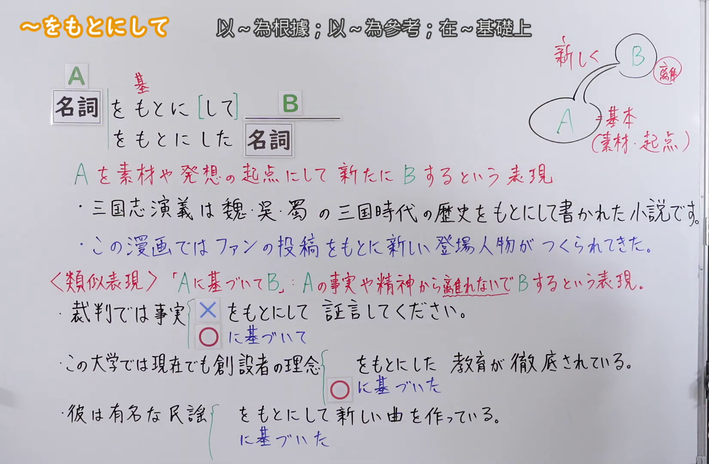
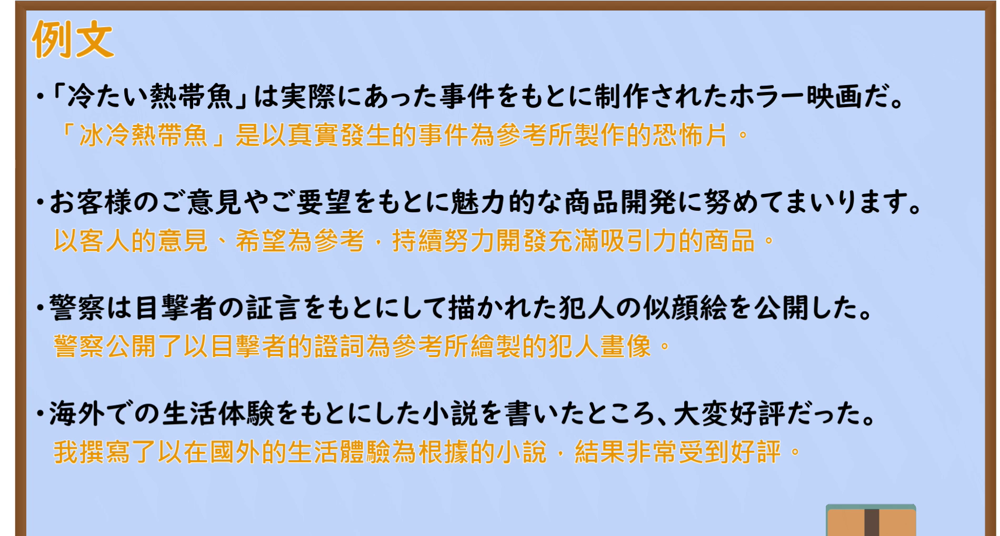

---
{
  "id": "N2-G-0095",
  "kind": "grammar",
  "level": "N2",
  "title": "～をもとにして：以某事物为素材或构思起点，重新创作",
  "card_revision": 1,
  "schema_version": 1,
  "source": {
    "lesson": "N2 第95个语法",
    "material": "出口日語原视频板书、日语自动字幕与 Hagoromo「をもとに（して）」条目",
    "video": "https://www.youtube.com/watch?v=goK17HkefpY",
    "screenshot": "assets/grammar/n2/N2-G-0095-connection.png",
    "screenshot_seconds": 300.0,
    "screenshot_crop": {
      "x": 0,
      "y": 0,
      "width": 1650,
      "height": 1080
    }
  },
  "tags": [
    "素材与依据",
    "N2"
  ],
  "confusions": [
    "～に基づいて"
  ]
}
---

# ～をもとにして

# 视频学习资料整理

- [出口日語第95课原视频](https://www.youtube.com/watch?v=goK17HkefpY)。
- 接续图：原视频 5:00（300.00 秒）；原图 1920×1080，固定左上角裁切区域 `(0, 0, 1650, 1080)`，保留接续、红字意义、例句与易混表达。片头 0:01 的画面中教师遮挡部分板书，因此改用此时点。

- 例句图：原视频约 6:50（410.43 秒）；原图 1920×1080，固定左上角裁切区域 `(0, 0, 1900, 1020)`，保留四条例句及视频自带译文。

# 核心

## 功能一：以 A 为素材或构思起点，重新做出 B

**最上位意味カテゴリー：**

- **～をもとに（して）：** ものごとの関係（事物之间的关系）

**中位意味カテゴリー：**

- **～をもとに（して）：** 基準（基准）

**意味：**

- **～をもとに（して）：** 根拠・材料・参考（依据、材料、参考）

**くわしい意味記述：**

- **～をもとに（して）：** あるものを作り出したりするときに，「Nを素材にして」「Nを参考にして」という意味。（在创作某种事物等情况下，表示“以 N 为素材”或“参考 N”。）

**派生語：** をもとに，をもとにして

### 例句

1. これは本当にあったことをもとにして書かれた話だ。

   （这是根据真实发生的事写成的故事。）

2. 漫画をもとに映画が作られた。

   （这部电影是根据漫画改编的。）

3. ここまでの三篇はそれぞれ筆者の体験をもとに書かれたものです。

   （前面的三篇文章分别是根据作者自身的经历写成的。）

# 来源

- [出口日語第95课原视频](https://www.youtube.com/watch?v=goK17HkefpY)
- [Hagoromo「をもとに（して）（根拠・材料・参考）」条目](https://www.hagoromo-text.work/)（站内检索「をもとにして」；释义与例句；查询日期：2026-09-23）
