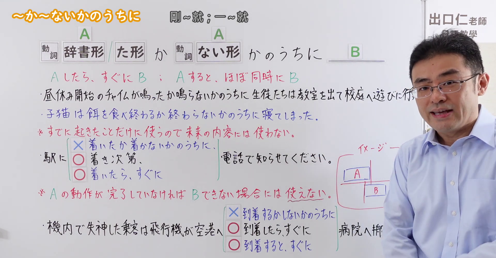
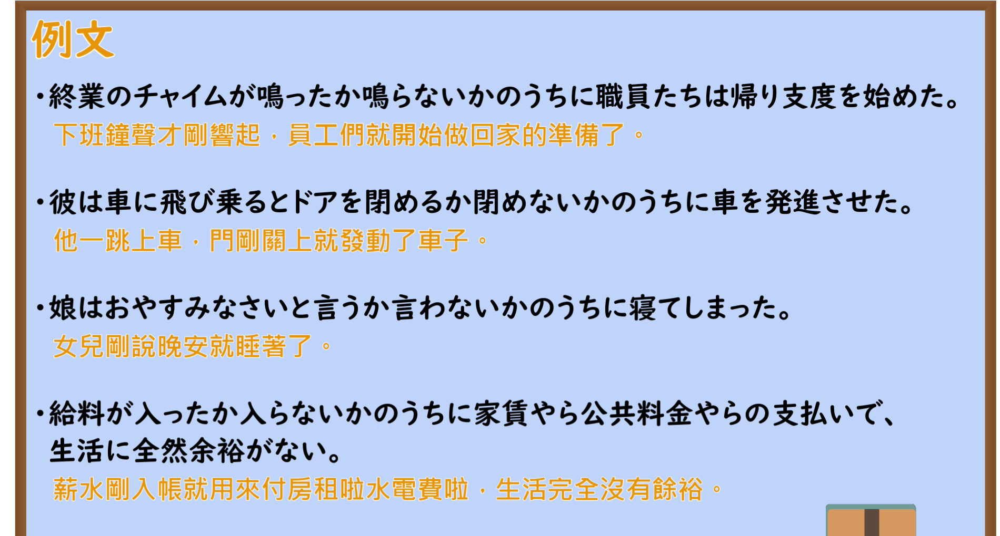

---
{
  "id": "N2-G-0096",
  "kind": "grammar",
  "level": "N2",
  "title": "～か～ないかのうちに（刚……就……）",
  "card_revision": 1,
  "schema_version": 1,
  "source": {
    "lesson": "N2 第96个语法",
    "material": "出口日語原视频板书、日语自动字幕与毎日のんびり日本語教師正文",
    "video": "https://www.youtube.com/watch?v=URZBrBxSuiY",
    "screenshot": "assets/grammar/n2/N2-G-0096-connection.png",
    "screenshot_seconds": 308.2,
    "screenshot_crop": {
      "x": 0,
      "y": 0,
      "width": 1920,
      "height": 1000
    }
  },
  "tags": [
    "时间先后",
    "动作几乎同时发生",
    "N2"
  ],
  "confusions": [
    "～ないうちに",
    "～たらすぐに"
  ]
}
---

# N2 第96个语法：～か～ないかのうちに

# 视频学习资料整理

- [出口日語原视频](https://www.youtube.com/watch?v=URZBrBxSuiY)，课程板书与日语自动字幕核对。
- 接续图：原视频 308.20 秒；原图 1920 × 1080；从左上角裁切至 `(0, 0, 1920, 1000)`，仅去除底部空白。老师遮挡了右侧部分例句，接续、红色意义说明、注意事项和左侧对比内容清晰可见。

- 例句图：原视频 349.30 秒；原图 1920 × 1080；从左上角裁切至 `(0, 0, 1900, 1020)`，去除右缘及底部多余画面。四条例句及视频自带的中文说明完整可见。

# 核心

## 功能一：A 一发生，B 就立即发生；或 A 与 B 几乎同时发生

**くわしい意味記述：**

- **～か～ないかのうちに：** 同じ動詞の辞書形、動た形とナイ形を使って接続し、実際は前件の動作が行われる直前に後件が発生したことを表します。前件と後件の動作がほぼ同時に発生したとも捉えられます。（同一个动词用辞书形或た形与ない形相接，表示后项发生在前项动作即将发生之前；也可以理解为前后两个动作几乎同时发生。）

### 与第97个语法的核心区别

| 核心比较 | 第96：～か～ないかのうちに | 第97：～かとおもうと(思うと)／～かとおもったら(思ったら) |
|---|---|---|
| 时间关系 | **A还没有完全结束，B就发生了**，两者几乎同时 | **A刚发生，紧接着就发生B** |
| 表达重点 | 强调**时间极短、动作衔接很快** | 强调**迅速变化**，常带惊讶或意外感 |
| 例句 | 映画が終わるか終わらないかのうちに、観客は席を立った。 电影还没完全结束，观众就起身了。 | 電車が動き出したかと思ったら、また止まった。 电车刚开动，就又停了。 |

第96的“还没完全结束”是典型画面，也可以表示“刚完成的那一瞬间”；不必限定为每一句都确实尚未结束。

对照来源：[日本語NET·96](https://nihongokyoshi-net.com/2019/05/23/jlptn2-grammar-ka-naikanouchini/)、[日本語NET·97](https://nihongokyoshi-net.com/2019/05/27/jlptn2-grammar-katoomouto/)（查询日期：2026-10-04）。

### 例句

1. バスは私が座るか座らないかのうちに走り出した。

   （我刚坐下，公交车就开动了。）

2. 演奏が終わるか終わらないかのうちに拍手をした。

   （演奏刚结束，就鼓起掌来。）

3. 息子は「おやすみ」と言うか言わないかのうちに寝付いた。

   （儿子刚说完“晚安”，就睡着了。）

4. チャイムが鳴るか鳴らないかのうちに学生は教室から飛び出していった。

   （铃声刚一响，学生们就冲出了教室。）

# 来源

- [出口日語原视频](https://www.youtube.com/watch?v=URZBrBxSuiY)
- [毎日のんびり日本語教師「【N2文法】～か～ないかのうちに」](https://mainichi-nonbiri.com/grammar/n2-kanaikanouchini/)（语法解释与例句；查询日期：2026-09-23）
