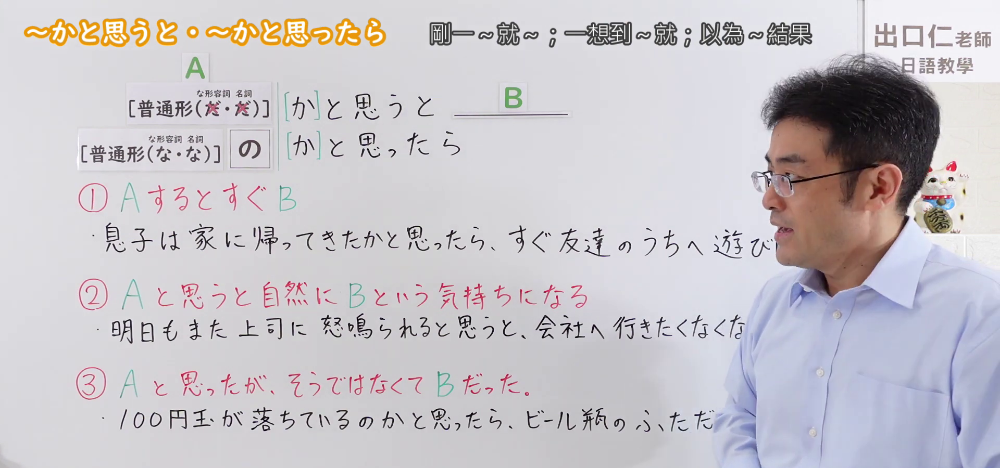
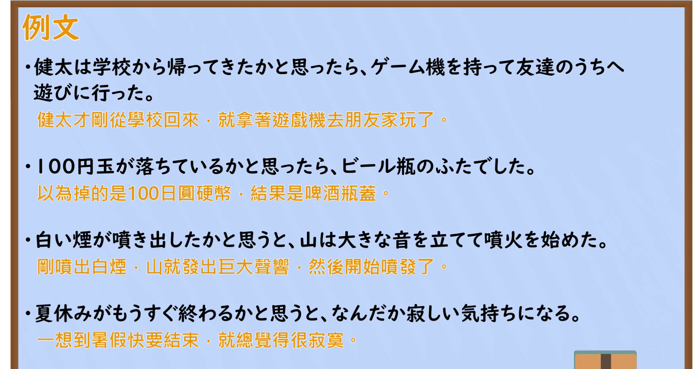

---
{
  "id": "N2-G-0097",
  "kind": "grammar",
  "level": "N2",
  "title": "～かとおもうと(思うと)／～かとおもったら(思ったら)（刚……就……；原以为……却……）",
  "card_revision": 1,
  "schema_version": 1,
  "source": {
    "lesson": "N2 第97个语法",
    "material": "出口日語原视频板书、日语自动字幕、日本語NET、毎日のんびり日本語教師与Bates College课堂例句",
    "video": "https://www.youtube.com/watch?v=9XOIAxGEvWU",
    "screenshot": "assets/grammar/n2/N2-G-0097-connection.png",
    "screenshot_seconds": 60.77,
    "screenshot_crop": {
      "x": 0,
      "y": 0,
      "width": 1920,
      "height": 900
    }
  },
  "tags": [
    "紧接发生",
    "自然情绪",
    "意外结果",
    "N2"
  ],
  "confusions": [
    "～か～ないかのうちに",
    "～たとたんに"
  ]
}
---

# N2 第97个语法：～かとおもうと(思うと)／～かとおもったら(思ったら)

# 视频学习资料整理

- [出口日語原视频](https://www.youtube.com/watch?v=9XOIAxGEvWU)。课程清单中的英文标题为平台翻译；以下日语形式以原视频板书和日语讲解为准。
- 接续图：原视频 60.77 秒；原图 1920 × 1080；从左上角裁切至 `(0, 0, 1920, 900)`，去除底部空白。三个红色用法说明和接续清晰可见；老师遮挡了右侧部分板书例句。

- 例句图：原视频 317.07 秒；原图 1920 × 1080；从左上角裁切至 `(0, 0, 1900, 1010)`，去除右缘与底部多余画面。四条例句及视频自带的中文说明完整可见。

# 核心

## 功能一：A 一发生，B 马上发生

**くわしい意味記述：**

- **～かとおもうと(思うと)／～かとおもったら(思ったら)：** 前の事象が起こった直後に、後の事象が起こる。（前一件事发生后，后一件事紧接着发生。）

### 与第96个语法的核心区别

| 核心比较 | 第96：～か～ないかのうちに | 第97：～かとおもうと(思うと)／～かとおもったら(思ったら) |
|---|---|---|
| 时间关系 | **A还没有完全结束，B就发生了**，两者几乎同时 | **A刚发生，紧接着就发生B** |
| 表达重点 | 强调**时间极短、动作衔接很快** | 强调**迅速变化**，常带惊讶或意外感 |
| 例句 | 映画が終わるか終わらないかのうちに、観客は席を立った。 电影还没完全结束，观众就起身了。 | 電車が動き出したかと思ったら、また止まった。 电车刚开动，就又停了。 |

第96的“还没完全结束”是典型画面，也可以表示“刚完成的那一瞬间”；不必限定为每一句都确实尚未结束。本表仅比较功能一“刚一……就……”的用法。

对照来源：[日本語NET·96](https://nihongokyoshi-net.com/2019/05/23/jlptn2-grammar-ka-naikanouchini/)、[日本語NET·97](https://nihongokyoshi-net.com/2019/05/27/jlptn2-grammar-katoomouto/)（查询日期：2026-10-04）。

### 例句

1. 空がピカッと光ったかと思うと、大きな雷の音が鳴った。

   （天空刚闪了一下，随即响起一声巨雷。）

2. 息子が帰って来たかと思うと、すぐに家を出ていった。

   （儿子刚回到家，马上又出门了。）

3. 電車が動き出したかと思ったら、また止まった。

   （电车刚开动，就又停了下来。）

## 功能二：一想到 A，就自然地产生 B 那样的心情

**くわしい意味記述：**

- **～(か)とおもうと(思うと)：** Aと思うと自然にBという気持ちになる。（一想到 A，就自然地产生 B 那样的心情。）

### 例句

1. 明日もまた上司に怒鳴られると思うと、会社へ行きたくなくなる。

   （一想到明天又要被上司吼，就不想去公司了。）

2. 夏休みがもうすぐ終わるかと思うと、なんだか寂しい気持ちになる。

   （一想到暑假马上就要结束，总觉得有些寂寞。）

3. 明日から夏休みが始まると思うと、心がウキウキする。

   （一想到明天就放暑假，心里就雀跃起来。）

## 功能三：原以为是 A，结果却是 B

**くわしい意味記述：**

- **～かとおもったら(思ったら)：** ただし後項には話者にとって想定外のこと、意外なことが述べられ、しばしば驚きや呆れのニュアンスが含まれます。（后项叙述的是出乎说话人预料的事，往往带有惊讶或愕然的语气。）

### 例句

1. 怒られると思ったら慰められた。

   （原以为会挨骂，结果却得到了安慰。）

2. このプレゼントきっと喜んでくれるだろうと思ったら、微妙な顔をされてしまった。

   （原以为对方一定会喜欢这份礼物，结果却露出了微妙的表情。）

3. 噂をよく耳にするのでどれだけ美味しいのかと思ったらそうでもなかった。

   （常听人说它好吃，原以为会非常美味，结果也不过如此。）

# 来源

- [出口日語原视频](https://www.youtube.com/watch?v=9XOIAxGEvWU)（三个板书用法；功能二前两条例句）
- [日本語NET「〜かと思うと／〜かと思ったら」](https://nihongokyoshi-net.com/2019/05/27/jlptn2-grammar-katoomouto/)（功能一的解释和例句；查询日期：2026-09-23）
- [毎日のんびり日本語教師「～かと思ったら／かと思いきや／かと思うと」](https://mainichi-nonbiri.com/grammar/n2-katoomottara/)（功能三的解释和例句；查询日期：2026-09-23）
- [Bates College「文法例文ほんやく」](http://abacus.bates.edu/~kofuji/Courses/tobira-GTranslation13.html)（仅采用功能二第三条例句；该页没有提供该用法的意义说明；查询日期：2026-09-23）
