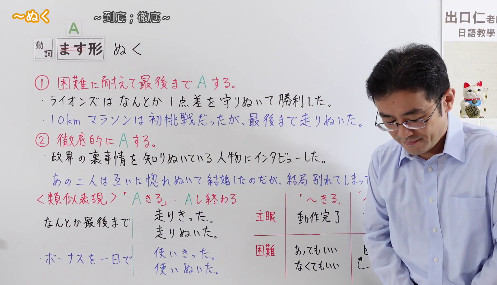
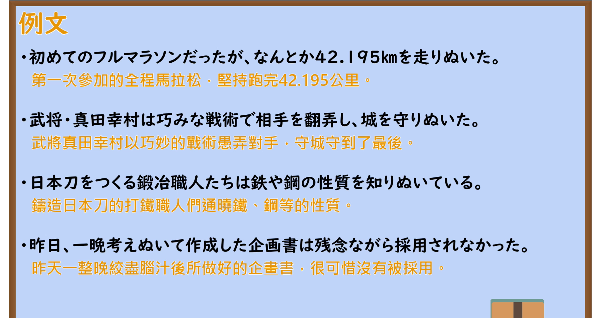

---
{
  "id": "N2-G-0098",
  "kind": "grammar",
  "level": "N2",
  "title": "～ぬく(抜く)（坚持到底；彻底地做）",
  "card_revision": 1,
  "schema_version": 1,
  "source": {
    "lesson": "N2 第98个语法",
    "material": "出口日語原视频板书、日语自动字幕与Japanese Exercises正文",
    "video": "https://www.youtube.com/watch?v=S-7bNEjlk30",
    "screenshot": "assets/grammar/n2/N2-G-0098-connection.png",
    "screenshot_seconds": 1.0,
    "screenshot_crop": {
      "x": 0,
      "y": 0,
      "width": 1880,
      "height": 1080
    }
  },
  "tags": [
    "坚持到底",
    "彻底",
    "N2"
  ],
  "confusions": [
    "～とおす(通す)",
    "～きる(切る)"
  ]
}
---

# N2 第98个语法：～ぬく(抜く)

# 视频学习资料整理

- [出口日語原视频](https://www.youtube.com/watch?v=S-7bNEjlk30)。课程清单显示英文标题，日语语法形式以原视频板书和讲解为准。
- 接续图：原视频 1.00 秒；原图 1920 × 1080；从左上角裁切至 `(0, 0, 1880, 1080)`，仅去除右侧多余画面。接续、两条红色意义说明及左侧例句清晰；老师遮挡了右下角一部分对比板书。

- 例句图：原视频 390.93 秒；原图 1920 × 1080；从左上角裁切至 `(0, 0, 1900, 1020)`，去除右缘及底部多余画面。四条例句和视频自带中文说明完整可见。

# 核心

## 功能一：克服困难，坚持把 A 做到最后

**くわしい意味記述：**

- **～ぬく(抜く)：** 最後まで頑張って～する。（努力坚持，把某事做到最后。）

### 例句

1. 大変だったけど、20キロ走りぬいた。

   （虽然很辛苦，但还是坚持跑完了 20 公里。）

2. 彼は最後の最後まで諦めずに戦いぬいた。

   （他直到最后一刻都没有放弃，坚持战斗到底。）

3. このプロジェクトを最後までやりぬく覚悟が必要だ。

   （需要有把这个项目坚持做到最后的决心。）

## 功能二：彻底地做 A

**くわしい意味記述：**

- **～ぬく(抜く)：** 非常に～する。（非常充分地做某事。）

### 例句

1. 彼は試験の答えを考えぬいてから書いた。

   （他把试题答案想透之后才写下来。）

2. 彼女は自分の未来について悩みぬいて、ついに新しい挑戦を始めた。

   （她为自己的未来苦思良久，终于开始了新的挑战。）

3. このレポートは、データを調べぬいて作成しました。

   （这份报告是在彻底查阅数据后写成的。）

# 来源

- [出口日語原视频](https://www.youtube.com/watch?v=S-7bNEjlk30)
- [Japanese Exercises「JLPT N2 ～ぬく 文法解説・問題」](https://japaneseexercises.com/2024/12/28/%E3%80%90jlpt-n2-%EF%BD%9E%E3%81%AC%E3%81%8F%E3%80%80%E6%96%87%E6%B3%95%E8%A7%A3%E8%AA%AC%E3%83%BB%E5%95%8F%E9%A1%8C%E3%80%91/)（两种用法的解释与例句；查询日期：2026-09-23）
