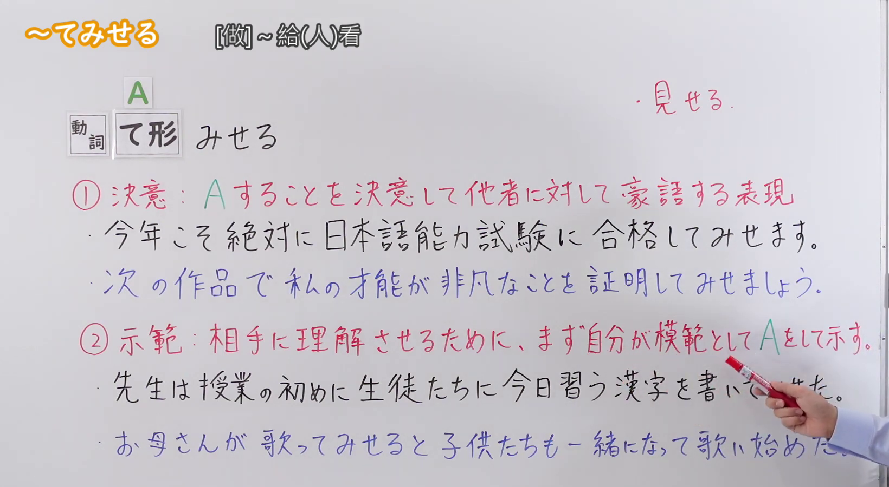

---
{
  "id": "N2-G-0099",
  "kind": "grammar",
  "level": "N2",
  "title": "～てみせる(見せる)（决心做到；示范给人看）",
  "card_revision": 1,
  "schema_version": 1,
  "source": {
    "lesson": "N2 第99个语法",
    "material": "出口日語原视频板书、日语自动字幕与毎日のんびり日本語教師正文",
    "video": "https://www.youtube.com/watch?v=ZjsfDwIu4G8",
    "screenshot": "assets/grammar/n2/N2-G-0099-connection.png",
    "screenshot_seconds": 120.0,
    "screenshot_crop": {
      "x": 0,
      "y": 0,
      "width": 1640,
      "height": 900
    }
  },
  "tags": [
    "决心",
    "示范",
    "N2"
  ],
  "confusions": [
    "～てみる",
    "～てあげる"
  ]
}
---

# N2 第99个语法：～てみせる(見せる)

# 视频学习资料整理

- [出口日語原视频](https://www.youtube.com/watch?v=ZjsfDwIu4G8)。课程清单中的英文标题为平台翻译；日语语法形式以原视频板书和讲解为准。
- 接续图：原视频 120.00 秒；原图 1920 × 1080；从左上角裁切至 `(0, 0, 1640, 900)`，去除右侧人像和底部空白。接续和两条红色说明完整可见；老师的手遮挡了下方一条例句的末尾，完整例句另见例句图。

- 例句图：原视频 207.70 秒；原图 1920 × 1080；从左上角裁切至 `(0, 0, 1900, 1020)`，去除右缘及底部多余画面。四条例句和视频自带中文说明完整可见。

# 核心

## 功能一：下定决心做 A，并向他人豪言一定做到

**くわしい意味記述：**

- **～てみせる(見せる)：** 話し手の何かを実現させるための決意や強い意志を表します。（表示说话人为实现某件事而怀有的决心或强烈意志。）

### 例句

1. 来月の試験、必ず合格してみせる。

   （下个月的考试，我一定要考过给大家看。）

2. 自分の力で必ずや頂上に登りつめてみせる。

   （我一定要靠自己的力量登上顶峰，证明给大家看。）

3. 今はまだ勝てないが、いつか彼を追い越してみせる。

   （现在还赢不了他，但总有一天我会超越他给大家看。）

## 功能二：为让对方理解，先亲自示范 A

**くわしい意味記述：**

- **～てみせる(見せる)：** 他の人に理解してもらうためにお手本を示すことを表します。（表示为了让别人理解而亲自作出示范。）

### 例句

1. この実験は危険ですので、まずは私が皆さんにやってみせましょう。

   （这个实验有危险，先由我做给大家看。）

2. 人を描くときは筋肉の構造を知らなければいけません。私がまず全身を描いてみせますね。

   （画人物时得了解肌肉结构。我先画出全身给你看。）

3. 私がやってみせますから見ていてください。

   （我来示范，请看着。）

# 来源

- [出口日語原视频](https://www.youtube.com/watch?v=ZjsfDwIu4G8)
- [毎日のんびり日本語教師「～てみせる」](https://mainichi-nonbiri.com/grammar/n1-temiseru/)（两种用法的解释与例句；查询日期：2026-09-23）
