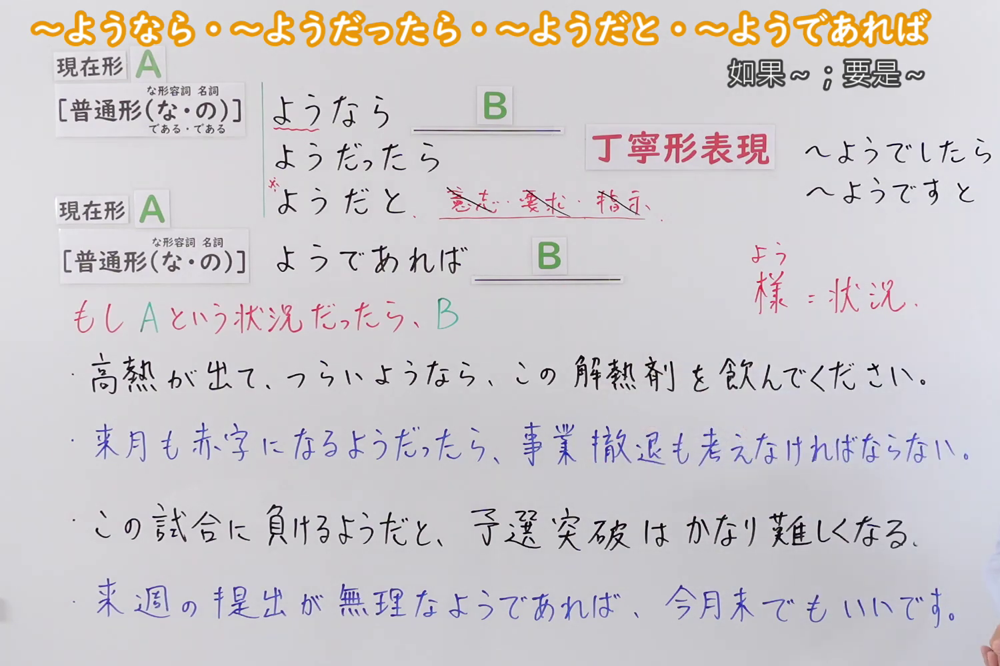
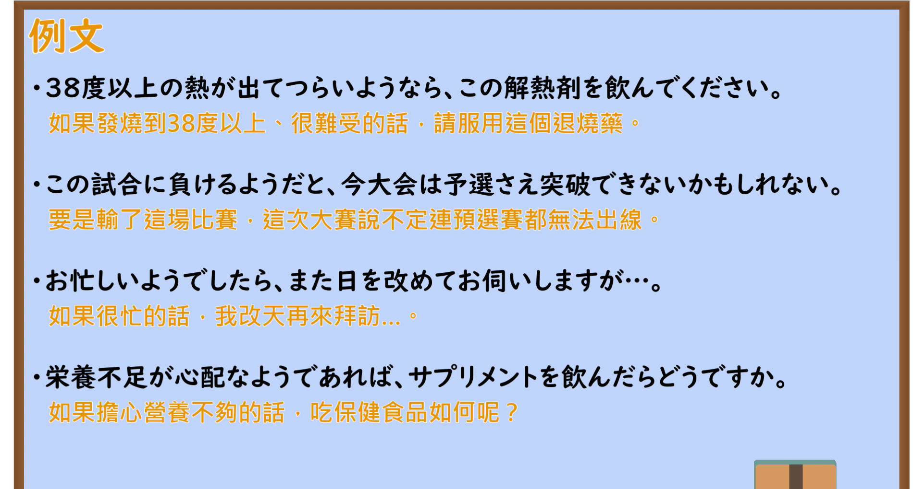

---
{
  "id": "N2-G-0100",
  "kind": "grammar",
  "level": "N2",
  "title": "～ようなら／～ようだったら／～ようだと／～ようであれば：如果出现 A 这种情况，就 B",
  "card_revision": 1,
  "schema_version": 1,
  "source": {
    "lesson": "N2 第100个语法",
    "material": "出口日語原视频板书、日语自动字幕与毎日のんびり日本語教師、HackMD 日文教学笔记正文",
    "video": "https://www.youtube.com/watch?v=kCwX19aDtu0",
    "screenshot": "assets/grammar/n2/N2-G-0100-connection.png",
    "screenshot_seconds": 210.0,
    "screenshot_crop": {
      "x": 0,
      "y": 0,
      "width": 1500,
      "height": 1000
    }
  },
  "tags": [
    "假定条件",
    "N2"
  ],
  "confusions": [
    "～なら",
    "～ようだ"
  ]
}
---

# ～ようなら／～ようだったら／～ようだと／～ようであれば

# 视频学习资料整理

- [出口日語第100课原视频](https://www.youtube.com/watch?v=kCwX19aDtu0)。
- 接续图：原视频约 3:30（210.00 秒）；原图 1920×1080，固定左上角裁切区域 `(0, 0, 1500, 1000)`，保留接续、含义及板书例句。

- 例句图：原视频约 4:19（258.97 秒）；原图 1920×1080，固定左上角裁切区域 `(0, 0, 1900, 1020)`，保留四条例句及视频自带译文。

# 核心

## 功能一：如果是 A 这种情况，就 B

**くわしい意味記述：**

- **～ようなら／～ようだったら／～ようであれば（毎日のんびり日本語教師）：** 仮定条件を表します。（表示假定条件。）「ようであれば」はやや硬めの表現です。（「ようであれば」是稍显正式的表达。）
- **～ようだと（HackMD 日文教学笔记）：** もし〜という状況・様子であるならば（もし〜なら）（如果处于某种情况或呈现某种状态，即“如果……”）；後節に悪い結果やネガティブな予測が続きやすい。（后项较常接不利结果或负面预测。）

### 例句

1. 到着が遅れるようなら、あらかじめ連絡をください。

   （如果会晚到，请提前联系。）

2. 明日も熱が下がらないようだったら病院に行こうと思う。

   （如果明天还不退烧，我打算去医院。）

3. 一人で運べないようなら、私が手伝おうか。

   （如果你一个人搬不动，我来帮忙吧？）

4. この程度の問題で諦めるようだと、今後のプロジェクトを任せることはできない。

   （如果遇到这种程度的问题就放弃，今后就不能把项目交给你了。）

# 来源

- [出口日語第100课原视频](https://www.youtube.com/watch?v=kCwX19aDtu0)
- [毎日のんびり日本語教師「【Ｎ２文法】～ようなら／ようだったら／ようであれば／ようでしたら」](https://mainichi-nonbiri.com/grammar/n2-younara/)（释义与例句 1～3；查询日期：2026-09-23）
- [HackMD 日文教学笔记「【N2文法】～ようなら／～ようだったら／～ようだと／～ようであれば」](https://hackmd.io/@eCG42u40TZ6s-_a7l15ZlQ/H1Ld3haUMx)（「ようだと」释义与例句 4；查询日期：2026-09-23）
