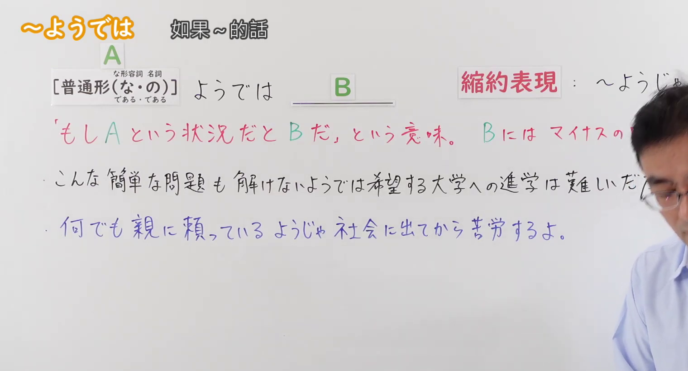
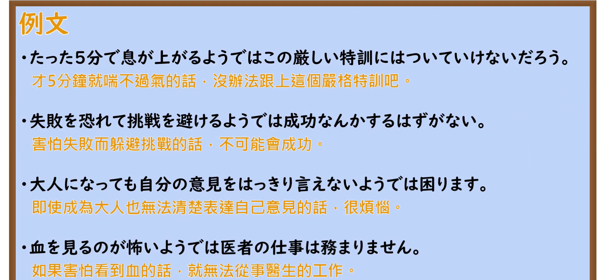

---
{
  "id": "N2-G-0101",
  "kind": "grammar",
  "level": "N2",
  "title": "ようでは（如果是……这样的话就……）",
  "card_revision": 1,
  "schema_version": 1,
  "source": {
    "lesson": "N2 第101个语法",
    "material": "出口日語原视频板书、日语自动字幕与Hagoromo文型检索正文",
    "video": "https://www.youtube.com/watch?v=hRAEjj1OYjw",
    "screenshot": "assets/grammar/n2/N2-G-0101-connection.png",
    "screenshot_seconds": 1,
    "screenshot_crop": {
      "x": 0,
      "y": 0,
      "width": 1520,
      "height": 820
    }
  },
  "tags": [
    "条件・仮定",
    "N2"
  ],
  "confusions": [
    "ようじゃ",
    "ようでは困る"
  ]
}
---

# N2 第101个语法：ようでは（如果是……这样的话就……）

## 视频学习资料整理

- 原视频链接：[出口日語原视频](https://www.youtube.com/watch?v=hRAEjj1OYjw)
- 接续图：
  - 时间：1.00s（0:01）
  - 原图尺寸：1920x1080
  - 裁切说明：固定左上角（x=0, y=0），裁去右侧与底部画面，裁切区域为 1520x820，完整保留接续形式、缩约形式、红色含义解释及板书例句；讲师在画面右侧鞠躬致意，红色解释末尾与首条板书例句尾部受人像遮挡，已结合原视频讲解核实为完整表达。
  - 图片链接：
- 例句图：
  - 时间：138.27s（2:18）
  - 原图尺寸：1920x1080
  - 裁切说明：固定左上角（x=0, y=0），裁去底部托盘空白，裁切区域为 1920x890，完整保留原视频 4 条例句与中文翻译。
  - 图片链接：

# 核心

## 功能一：「如果是A这种状况就会B」的意思

**最上位意味カテゴリー：**

- **Vるようでは：** 考え・感情（思考与感情）

**中位意味カテゴリー：**

- **Vるようでは：** 主張・断定的評価（主张与断定性评价）

**意味：**

- **Vるようでは：** 評価（评价）

**くわしい意味記述：**

- **Vるようでは：** 「そのような様子では」という意味を表す。後には「困る」や「問題がある」という表現が続く。（表示“如果是那样一种状态/样子的话”之意。后项多接续“令人为难”或“有问题”等表达。）

**派生語：** 未列出

### 例句

1. 受付を担当する職員が正しい敬語が使えないようでは困る。

   （如果负责接待的员工连正确的敬语都不会用，那可就伤脑筋了。）

2. こんな簡単な問題も間違えるようでは、試験に受かりそうもない。

   （如果连这么简单的问题都会弄错，那恐怕很难通过考试。）

3. したがって、無数の語句をおぼえていても、その語句の連絡と結びつけを新しく作り出せないようでは役に立ちません。

   （因此，即使记住了无数词句，如果不能重新创造出这些词句之间的联络与结合，也是派不上用场的。）

4. この反応がよくわからないようでは、ことばのうまい使い手とはならないでしょう。

   （如果对这种反应不能很好地理解，大概就无法成为善用语言的高手吧。）

# 来源

- [出口日語原视频](https://www.youtube.com/watch?v=hRAEjj1OYjw)
- [Hagoromo文型检索「Vるようでは」](https://hagoromo-text.work/)（查询日期：2026-09-24）
