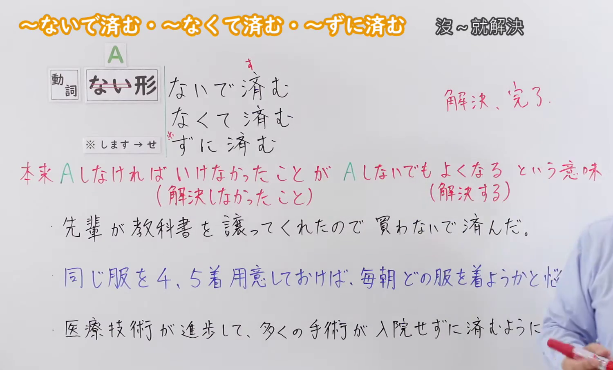
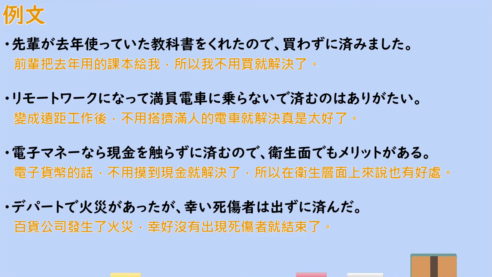

---
{
  "id": "N2-G-0102",
  "kind": "grammar",
  "level": "N2",
  "title": "ないですむ(済む)／なくてすむ(済む)／ずにすむ(済む)（不做…就解决了）",
  "card_revision": 1,
  "schema_version": 1,
  "source": {
    "lesson": "N2 第102个语法",
    "material": "出口日語原视频板书、日语自动字幕与毎日のんびり日本語教師正文",
    "video": "https://www.youtube.com/watch?v=J50c20o45jQ",
    "screenshot": "assets/grammar/n2/N2-G-0102-connection.png",
    "screenshot_seconds": 98.4,
    "screenshot_crop": {
      "x": 0,
      "y": 0,
      "width": 1500,
      "height": 905
    }
  },
  "tags": [
    "ない形",
    "解決・回避",
    "N2"
  ],
  "confusions": [
    "「～て済む／～で済む」（那样就够了／事情不再变麻烦）",
    "「～ずには済まない／～ないでは済まない」（按常识、社会通念上必须做）"
  ]
}
---

# N2 第102个语法：～ないですむ(済む)／なくてすむ(済む)／ずにすむ(済む)（不做…就解决了）

## 视频学习资料整理

原视频：[出口日語 N2 語法 第102個「～ないで済む／～なくて済む／～ずに済む」](https://www.youtube.com/watch?v=J50c20o45jQ)（约 5 分 15 秒）

### 接续图

- 实际时间：1:38（98.4 秒）。
- 原图尺寸：1920×1080；裁切区域：x=0、y=0、宽 1500、高 905（固定左上角收拢右下角，裁去底部空白与右侧多余画面）。
- 画面内容：板书记录本课接续「動詞ない形＋ないで済む／なくて済む／ずに済む（※します→せ）」、红色意味说明「本来 Aしなければいけなかったことが Aしないでもよくなる という意味（解決しなかったこと）（解決する）」、红色批注「解決、完了」，以及例句一「先輩が教科書を譲ってくれたので 買わないで済んだ。」。
- 未采用 0:01 的原因：0:01 画面为整段接续尚未写全的时机，老师肩部遮挡红色意味说明的右半与例句行尾，接续不完整，故改用 1:38 的清晰画面。
- 遮挡说明：1:38 时老师手部与画面右侧截断例句二「同じ服を4、5着…」、例句三「医療技術が進歩して…」的行尾，完整例句见下方例句图。

### 例句图

- 实际时间：3:56（235.9 秒）。
- 原图尺寸：1920×1080；裁切区域：x=50、y=20、宽 1821、高 1026（裁去视频四周黑边与右侧多余画面）。
- 画面内容：本课「例文」页，四条例句及视频自带中译，分别使用「買わずに済みました」「乗らないで済む」「触らずに済む」「出ずに済んだ」。

# 核心

## 功能一：原本必须做 A 的事情，变成了不做 A 也可以的意思（原本没得到解决的事情获得解决）

**くわしい意味記述：**

- **ないですむ(済む)／なくてすむ(済む)／ずにすむ(済む)：** そうしなくても問題が解決できることを表します。通常は悪い事態を回避することに用います。話し言葉では「ないで済む／なくて済む」をよく用います。（表示即使不那么做，问题也能得到解决。通常用于回避不好的事态。口语中常用「ないで済む／なくて済む」。）

### 例句

1. インフルは息子だけで、家族にうつらずに済んだ。

   （得流感的只有儿子，没有传染给家人。）

2. メモしておけば忘れずに済む。

   （事先记好笔记，就不会忘。）

3. ちゃんと説明したら怒られずに済んだのではないか。

   （要是好好说明的话，就不会挨骂了吧。）

4. 階段から落ちたけど怪我しなくて済んでよかった。

   （虽然从楼梯上摔了下来，但幸好没有受伤。）

5. 予約してたおかげで待ち時間が全くなくて済んだ。

   （多亏提前预约，完全没有等待。）

# 来源

- [出口日語 N2 語法 第102個「～ないで済む／～なくて済む／～ずに済む」](https://www.youtube.com/watch?v=J50c20o45jQ)
- [毎日のんびり日本語教師「【Ｎ３文法】～ずに済む／ないで済む／なくて済む」](https://mainichi-nonbiri.com/grammar/n3-zunisumu/)（查询日期：2026-09-23）
- 该形式在 Hagoromo 文型检索中未收录（查询「ずにすむ」「すむ」「ないですむ」「なくてすむ」均无对应条目），按优先级采用备选网站第 1 位「毎日のんびり日本語教師」的实际条目，其「解説」用作本卡「くわしい意味記述」，例句取自同一条目。
