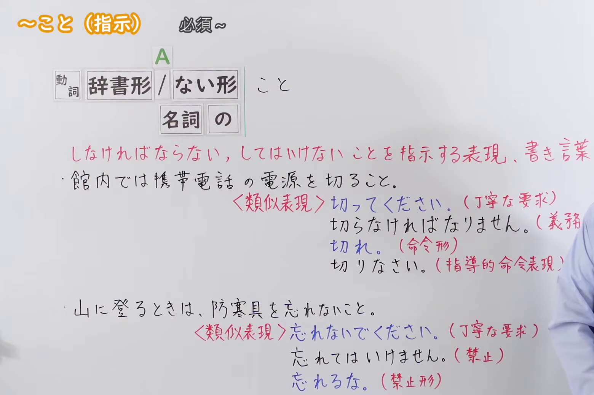
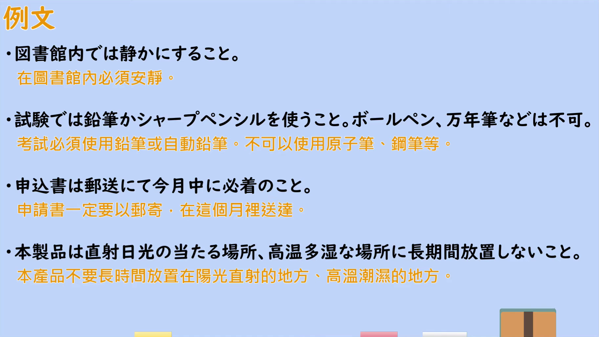

---
{
  "id": "N2-G-0103",
  "kind": "grammar",
  "level": "N2",
  "title": "こと（指示）（必須～：指示必须做或不可以做的事，书面语）",
  "card_revision": 1,
  "schema_version": 1,
  "source": {
    "lesson": "N2 第103个语法",
    "material": "出口日語原视频板书、日语自动字幕与Hagoromo文型检索正文",
    "video": "https://www.youtube.com/watch?v=Zv844blKdYo",
    "screenshot": "assets/grammar/n2/N2-G-0103-connection.png",
    "screenshot_seconds": 45.7,
    "screenshot_crop": {
      "x": 0,
      "y": 0,
      "width": 1560,
      "height": 1040
    }
  },
  "tags": [
    "書き言葉",
    "指示・命令",
    "N2"
  ],
  "confusions": [
    "「～てください」（礼貌的请求）",
    "「～なければなりません」（义务、规定）",
    "「～なさい」（指导性命令表现）",
    "「～な／～てはいけません」（禁止）"
  ]
}
---

# N2 第103个语法：～こと（指示）（必須～）

## 视频学习资料整理

原视频：[出口日語 N2 語法 第103個「～こと（指示）」](https://www.youtube.com/watch?v=Zv844blKdYo)（约 4 分 27 秒）

### 接续图

- 实际时间：0:45（45.7 秒）。
- 原图尺寸：1920×1080；裁切区域：x=0、y=0、宽 1560、高 1040（固定左上角收拢右下角，裁去底部空白与右侧多余画面）。
- 画面内容：板书记录本课接续「動詞 辞書形／ない形＋こと」「名詞＋の」、红色意味说明「しなければならない、してはいけないことを指示する表現、書き言葉」，以及例句一「館内では携帯電話の電源を切ること。」与例句二「山に登る時は、防寒具を忘れないこと。」各自的〈類似表現〉对照（切ってください／切らなければなりません／切れ／切りなさい；忘れないでください／忘れてはいけません／忘れるな）。
- 未采用 0:01 的原因：0:01 时老师身体遮住红色意味说明的尾部与各条类似表现的行尾，板书不完整，故改用 0:45 的清晰画面。
- 遮挡说明：0:45 时「切らなければなりません。（義務・規定）」的「・規定）」部分被老师身体遮挡，其余板书完整。

### 例句图

- 实际时间：3:20（199.7 秒）。
- 原图尺寸：1920×1080；裁切区域：x=50、y=20、宽 1821、高 1026（裁去视频四周黑边与右侧多余画面）。
- 画面内容：本课「例文」页，四条例句及视频自带中译：「図書館内では静かにすること」「試験では鉛筆かシャープペンシルを使うこと」「申込書は郵送にて今月中に必着のこと」「本製品は直射日光の当たる場所、高温多湿な場所に長期間放置しないこと」。

# 核心

## 功能一：指示必须做或不可以做的事情的表达（书面语）

**最上位意味カテゴリー：**

- **Vること：** 人との関係（人与人的关系）

**中位意味カテゴリー：**

- **Vること：** 依頼・命令（请求与命令）

**意味：**

- **Vること：** 命令（命令）

**くわしい意味記述：**

- **Vること：** Vで表す行為をするように（またはしないように）相手に命令したり指示したりする時に使う。規則を伝える時に使うことが多い。（用于命令或指示对方做（或不做）V 所表示的行为。多用于传达规则。）

**派生語：** 未列出

### 例句

1. テスト中、携帯電話を使用しないこと。

   （考试期间不要使用手机。）

2. 解答用紙は鉛筆で書くこと。

   （答题卡请用铅笔书写。）

3. そういうものに目をつむり、決して疑いを持たないこと。

   （对那类事情睁一只眼闭一只眼，绝不要抱有任何怀疑。）

# 来源

- [出口日語 N2 語法 第103個「～こと（指示）」](https://www.youtube.com/watch?v=Zv844blKdYo)
- [Hagoromo 文型検索「Vること」](https://hagoromo-text.work/lookup?text=V%E3%82%8B%E3%81%93%E3%81%A8&mode=full)（查询日期：2026-09-23；该检索返回此条目全文与例句）
