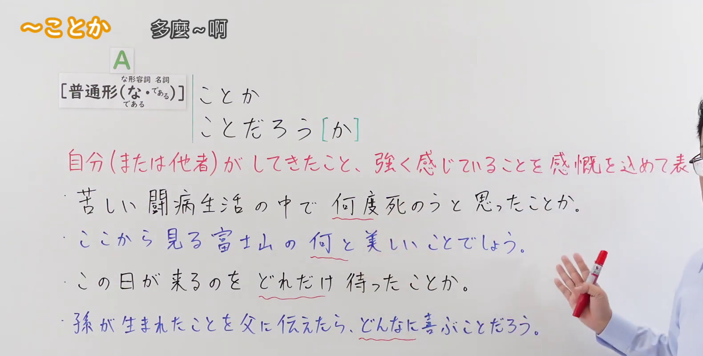
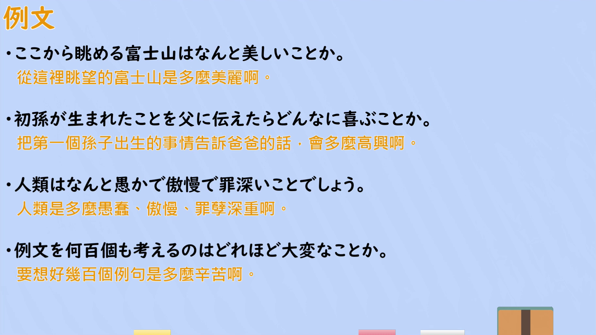

---
{
  "id": "N2-G-0104",
  "kind": "grammar",
  "level": "N2",
  "title": "ことか／ことだろう[か]（多麼～啊：倾注感慨地表达自己或他人经历过、强烈感受到的事）",
  "card_revision": 1,
  "schema_version": 1,
  "source": {
    "lesson": "N2 第104个语法",
    "material": "出口日語原视频板书、日语自动字幕与Hagoromo文型检索正文",
    "video": "https://www.youtube.com/watch?v=LuGqFqsy5Wo",
    "screenshot": "assets/grammar/n2/N2-G-0104-connection.png",
    "screenshot_seconds": 132.0,
    "screenshot_crop": {
      "x": 0,
      "y": 0,
      "width": 1580,
      "height": 800
    }
  },
  "tags": [
    "感慨・強調程度",
    "疑問詞と呼応",
    "N2"
  ],
  "confusions": [
    "「～ものか」（强烈否定、反语，如「行くものか」）",
    "「～ことに」（把感情直接前置，如「嬉しいことに」）",
    "「～ことだろう」（以某个依据进行预想、推测，如「さぞ大きくなったことだろう」）"
  ]
}
---

# N2 第104个语法：～ことか（多麼～啊）

## 视频学习资料整理

原视频：[出口日語 N2 語法 第104個「～ことか」](https://www.youtube.com/watch?v=LuGqFqsy5Wo)（约 5 分 00 秒）

### 接续图

- 实际时间：2:12（132.0 秒）。
- 原图尺寸：1920×1080；裁切区域：x=0、y=0、宽 1580、高 800（固定左上角收拢右下角，裁去底部空白与右侧多余画面）。
- 画面内容：板书记录本课接续「[普通形（な形・名詞：な／である）]＋ことか／ことだろう［か］」、红色意味说明「自分（または他者）がしてきたこと、強く感じていることを感慨を込めて表す」，以及四条板书例句（苦しい闘病生活の中で 何度死のうと思ったことか／ここから見る富士山の 何と美しいことでしょう／この日が来るのを どれだけ待ったことか／孫が生まれたことを父に伝えたら、どんなに喜ぶことだろう），其中「何度・何と・どれだけ・どんなに」用红线标注，提示与疑问词呼应使用。
- 未采用 0:01 的原因：0:01 时老师身体遮住红色意味说明的尾部与各条例句的行尾，板书不完整，故改用 2:12 的清晰画面。
- 遮挡说明：2:12 是多个时点中红色意味说明可见范围最大的一帧，其末尾「す」仍被老师面部遮挡；其余板书内容完整。

### 例句图

- 实际时间：3:45（224.6 秒）。
- 原图尺寸：1920×1080；裁切区域：x=50、y=20、宽 1821、高 1026（裁去视频四周黑边与右侧多余画面）。
- 画面内容：本课「例文」页，四条例句及视频自带中译：「ここから眺める富士山はなんと美しいことか」「初孫が生まれたことを父に伝えたらどんなに喜ぶことか」「人類は何と愚かで傲慢で罪深いことでしょう」「例文を何百個も考えるのはどれほど大変なことか」。

# 核心

## 功能一：表达自己（或他人）经历过的事、强烈感受到的事，倾注感慨

**最上位意味カテゴリー：**

- **〔疑問詞〕〜ことか：** 考え・感情（想法与感情）

**中位意味カテゴリー：**

- **〔疑問詞〕〜ことか：** 主張・断定的評価（主张与断定性的评价）

**意味：**

- **〔疑問詞〕〜ことか：** 主張（主张）

**くわしい意味記述：**

- **〔疑問詞〕〜ことか：** 「あることがどの程度，どのぐらいのことかが分からないぐらい程度」という意味を表す。程度が激しいことを表す。（表示"某件事到了说不清究竟有多深的程度"，表达程度之激烈。）

**派生語：** 未列出

### 例句

1. 子どもたちの将来のことをどんなに心配したことか。

   （曾多么担心孩子们的将来啊。）

2. そのことが、多くの中高年ファンをどれだけ勇気づけたことか。

   （那件事给了多少中老年粉丝多大的鼓舞啊。）

3. しかし、わずか三〇〇〇円の福袋を売りつけるにも、あんなに手間ひまをかけて楽しい夢を見せてくれた昔の催眠商法にくらべて、老人ばかりを狙って怪しげな健康器具などを売りつける最近の手口のなんと強引でドライなことか。

   （然而，即便是把三千日元左右的福袋推销出去，比起过去那种不惜费尽心思、让人做个美梦的"催眠推销法"，如今专挑老年人兜售可疑保健器材之类手法，是多么强硬而冷漠啊。）

# 来源

- [出口日語 N2 語法 第104個「～ことか」](https://www.youtube.com/watch?v=LuGqFqsy5Wo)
- [Hagoromo 文型検索「〔疑問詞〕〜ことか」](https://hagoromo-text.work/lookup?text=%E3%81%93%E3%81%A8%E3%81%8B&mode=full)（查询日期：2026-09-23；该检索返回此条目全文与例句）
