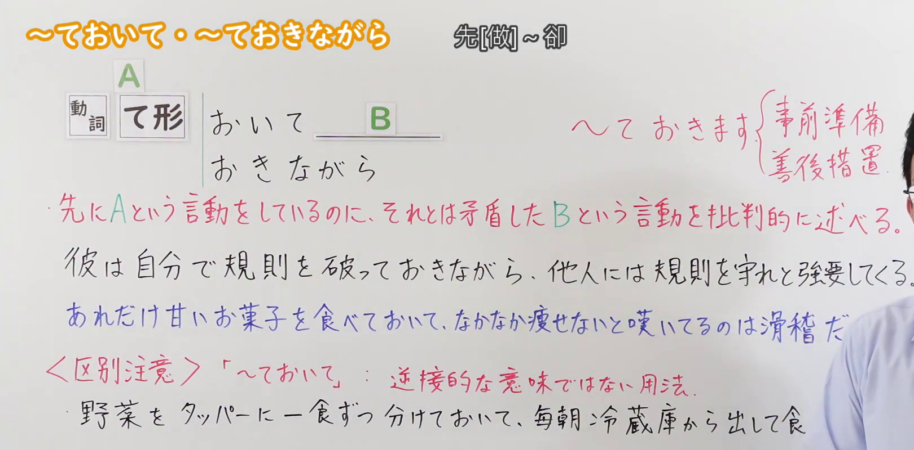
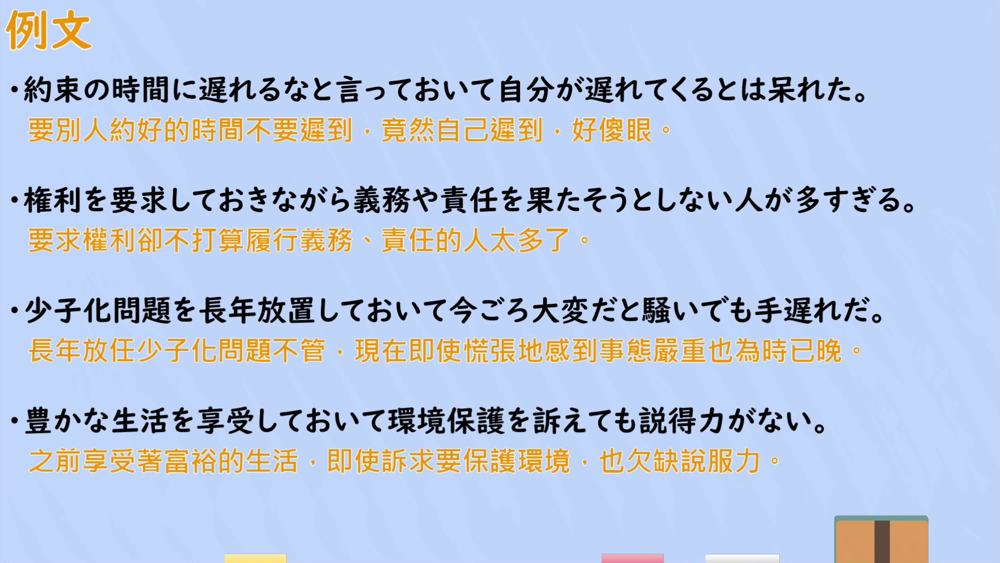

---
{
  "id": "N2-G-0105",
  "kind": "grammar",
  "level": "N2",
  "title": "ておいて／ておきながら（先[做]～卻：对与事前行動相矛盾的行为进行非难）",
  "card_revision": 1,
  "schema_version": 1,
  "source": {
    "lesson": "N2 第105个语法",
    "material": "出口日語原视频板书、日语自动字幕与HackMD「【N2文法】～ておいて / ～ておきながら」正文",
    "video": "https://www.youtube.com/watch?v=DWJrYqAm3Co",
    "screenshot": "assets/grammar/n2/N2-G-0105-connection.png",
    "screenshot_seconds": 105.5,
    "screenshot_crop": {
      "x": 0,
      "y": 0,
      "width": 1620,
      "height": 800
    }
  },
  "tags": [
    "逆接・非難",
    "て形＋おく",
    "N2"
  ],
  "confusions": [
    "「～ておいて」的普通用法（单纯的动作顺序、事前准备，如「野菜を分けておいて毎朝冷蔵庫から出して食べます」）",
    "「～くせに」（对与评价、立场相矛盾的行为的非难，含强烈的轻蔑）",
    "「～ものの」（客观、书面语的事实逆接，非难色彩淡）"
  ]
}
---

# N2 第105个语法：～ておいて／～ておきながら（先[做]～卻）

## 视频学习资料整理

原视频：[出口日語 N2 語法 第105個「～ておいて・～ておきながら」](https://www.youtube.com/watch?v=DWJrYqAm3Co)（约 5 分 43 秒）

### 接续图

- 实际时间：1:45（105.5 秒）。
- 原图尺寸：1920×1080；裁切区域：x=0、y=0、宽 1620、高 800（固定左上角收拢右下角，裁去底部空白与右侧多余画面）。
- 画面内容：板书记录本课接续「動詞 て形＋おいて B／おきながら」、右侧批注「～ておきます｛事前準備／善後措置｝」、红色意味说明「先にAという言動をしているのに、それとは矛盾したBという言動を批判的に述べる。」，以及例句一「彼は自分で規則を破っておきながら、他人には規則を守れと強要してくる。」、例句二「あああれだけ甘いお菓子を食べておいて、なかなか痩せないと嘆いているのは滑稽だ」、「〈区別注意〉「～ておいて」：逆接的な意味ではない用法。」与普通动作顺序例「野菜をタッパーに一食ずつ分けておいて、毎朝冷蔵庫から出して食…」。
- 未采用 0:01 的原因：0:01 与 0:53 时老师站位偏左，遮住右侧批注与部分例句行尾；1:45 时老师站在最右侧，板书可见范围最大，故改用该时点。
- 遮挡说明：1:45 时例句二末尾的「。」与最后一行普通用法例的「べます」部分被老师身体遮挡，其余板书完整。

### 例句图

- 实际时间：4:17（257.1 秒）。
- 原图尺寸：1920×1080；裁切区域：x=50、y=20、宽 1821、高 1026（裁去视频四周黑边与右侧多余画面）。
- 画面内容：本课「例文」页，四条例句及视频自带中译：「約束の時間に遅れるなと言っておいて自分が遅れてくるとは呆れた」「権利を要求しておきながら義務や責任を果たそうとしない人が多すぎる」「少子化問題を長年放置しておいて今頃大変だと騒いでも手遅れだ」「豊かな生活を享受しておいて環境保護を訴えても説得力がない」。

# 核心

## 功能一：明明先做出了 A 的言行，却批判性地陈述与之矛盾的 B 的言行

**くわしい意味記述：**

- **ておいて／ておきながら：** 事前に自分で〜しておきながら、それに反する行動や態度をとることへの不満・批判を表す。自分が前もって行った行動・発言や、事前に発生させた状況に対して、矛盾する態度をとったり責任を放棄したりする様子を非難・呆れ・不満を込めて表します。話し手の「非難・呆れ・怒り・批判」の感情が強く含まれ、単なる事実の逆接（〜なのに）ではなく、「自分でそうしておいて、よくそんなことが言えるね／できるね」という相手の勝手な振る舞いに対する強いトゲ（非難）が伴います。（表示对"自己事先明明做了某事，却采取与之相矛盾的行动或态度"的不满与批判。对于自己事先做过的行为、发言，或自己事先造成的情况，带着责难、惊讶、不满来表达其采取矛盾态度或放弃责任的样子。强烈含有说话人"责难、惊讶、愤怒、批判"的感情，并非单纯的事实逆接（〜なのに），而是伴随"自己明明那样做了，居然还能说出／做出这种事"这种对对方任性举止的强烈锋芒（责难）。）

### 例句

1. 自分で頼んでおいて、お礼も言わない。

   （自己拜托了人家，却连句谢谢都不说。）

2. 約束を忘れておいて、開き直るなんて酷い。

   （自己忘了约定，还一副理直气壮的样子，太过分了。）

3. 人に「手伝え」と言っておきながら、自分は何もせずに遊んでいる。

   （嘴上对别人说"去帮忙"，自己却什么都不做，只顾着玩。）

4. あれだけ熱く大口を叩いておいて、途中で投げ出すなんて失望したよ。

   （自己那样慷慨激昂地夸下海口，中途却甩手不干，真令人失望。）

5. 散々勉強しなきゃと言っておきながら、結局昨日はゲームをしてしまった。

   （自己嘴上说"必须拼命学习"，结果昨天还是打了游戏。）

# 来源

- [出口日語 N2 語法 第105個「～ておいて・～ておきながら」](https://www.youtube.com/watch?v=DWJrYqAm3Co)
- [HackMD「【N2文法】～ておいて / ～ておきながら」](https://hackmd.io/@eCG42u40TZ6s-_a7l15ZlQ/S14jG-CIGg)（查询日期：2026-09-23）
- 该形式 Hagoromo 未收录（「ておきながら」「ておいて」「おきながら」均无对应条目，「Vておく」仅为事前准备义），三个规定备选网站也无直接对应条目，故按流程采用互联网检索所得的直接对应页面；其「意味・ニュアンス」用作本卡「くわしい意味記述」，例句取自同一页面。
