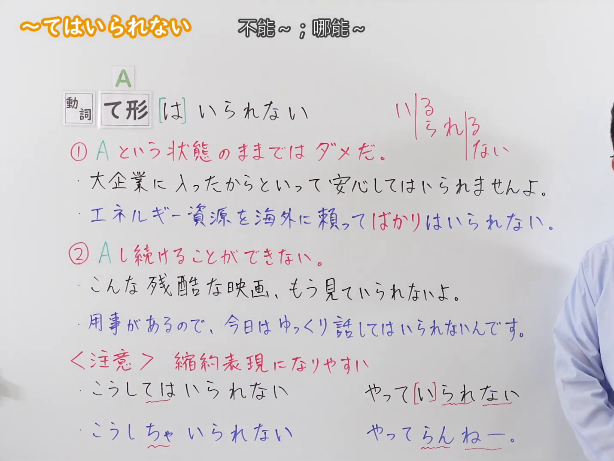
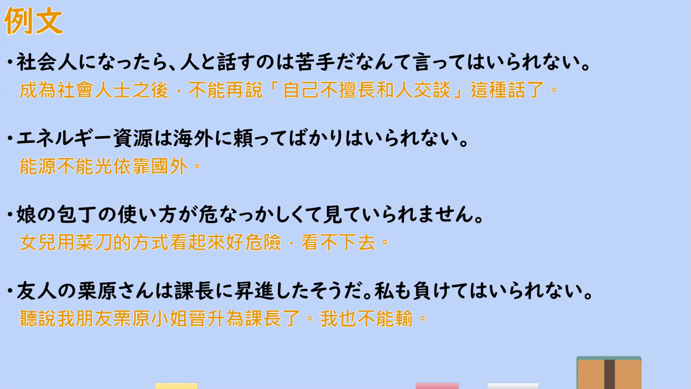

---
{
  "id": "N2-G-0106",
  "kind": "grammar",
  "level": "N2",
  "title": "てはいられない（不能～；哪能～：不能一直处于某状态／无法持续做某动作）",
  "card_revision": 1,
  "schema_version": 1,
  "source": {
    "lesson": "N2 第106个语法",
    "material": "出口日語原视频板书、日语自动字幕与Hagoromo文型检索正文",
    "video": "https://www.youtube.com/watch?v=iYZ0imtji-4",
    "screenshot": "assets/grammar/n2/N2-G-0106-connection.png",
    "screenshot_seconds": 245.0,
    "screenshot_crop": {
      "x": 0,
      "y": 0,
      "width": 1430,
      "height": 1075
    }
  },
  "tags": [
    "避けられない心情・行動",
    "縮約表現",
    "N2"
  ],
  "confusions": [
    "「Vずにはいられない／Vないではいられない」（抑制不住、不由自主地～，指心情自然涌现）",
    "「〜ざるを得ない」（受外部情况所迫不得不～）",
    "「〜わけにはいかない」（出于社会常识或情理不能～）"
  ]
}
---

# N2 第106个语法：～てはいられない（不能～；哪能～）

## 视频学习资料整理

原视频：[出口日語 N2 語法 第106個「～てはいられない」](https://www.youtube.com/watch?v=iYZ0imtji-4)（约 5 分 50 秒）

### 接续图

- 实际时间：4:05（245.0 秒）。
- 原图尺寸：1920×1080；裁切区域：x=0、y=0、宽 1430、高 1075（固定左上角收拢右下角，裁去右侧多余画面）。
- 画面内容：板书记录本课接续「動詞 て形 [は] いられない」及其红色省略标记（れ／られ／ない 可缩约），意味①「A という状態のままではダメだ。」与两条例句（大企業に入ったからといって安心してはいられませんよ／エネルギー資源を海外に頼ってばかりはいられない），意味②「A し続けることができない。」与两条例句（こんな残酷な映画、もう見ていられないよ／用事があるので、今日はゆっくり話してはいられないんです），以及「〈注意〉縮約表現になりやすい」与缩约例（こうしてはいられない／こうしちゃいられない、やって[い]られない／やってらんねー。）。
- 未采用 0:01 的原因：0:01 与 0:14 时老师身体遮住板书右半（①、②的例句行尾与缩约表现），板书不完整；4:05 时老师让开，板书完整可见，故改用该时点。
- 遮挡说明：4:05 画面右缘仅余老师衣袖，板书文字未被遮挡。

### 例句图

- 实际时间：4:22（262.1 秒）。
- 原图尺寸：1920×1080；裁切区域：x=50、y=20、宽 1821、高 1026（裁去视频四周黑边与右侧多余画面）。
- 画面内容：本课「例文」页，四条例句及视频自带中译：「社会人になったら、人と話すのは苦手だなんて言ってはいられない」「エネルギー資源は海外に頼ってばかりはいられない」「娘の包丁の使い方が危なっかしくて見ていられません」「友人の栗原さんは課長に昇進したそうだ。私も負けてはいられない」。

# 核心

## 功能一：不能一直处于 A 的状态

**最上位意味カテゴリー：**

- **Vて（は）いられない：** 考え・感情（想法与感情）

**中位意味カテゴリー：**

- **Vて（は）いられない：** 避けられない心情・行動（无法回避的心情与行动）

**意味：**

- **Vて（は）いられない：** 行動（行动）

**くわしい意味記述：**

- **Vて（は）いられない：** 「〜をしている場合ではない」「〜ができるような状態ではない」という意味を表す。ある状態でい続けるのではなく，急いで他の行動に移さなければならないという意味を持つ。「ぐずぐず/のんびり/うかうかしてはいられない」「…なんて言ってはいられない」「…に負けてはいられない」といった使い方をする。「Vちゃいられない」という言い方や，さらにくだけた話し言葉では「Vてられない」「Vてらんない」という言い方もある。（表示"不是做〜的时候""不是能做〜的状态"。含有不能一直停留在某种状态、必须赶紧转向其他行动之意。有「ぐずぐず／のんびり／うかうかしてはいられない」「…なんて言ってはいられない」「…に負けてはいられない」等用法。此外还有「Vちゃいられない」的说法，在更随便的口语中也有「Vてられない」「Vてらんない」的说法。）

**派生語：** Vてはいられない，Vちゃいられない

### 例句

1. 急ぐので、バスを待ってはいられない。

   （因为赶时间，不能就这么等公交车。）

2. しかし、現実に異物が入ってしまったら、大人でも恥ずかしいなどといってはいられない。

   （但是，现实中一旦异物进到里面，即便是大人也不能再说"难为情"之类的话。）

3. お前さんなんかに、かまっちゃいられないよ。

   （哪有闲工夫搭理你这种人。）

## 功能二：无法持续做 A

**最上位意味カテゴリー：**

- **Vて（は）いられない：** 考え・感情（想法与感情）

**中位意味カテゴリー：**

- **Vて（は）いられない：** 避けられない心情・行動（无法回避的心情与行动）

**意味：**

- **Vて（は）いられない：** 行動（行动）

**くわしい意味記述：**

- **Vて（は）いられない：** 「〜をしている場合ではない」「〜ができるような状態ではない」という意味を表す。ある状態でい続けるのではなく，急いで他の行動に移さなければならないという意味を持つ。「ぐずぐず/のんびり/うかうかしてはいられない」「…なんて言ってはいられない」「…に負けてはいられない」といった使い方をする。「Vちゃいられない」という言い方や，さらにくだけた話し言葉では「Vてられない」「Vてらんない」という言い方もある。（表示"不是做〜的时候""不是能做〜的状态"。含有不能一直停留在某种状态、必须赶紧转向其他行动之意。有「ぐずぐず／のんびり／うかうかしてはいられない」「…なんて言ってはいられない」「…に負けてはいられない」等用法。此外还有「Vちゃいられない」的说法，在更随便的口语中也有「Vてられない」「Vてらんない」的说法。）

**派生語：** Vてはいられない，Vちゃいられない

### 例句

1. かわいそうで見ていられないから、仕事をかわってあげた。

   （因为看着太可怜，实在看不下去，就替他把工作做了。）

2. 心配で心配でね、じっとしていられなくて、外へ出て行っちゃったよ。

   （担心得不得了，实在待不住，就跑到外面去了。）

3. 静かに待っちゃいられない。

   （没法安安静静地等着。）

# 来源

- [出口日語 N2 語法 第106個「～てはいられない」](https://www.youtube.com/watch?v=iYZ0imtji-4)
- [Hagoromo 文型検索「Vて（は）いられない」「Vちゃいられない」](https://hagoromo-text.work/lookup?text=%E3%81%84%E3%82%89%E3%82%8C%E3%81%AA%E3%81%84&mode=partial)（查询日期：2026-09-23；该检索返回两条条目全文与例句）
- 两条条目互为对方的派生語，属同一功能（意味均为「行動」），已合并；「くわしい意味記述」取自「Vて（は）いられない」条目，例句取自这两条条目。
