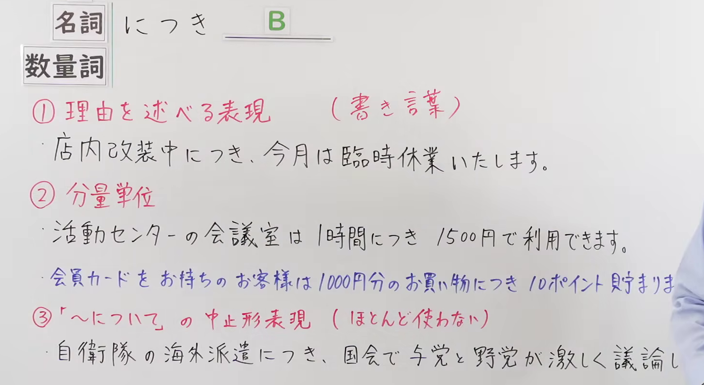
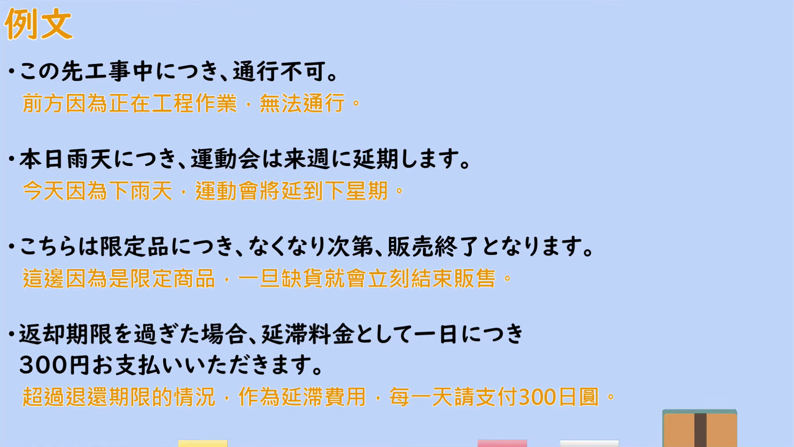

---
{
  "id": "N2-G-0107",
  "kind": "grammar",
  "level": "N2",
  "title": "につき（因為～；每～：陈述理由・分量单位・「〜について」的中止形说法）",
  "card_revision": 1,
  "schema_version": 1,
  "source": {
    "lesson": "N2 第107个语法",
    "material": "出口日語原视频板书、日语自动字幕与Hagoromo文型检索正文",
    "video": "https://www.youtube.com/watch?v=VGQ6KuiZKKA",
    "screenshot": "assets/grammar/n2/N2-G-0107-connection.png",
    "screenshot_seconds": 100.0,
    "screenshot_crop": {
      "x": 70,
      "y": 190,
      "width": 1460,
      "height": 800
    }
  },
  "tags": [
    "原因・理由",
    "単位あたり",
    "対象・中止形",
    "N2"
  ],
  "confusions": [
    "「〜ので／〜から」（口语中的理由表达；「〜につき」的理由用法属书面语）",
    "「〜について」（表示对象、主题；与本课两条例目形态相近但功能不同）",
    "「〜ごとに／〜あたり」（表示「每～」的口语说法，与「数量詞＋につき」同义）"
  ]
}
---

# N2 第107个语法：～につき（因為～；每～）

## 视频学习资料整理

原视频：[出口日語 N2 語法 第107個「～につき」](https://www.youtube.com/watch?v=VGQ6KuiZKKA)（约 5 分 48 秒）

### 接续图

- 实际时间：1:40（100.0 秒）。
- 原图尺寸：1920×1080；裁切区域：x=70、y=190、宽 1460、高 800（按板书实际内容范围裁切，去掉右侧多余画面）。
- 画面内容：板书记录本课接续「名詞／数量詞＋につき B」、用法①「理由を述べる表現（書き言葉）」与例句「店内改装中につき、今月は臨時休業いたします。」、用法②「分量単位」与例句「活動センターの会議室は 1時間につき 1500円で利用できます。」「会員カードをお持ちのお客様は 1000円分のお買い物につき 10ポイント貯まりま…」、用法③「『〜について』の中止形表現（ほとんど使わない）」与例句「自衛隊の海外派遣につき、国会で与党と野党が激しく議論し…」。
- 未采用 0:01 的原因：0:01 时老师身体遮住②的第一条例句行尾（「利用でき…」）以及②③例句的行尾，板书不完整；1:40 的板书可见范围最大，故改用该时点。
- 遮挡说明：1:40 镜头已推近，橙色标题行（因為～；每～）不在画面内；② 第二条例句末尾「ます。」与 ③ 例句末尾「ている。」被老师面部遮挡。

### 例句图

- 实际时间：4:11（251.7 秒）。
- 原图尺寸：1920×1080；裁切区域：x=50、y=20、宽 1821、高 1026（裁去视频四周黑边与右侧多余画面）。
- 画面内容：本课「例文」页，四条例句及视频自带中译：「この先工事中につき、通行不可」「本日雨天につき、運動会は来週に延期します」「こちらは限定品につき、なくなり次第、販売終了となります」「返却期限を過ぎた場合、延滞料金として一日につき 300円お支払いいただきます」。

# 核心

## 功能一：陈述理由（书面语）

**最上位意味カテゴリー：**

- **につき：** ものごとの関係（事物之间的关系）

**中位意味カテゴリー：**

- **につき：** 原因・理由（原因与理由）

**意味：**

- **につき：** 根拠（依据）

**くわしい意味記述：**

- **につき：** 「〜なので」という理由を表す表現。改まった表現で，掲示や文書などで用いられる。（表示"因为〜"的理由。属于较正式的表达，用于告示、文书等。）

**派生語：** 未列出

### 例句

1. 本日は定休日につき、休業いたします。

   （今天因定休日，暂停营业。）

2. 我々は、国連安全保障理事会決議六八八に違反してとられたイラク内のすべての人々に対する抑圧的な行為につきイラク政権に対して警告を発する。

   （我们针对伊拉克政权违反联合国安理会第688号决议、对伊拉克国内全体民众采取的压制行为，向该政权发出警告。）

3. すると、さっそく脳を容れるガラスの容器が、モースのもとへ送られてきたので、彼は研究所の理事に対して、ご請求の品は今なお使用中につき、いずれ用済みのうえ献上したい、と書き送ったという。

   （于是，用来盛放大脑的玻璃容器很快被送到了莫尔斯那里，他便写信答复研究所的理事说：您索要的物品目前仍在使用，待用毕后再献上。）

## 功能二：分量单位（每～）

**最上位意味カテゴリー：**

- **につき：** ものごとの関係（事物之间的关系）

**中位意味カテゴリー：**

- **につき：** 関連・対応（关联与对应）

**意味：**

- **につき：** 対応（对应）

**くわしい意味記述：**

- **につき：** 「名詞や数字で表された単位に対応して」という意味を表す。（表示"与名词或数字所表示的单位相对应"。）

**派生語：** について

### 例句

1. １か月につき５万円を払うこととする。

   （每月支付 5 万日元。）

2. 「ホテル税」は、宿泊料金が一万円以上のホテルや旅館の利用者に対し、一泊につき百円を課税、税収は年間十三億円となる。

   （"酒店税"是对住宿费在 1 万日元以上的酒店、旅馆的利用者按每晚 100 日元征税，税收每年达 13 亿日元。）

3. 就業者の作業時間は、１日につき８時間、１週間につき４０時間であり、原則として土曜日及び日曜日が休日となっている。

   （从业者的劳动时间为每天 8 小时、每周 40 小时，原则上周六、周日为休息日。）

## 功能三：「〜について」的中止形表现（几乎不使用）

**最上位意味カテゴリー：**

- **について（につき）：** ものごとの関係（事物之间的关系）

**中位意味カテゴリー：**

- **について（につき）：** 関連・対応（关联与对应）

**意味：**

- **について（につき）：** 対応（对应）

**くわしい意味記述：**

- **について（につき）：** 発言・思考・調査などの対象を表す。（表示发言、思考、调查等的对象。）

**派生語：** についての，については，についても，につき

### 例句

1. Ａ社の業績につき、ご報告いたします。

   （就 A 公司的业绩，向您汇报。）

2. 大臣および総裁は、ロシアの代表とも会合し、ロシアの改革プログラムにつき議論した。

   （大臣和总裁还与俄罗斯代表会面，就俄罗斯的改革方案进行了讨论。）

3. 彼らは、安定的で永続的な為替レートの関係を回復することの重要性につき合意した。

   （他们就恢复稳定而持久的汇率关系的重要性达成了一致。）

# 来源

- [出口日語 N2 語法 第107個「～につき」](https://www.youtube.com/watch?v=VGQ6KuiZKKA)
- [Hagoromo 文型検索「につき」](https://hagoromo-text.work/lookup?text=%E3%81%AB%E3%81%A4%E3%81%8D&mode=full)（查询日期：2026-09-23；该检索返回两条例目全文与例句）
- [Hagoromo 文型検索「について」](https://hagoromo-text.work/lookup?text=%E3%81%AB%E3%81%A4%E3%81%84%E3%81%A6&mode=full)（查询日期：2026-09-23）
- 「につき」的两条例目同形但功能不同（一条表示原因・理由，一条表示関連・対応），分别作为功能一与功能二的依据。功能三对应板书第③项「『〜について』の中止形表現」，Hagoromo 未为这一用法单列「につき」条目，故采用「について」条目（其派生語明确列出「につき」，且例句含「Ａ社の業績につき、ご報告いたします。」），字段数值与例句均取自该条目。
