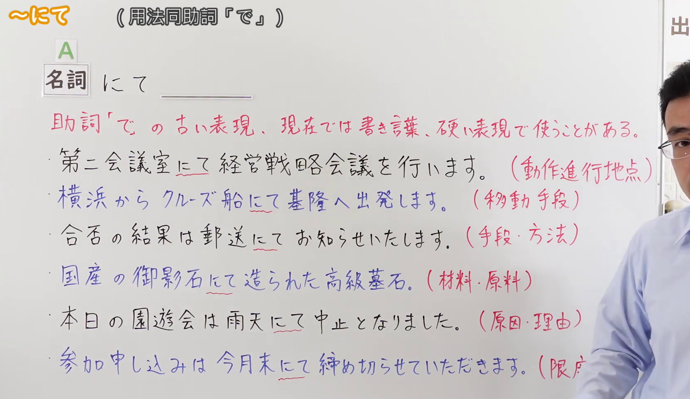
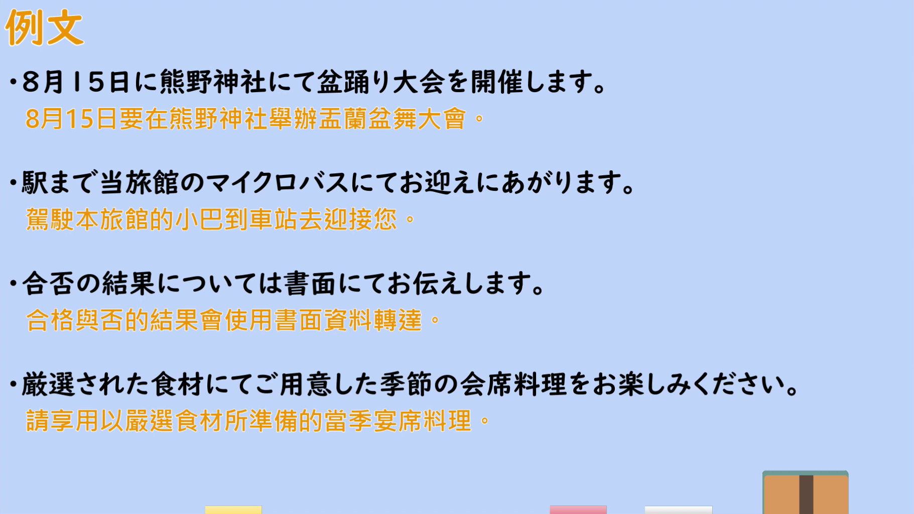

---
{
  "id": "N2-G-0108",
  "kind": "grammar",
  "level": "N2",
  "title": "にて（用法同助詞「で」：動作進行地点／移動手段／手段・方法／材料・原料／原因・理由／限度）",
  "card_revision": 1,
  "schema_version": 1,
  "source": {
    "lesson": "N2 第108个语法",
    "material": "出口日語原视频板书、日语自动字幕与日语教学网站正文（毎日のんびり日本語教師、nihon5-bunka、Indeed 日语用法解说）",
    "video": "https://www.youtube.com/watch?v=H2hqQHoFmdI",
    "screenshot": "assets/grammar/n2/N2-G-0108-connection.png",
    "screenshot_seconds": 150.0,
    "screenshot_crop": {
      "x": 25,
      "y": 25,
      "width": 1675,
      "height": 970
    }
  },
  "tags": [
    "書き言葉",
    "格助詞（で）",
    "ビジネス文書",
    "N2"
  ],
  "confusions": [
    "「〜で」（同义的口语与通用形式；「にて」是其较生硬、书面化的说法）",
    "「〜をもって」（同样表示手段或时间界限的书面语，语感更硬、更正式，如「本日をもって閉店します」）",
    "「〜によって」（表示手段、原因的书面语，接续与用法不同）"
  ]
}
---

# N2 第108个语法：～にて（用法同助詞「で」）

## 视频学习资料整理

原视频：[出口日語 N2 語法 第108個「～にて」](https://www.youtube.com/watch?v=H2hqQHoFmdI)（约 4 分 49 秒）

### 接续图

- 实际时间：2:30（150.0 秒）。
- 原图尺寸：1920×1080；裁切区域：x=25、y=25、宽 1675、高 970（按板书实际内容范围裁切，去掉右侧多余画面）。
- 画面内容：板书记录标题「～にて（用法同助詞「で」）」、接续「名詞＋にて」、红色意味说明「助詞「で」の古い表現、現在では書き言葉、硬い表現で使うことがある。」，以及六条带用法标注的例句：第二会議室にて経営戦略会議を行います。（動作進行地点）／横浜からクルーズ船にて基隆へ出発します。（移動手段）／合否の結果は郵送にてお知らせいたします。（手段・方法）／国産の御影石にて造られた高級墓石。（材料・原料）／本日の園遊会は雨天にて中止となりました。（原因・理由）／参加申し込みは今月末にて締め切らせていただきます。（限度）。
- 未采用 0:11 的原因：0:11 时红色意味说明的末尾「使うことがある。」与部分例句行尾被老师头部遮挡；2:30 时板书完整可见，故改用该时点。
- 遮挡说明：2:30 时第六条例句的用法标注「（限度）」的右括号被老师肩部遮挡，其余板书内容完整。

### 例句图

- 实际时间：3:36（216.1 秒）。
- 原图尺寸：1920×1080；裁切区域：x=50、y=20、宽 1821、高 1026（裁去视频四周黑边与右侧多余画面）。
- 画面内容：本课「例文」页，四条例句及视频自带中译：「8月15日に熊野神社にて盆踊り大会を開催します」「駅まで当旅館のマイクロバスにてお迎えにあがります」「合否の結果については書面にてお伝えします」「厳選された食材にてご用意した季節の会席料理をお楽しみください」。

# 核心

## 功能一：動作進行地点（动作进行的场所）

**くわしい意味記述：**

- **にて：** ①物事が発生した場所。（①事物发生的地点。）

### 例句

1. 予約は店頭にて承っております。

   （预约在门店受理。）

2. イベントは駅前中央広場にて行います。

   （活动在车站前中央广场举行。）

3. それでは明日会場にてお待ちしております。

   （那么，明天在会场恭候各位。）

## 功能二：移動手段（移动手段）

**くわしい意味記述：**

- **にて：** 「会場にて実施します」「電車にて帰宅します」のように使われる「にて」は、名詞に付いて使われる格助詞の1つです。（像「会場にて実施します」「電車にて帰宅します」这样使用的「にて」，是接在名词后使用的格助词之一。）

### 例句

1. 電車にて向かいます。

   （乘电车前往。）

2. 電車にて帰宅します。

   （乘电车回家。）

3. 徒歩にて参ります。

   （我徒步过去。）

## 功能三：手段・方法（手段、方法）

**くわしい意味記述：**

- **にて：** ②手段・方法・材料（②手段、方法、材料）

### 例句

1. お電話もしくはインターネット予約にて受付しております。

   （我们接受电话或网络预约。）

2. 席の状況は電話にて確認いただけると状況をお伝えできます。

   （座位情况可通过电话确认，我们会告知最新状况。）

3. ご予約は随時、先着順にて受け付けております。

   （预约随时受理，按先到先得的顺序。）

## 功能四：材料・原料（材料、原料）

**くわしい意味記述：**

- **にて：** 材料を示す場合は、「この文机（ふづくえ）は高級なヒノキにて製作しています」のように使用できます。（表示材料时，可以像「这张书桌是用高档桧木制作的」这样使用。）

### 例句

1. この製品は地球の環境に配慮した再生可能な原材料にて作っております。

   （本产品使用顾及地球环境的可再生原材料制造。）

2. この文机（ふづくえ）は高級なヒノキにて製作しています。

   （这张书桌使用高档桧木制作。）

3. 国産の御影石にて造られた高級墓石。

   （使用日本国产御影石打造的高级墓碑。）

## 功能五：原因・理由（原因、理由）

**くわしい意味記述：**

- **にて：** 「にて」には、何かの原因や理由を示す役割もあります。（「にて」也有表示某种原因或理由的作用。）

### 例句

1. 父の急病にて業務を早退します。

   （因父亲急病，提前下班。）

2. 原料高騰の影響にて値上げを実施する予定です。

   （因原材料价格高涨的影响，计划实施涨价。）

3. 顧客からの要望にて、仕様を変更しました。

   （应客户要求，变更了规格。）

## 功能六：限度（限度、时间范围的终点）

**くわしい意味記述：**

- **にて：** ③時間的な範囲の終わり（③时间范围的终点）

### 例句

1. これにて終了。

   （到此结束。）

2. 申し込みは１０月２６日にて締め切らせていただきます。

   （申请截止到 10 月 26 日。）

3. 当店は本日にて閉店となります。

   （本店将于今日闭店。）

# 来源

- [出口日語 N2 語法 第108個「～にて」](https://www.youtube.com/watch?v=H2hqQHoFmdI)
- [毎日のんびり日本語教師「～にて」](https://mainichi-nonbiri.com/grammar/n3-nite/)（查询日期：2026-09-23；「解説」的①与②用于功能一、功能三，「くわしい意味記述」与例句均取自该页）
- [nihon5-bunka「日本語の文法・例文：JLPT N2 ～にて」](https://nihon5-bunka.net/japanese-grammar-intermediate-nite/)（查询日期：2026-09-23；功能六的第三条例句取自该页「3. 時間」）
- [Indeed キャリアガイド「【例文付き】「にて」の使い方をマスターしよう！5つの意味を解説」](https://jp.indeed.com/career-advice/career-development/how-to-use-at)（查询日期：2026-09-23；功能二、四、五的「くわしい意味記述」与例句取自该页）
- 处理说明：Hagoromo 未收录「にて」（整词与部分匹配均无条目），故按流程依次查询三个备选网站；第一站（毎日のんびり）与第二站（nihon5-bunka）有直接对应条目，其未涵盖的「移動手段」「材料・原料」「原因・理由」用法由互联网检索所得的日语用法解说页面补足。所选来源把「手段・方法・材料」归并为一类，故功能二、三、四的释义文字分别取自各来源中提及该用法的原文。
- 学习者指定补充：功能四的第三条例句「国産の御影石にて造られた高級墓石。」取自本课板书。该组在全部来源中只找到 2 条网页例句（Indeed 页面），不足以满足每功能 3 条例句，故按学习者要求补入板书例句。
