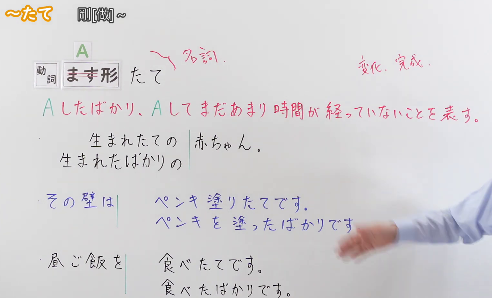
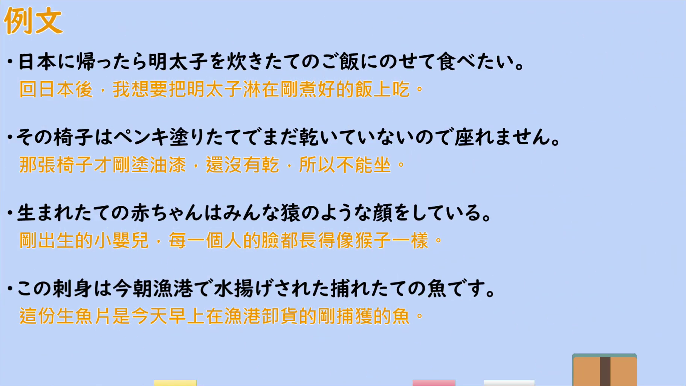

---
{
  "id": "N2-G-0109",
  "kind": "grammar",
  "level": "N2",
  "title": "たて(立て)（剛[做]～：Aしたばかり、Aしてまだあまり時間が経っていない）",
  "card_revision": 1,
  "schema_version": 1,
  "source": {
    "lesson": "N2 第109个语法",
    "material": "出口日語原视频板书、日语自动字幕与毎日のんびり日本語教師正文",
    "video": "https://www.youtube.com/watch?v=uIAYPsMaJN8",
    "screenshot": "assets/grammar/n2/N2-G-0109-connection.png",
    "screenshot_seconds": 91.1,
    "screenshot_crop": {
      "x": 30,
      "y": 20,
      "width": 1530,
      "height": 930
    }
  },
  "tags": [
    "たばかりと類義",
    "接尾辞",
    "N2"
  ],
  "confusions": [
    "「〜たばかり」（同样表示时间间隔短，但可接「食べる」等非变化动词，也没有「新鲜、正面」的限制）",
    "「〜たところ」（表示动作刚刚结束的时点，侧重时间点）",
    "「〜ほやほや」（口语中表示「刚出炉」的说法，如「できたてホヤホヤ」）"
  ]
}
---

# N2 第109个语法：～たて(立て)（剛[做]～）

## 视频学习资料整理

原视频：[出口日語 N2 語法 第109個「～たて」](https://www.youtube.com/watch?v=uIAYPsMaJN8)（约 4 分 17 秒）

### 接续图

- 实际时间：1:31（91.1 秒）。
- 原图尺寸：1920×1080；裁切区域：x=30、y=20、宽 1530、高 930（按板书实际内容范围裁切，去掉右侧多余画面）。
- 画面内容：板书记录标题「～たて」「剛[做]～」、接续「動詞 ます形＋たて」及红色批注「～名詞。」「変化・完成」、红色意味说明「Aしたばかり、Aしてまだあまり時間が経っていないことを表す。」，以及三组与「～たばかり」的对照板书（生まれたての／生まれたばかりの 赤ちゃん。／その壁は ペンキ塗りたてです。／ペンキを塗ったばかりです。／昼ご飯を 食べたてです。／食べたばかりです。）。
- 未采用 0:01 的原因：0:01 时老师头部遮住红色意味说明的末尾（「表す。」）与部分例句行尾，板书不完整；1:31 时板书完整可见，故改用该时点。
- 遮挡说明：1:31 画面右侧与右下方仅余老师手臂，板书文字未被遮挡。

### 例句图

- 实际时间：2:52（171.8 秒）。
- 原图尺寸：1920×1080；裁切区域：x=50、y=20、宽 1821、高 1026（裁去视频四周黑边与右侧多余画面）。
- 画面内容：本课「例文」页，四条例句及视频自带中译：「日本に帰ったら明太子を炊きたてのご飯にのせて食べたい」「その椅子はペンキ塗りたてでまだ乾いていないので座れません」「生まれたての赤ちゃんはみんな猿のような顔をしている」「この刺身は今朝漁港で水揚げされた捕れたての魚です」。

# 核心

## 功能一：表示刚做了 A、做完 A 还没过多久

**くわしい意味記述：**

- **たて：** 動ます形に接続して、「～たばかり」と同じ意味を表します。特に新鮮な状態や新しい状態であることを表すので、良い意味だけに使えます。なお、「～たて」は名詞として扱います。この文法は新鮮さがなければ使えません。また「壊す」等のマイナス表現にも使えません。（接在动词ます形后，表示与「～たばかり」相同的意思。由于它特别表示新鲜、崭新的状态，所以只能用于正面的意思。另外，「～たて」按名词处理。这个语法如果没有"新鲜感"就不能使用，也不能用于「壊す」等负面表达。）

### 例句

1. できたての料理は一番おいしい。

   （刚做好的饭菜最好吃。）

2. 先輩には高校に入りたての頃から仲良くしてもらっていた。

   （我从刚进高中时起就受到学长的照顾。）

3. 洗いたてのタオルを使うと気持ちいい。

   （使用刚洗好的毛巾感觉很舒服。）

4. 干したての布団の匂いが好き。

   （我喜欢刚晒好的被子的味道。）

# 来源

- [出口日語 N2 語法 第109個「～たて」](https://www.youtube.com/watch?v=uIAYPsMaJN8)
- [毎日のんびり日本語教師「～たて／たての」](https://mainichi-nonbiri.com/grammar/n2-tate/)（查询日期：2026-09-23；「くわしい意味記述」与例句均取自该页的「解説」「備考」和例文）
- 处理说明：Hagoromo 未收录「たて」（整词与部分匹配均无条目），故按流程依次查询三个备选网站；第一站（毎日のんびり）即有直接对应本课语法的条目，按优先级采用该站，无需继续后续站点。
