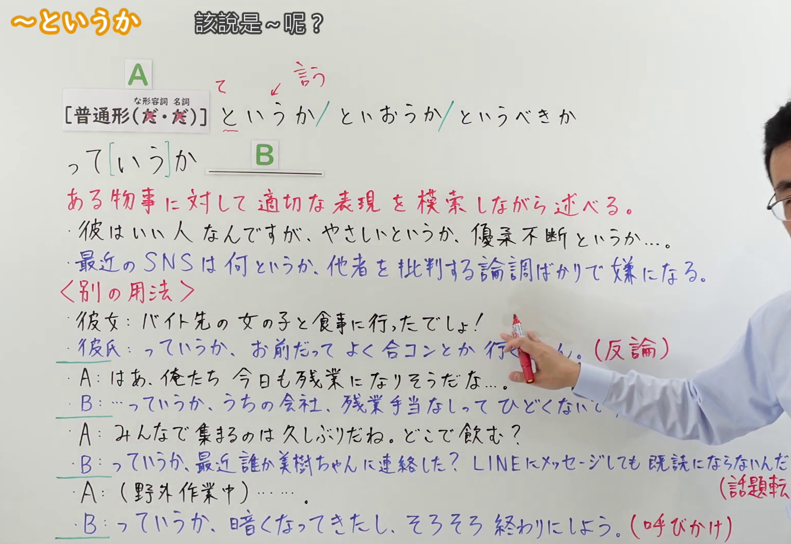
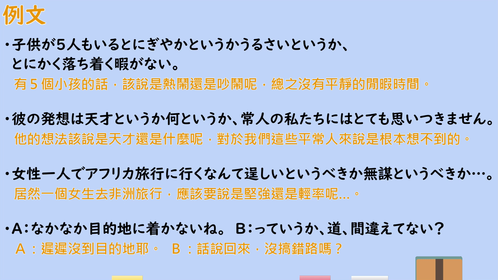

---
{
  "id": "N2-G-0110",
  "kind": "grammar",
  "level": "N2",
  "title": "というか（該説是～呢？：AというかBというか／文頭の「ていうか」）",
  "card_revision": 1,
  "schema_version": 1,
  "source": {
    "lesson": "N2 第110个语法",
    "material": "出口日語原视频板书、日语自动字幕与日语教学网站正文（日本語教師のN1et、光村図書「っていうか」）",
    "video": "https://www.youtube.com/watch?v=lnAc-NAZwc8",
    "screenshot": "assets/grammar/n2/N2-G-0110-connection.png",
    "screenshot_seconds": 240.0,
    "screenshot_crop": {
      "x": 25,
      "y": 20,
      "width": 1535,
      "height": 1055
    }
  },
  "tags": [
    "言い換え",
    "話し言葉",
    "N2"
  ],
  "confusions": [
    "「〜というより」（N3；比较两者并倾向于后者）",
    "「〜かというと」（提示话题并给出说明、判断）",
    "「〜とか〜とか」（并列列举，不含「摸索恰当说法」的语气）"
  ]
}
---

# N2 第110个语法：～というか（該説是～呢？）

## 视频学习资料整理

原视频：[出口日語 N2 語法 第110個「～というか」](https://www.youtube.com/watch?v=lnAc-NAZwc8)（约 7 分 47 秒）

### 接续图

- 实际时间：4:00（240.0 秒）。
- 原图尺寸：1920×1080；裁切区域：x=25、y=20、宽 1535、高 1055（按板书实际内容范围裁切，去掉右侧多余画面）。
- 画面内容：板书记录标题「～というか」「該説是～呢？」、接续「［普通形（だ・だ）］というか／といおうか／というべきか」与「っ［いう］が」、红色意味说明「ある物事に対して適切な表現を模索しながら述べる。」、基本用法两条例句（彼はいい人なんですが、やさしいというか、優柔不断というか…。／最近のSNSは何というか、他者を批判する論調ばかりで嫌になる。），以及〈別の用法〉的四组对话例句及其标注：（反論）（意見表明）（話題転換）（呼びかけ）。
- 未采用 0:01 的原因：0:01 时老师身体遮住板书右半（红色意味说明的尾部、例句行尾与〈別の用法〉的标注）；4:00 的板书可见范围最大，故改用该时点。
- 遮挡说明：4:00 时老师衣袖遮住第二组对话末尾「すか？」与其标注「（意見表明）」，第三组标注「（話題転換）」的右括号略被遮挡，其余板书内容完整。

### 例句图

- 实际时间：6:06（365.6 秒）。
- 原图尺寸：1920×1080；裁切区域：x=50、y=20、宽 1821、高 1026（裁去视频四周黑边与右侧多余画面）。
- 画面内容：本课「例文」页，四条例句及视频自带中译：「子供が5人もいるとにぎやかというかうるさいというか、とにかく落ち着く暇がない」「彼の発想は天才というか何というか、常人の私たちにはとても思いつきません」「女性一人でアフリカ旅行に行くなんて逞しいというか無謀というか…」「A:なかなか目的地に着かないね。B:っていうか、道、間違えてない？」。

# 核心

## 功能一：ある物事に対して適切な表現を模索しながら述べる（对某事物一边摸索恰当的表达一边叙述）

**くわしい意味記述：**

- **というか：** １．Xと言うのが妥当なのか、Yと言うのが妥当なのか考えながら発話する時に用いる。２．後件は会話ではよく省かれる。また、話者の言いたいことは後ろの方にある事が多い。３．二つ目の「というか」を省いて文を作ることもできる。日常使う場合、省かれる事の方が多い。４．「というか」の代わりに「ていうか」という形も用いられる。５．「～というか何というか」という形もある。６．聞くことは少ないが、「というか」を三回以上使うこともある。（1．用于一边思考"说成 X 妥当、还是说成 Y 妥当"一边发话的场合。2．后半句在会话中常被省略，而且说话人真正想说的内容多在后半。3．也可以省去第二个「というか」来造句，日常使用中省去的反而更多。4．也有用「ていうか」代替「というか」的形式。5．还有「～というか何というか」的形式。6．虽然不太听得到，也有把「というか」用三次以上的情况。）

### 例句

1. 彼と別れてうれしいというか寂しいというか、よくわかりません。

   （和他分手，说是高兴还是寂寞，我自己也说不清。）

2. 日本の生活は楽しいというか大変というか、とにかく色々な事があって説明できない。

   （在日本的生活，说是愉快还是辛苦，总之事太多，无法用一句话说明。）

3. 風貌というか雰囲気というか、彼の落ち着きは高校生には見えない。

   （该说是相貌还是气质呢，他的沉稳看起来不像高中生。）

4. 彼の言動は猛々しいというか、荒々しいというか、だけど一生懸命さに皆を惹きつける魅力がある。

   （他的言行，说是勇猛也好、粗犷也好，但那股拼劲有吸引大家的魅力。）

## 功能二：文頭の「ていうか」で反論・意見表明・話題転換・呼びかけを示す（用句首的「ていうか」表示反驳、表明意见、转换话题、招呼）

**くわしい意味記述：**

- **というか：** 「というか」は「というよりも」「それよりも」「そんなことよりも」という意味の言葉としても使える。これは会話ではよく「ていうか」、さらに俗語的になるが「っていうか」「ってか」「つーか」となる。（「というか」也可以作为表示「というよりも」「それよりも」「そんなことよりも」之意的词使用。会话中常说成「ていうか」，更俚俗的说法是「っていうか」「ってか」「つーか」。）

### 例句

1. あの有名な歌手に会えるなんて、恐縮しちゃうというか、感激だ。

   （能见到那位有名的歌手，与其说是惶恐，不如说是感激。）

2. ダイヤモンドヘッドに行って日の出を見る予定、というか見るぞ。

   （计划去钻石头山看日出——应该说，一定要去看！）

3. 「っていうか、これ、おいしい！」

   （「话说回来，这个很好吃！」）

4. 「っていうか、これでいいんじゃないですか？」

   （「话说，这样不就可以了吗？」）

# 来源

- [出口日語 N2 語法 第110個「～というか」](https://www.youtube.com/watch?v=lnAc-NAZwc8)
- [日本語教師のN1et「JLPT文法解説：というか N2」](https://jn1et.com/toiuka-n2/)（查询日期：2026-09-23；两个功能的「くわしい意味記述」取自该页「意味・使い方」，功能一、二各两条例句取自该页例文）
- [光村図書「っていうか」（森山卓郎）](https://www.mitsumura-tosho.co.jp/download_file/view/fbe9e402-f611-4cbc-92bc-1ed0c8a83f5c/1380)（查询日期：2026-09-23；功能二后两条例句取自该文例句）
- 处理说明：Hagoromo 未收录「というか」（整词与部分匹配均无条目），三个备选网站也检索不到对应条目，故按流程进入互联网检索，采用上列两个直接对应本课语法、含日文说明与实际例句的页面。板书的〈別の用法〉列出反論・意見表明・話題転換・呼びかけ四类，所选页面把这一用法概括为「というよりも／それよりも／そんなことよりも」及句首的「ていうか」，与板书对应一致。
