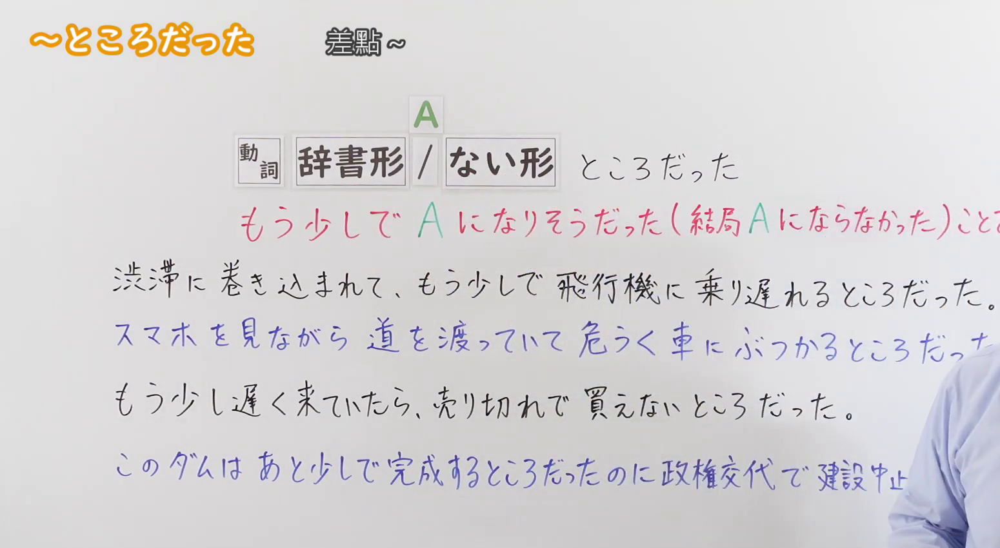
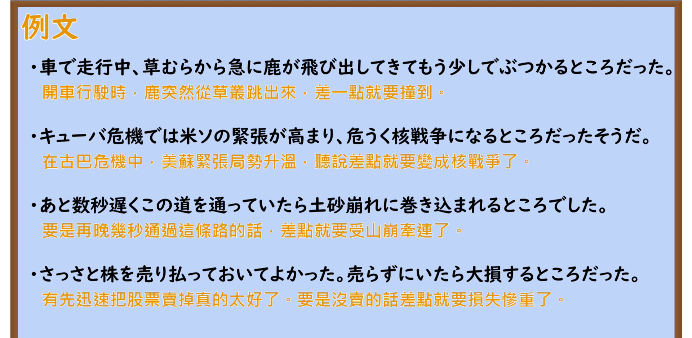

---
{
  "id": "N2-G-0111",
  "kind": "grammar",
  "level": "N2",
  "title": "～ところだった：差一点就……／险些……",
  "card_revision": 1,
  "schema_version": 1,
  "source": {
    "lesson": "N2 第111个语法",
    "material": "出口日語原视频板书、日语自动字幕与Hagoromo・毎日のんびり日本語教師正文",
    "video": "https://www.youtube.com/watch?v=RvLZp9fVulU",
    "screenshot": "assets/grammar/n2/N2-G-0111-connection.png",
    "screenshot_seconds": 14,
    "screenshot_crop": {
      "x": 0,
      "y": 0,
      "width": 1550,
      "height": 850
    }
  },
  "tags": [
    "ところだった",
    "時間的前後",
    "N2"
  ],
  "confusions": [
    "～そうになる（表示眼看就要发生某事，但实际未成；侧重动作过程濒临发生）",
    "～（る）ところだ（表示正要开始做某事）",
    "～たところだ（表示刚做完某事）"
  ]
}
---

# N2 第111个语法：～ところだった

# 视频学习资料整理

- 原视频：[出口日語「～ところだった」](https://www.youtube.com/watch?v=RvLZp9fVulU)
- 接续图：00:14.00；原图 1920×1080；裁切区域 `x=0, y=0, width=1550, height=850`。0:01 时老师鞠躬行礼且身体遮挡板书后半部与例句，故选取老师退至右侧、板书完整的第14秒画面；固定左上角，裁去右侧人物主体及底部空白，完整保留接续形式、红色含义说明与板书例句。
- 例句图：03:51.33；原图 1920×1080；裁切区域 `x=0, y=0, width=1920, height=940`。固定左上角，裁去底部多余边框与杂物，完整保留4条例句及中文翻译。

# 核心

## 功能一：差一点就要变成 A（结果并没有变成 A）

**最上位意味カテゴリー：**

- **るところだった：** 場所・時間（场所与时间）

**中位意味カテゴリー：**

- **るところだった：** 時間的前後（时间的前后）

**意味：**

- **るところだった：** 時間的前後（时间的前后）

**くわしい意味記述：**

- **るところだった：** 「もうすこしで」「あやうく」などがついて，よくないことがおこる可能性があったことを表す。（常接「もうすこしで」「あやうく」等词，表示险些发生不良事态的可能。）

**派生語：** 未列出

### 例句

1. 怪しい電話が掛かってきて、もう少しでだまされるところだった。

   （接到可疑的电话，差一点就被骗了。）

2. 赤信号を無視した車が走ってきて、危ないところだった。

   （闯红灯的车冲了过来，险些遭遇危险。）

3. 教えてくれなかったらまた忘れるところだった。

   （要是你没提醒我，我差点又忘了。）

4. 天気が良くてのんびり歩いていたら、もう少しで電車に乗り遅れるところだった。

   （天气很好一边悠闲地散步，差点没赶上电车。）

5. 目覚まし設定し忘れて、あやうく寝過ごすところだった。

   （忘了定闹钟，差一点就睡过头了。）

# 来源

- [出口日語原视频](https://www.youtube.com/watch?v=RvLZp9fVulU)
- [Hagoromo 文型检索「るところだった」](https://www.hagoromo-text.work/)（查询日期：2026-09-23，用于最上位・中位意味カテゴリー、意味、くわしい意味記述、派生語及作例）
- [毎日のんびり日本語教師「【Ｎ２文法】～ところだった」](https://mainichi-nonbiri.com/grammar/n2-tokorodatta/)（查询日期：2026-09-23，用于补充用例）
