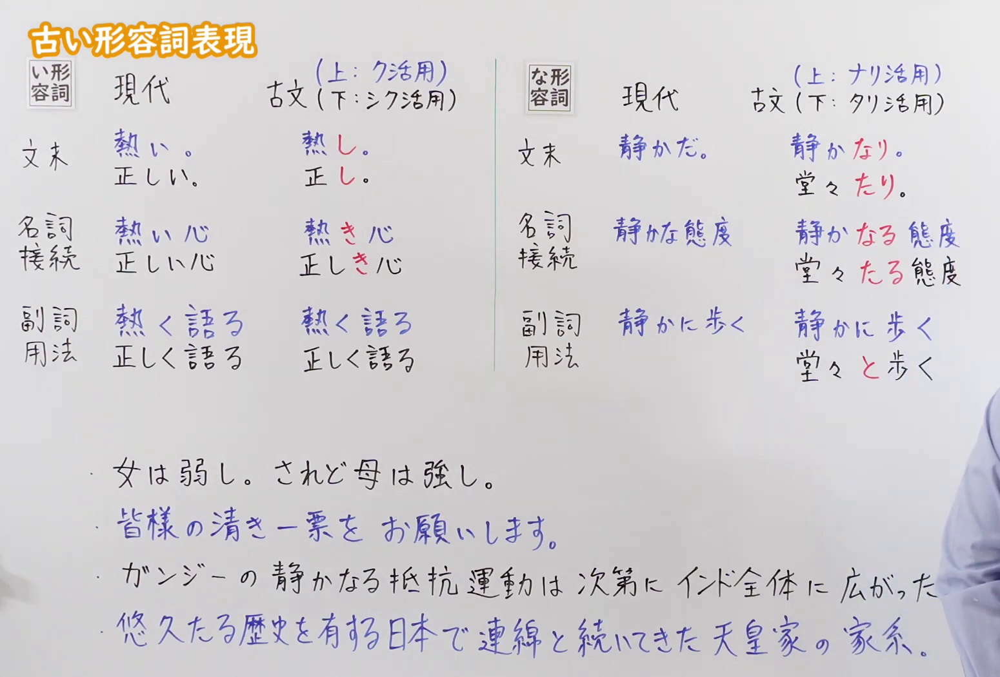
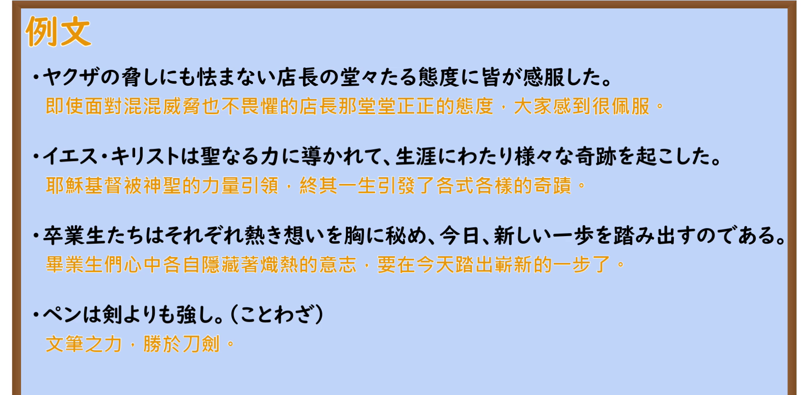

---
{
  "id": "N2-G-0112",
  "kind": "grammar",
  "level": "N2",
  "title": "～たる・～なる・～き・～し（古い形容詞表現）：古代形容词在现代日语中的残留表达",
  "card_revision": 1,
  "schema_version": 1,
  "source": {
    "lesson": "N2 第112个语法",
    "material": "出口日語原视频板书、日语自动字幕与大修館書店国語メディア記事正文",
    "video": "https://www.youtube.com/watch?v=OJZ7kCEinFI",
    "screenshot": "assets/grammar/n2/N2-G-0112-connection.png",
    "screenshot_seconds": 10,
    "screenshot_crop": {
      "x": 0,
      "y": 0,
      "width": 1550,
      "height": 1050
    }
  },
  "tags": [
    "古い形容詞表現",
    "文語表現",
    "N2"
  ],
  "confusions": [
    "～たるもの（表示“作为……理应……”的资格/义务，属于 N1 文法句型）",
    "～になる（动词“变得……”，表示状态变化）",
    "～し～し（助词“既……又……”，表示列举或原因）"
  ]
}
---

# N2 第112个语法：～たる・～なる・～き・～し（古い形容詞表現）

# 视频学习资料整理

- 原视频：[出口日語「【Ｎ２文法】～たる・～なる・～き・～し（古い形容詞表現）」](https://www.youtube.com/watch?v=OJZ7kCEinFI)
- 接续图：00:10.00；原图 1920×1080；裁切区域 `x=0, y=0, width=1550, height=1050`。0:01 时老师鞠躬行礼且身体遮挡右侧な形容词板块与第4条例句尾部，故选取老师退至右侧、板书完整的第10秒画面；固定左上角，裁去右侧人物主体及边缘空白，完整保留い形容词与な形容词的现代・古文对比表、红色活用变化及4条板书例句。
- 例句图：08:15.17（495.17秒）；原图 1920×1080；裁切区域 `x=0, y=0, width=1920, height=940`。固定左上角，裁去底部多余边框与杂物，完整保留4条例句及中文翻译。

# 核心

## 功能一：古典日语残留的形容词与形容动词表现（用于硬体文章、格言谚语与惯用修饰）

**くわしい意味記述：**

- **～たる（な形容詞・タリ活用連体形）：** 「状態語＋と」に動詞「あり」が融合して出来た古文の形容動詞（タリ活用）の連体形。現代語でも「確固たるアリバイ」「堂々たる態度」「惨憺たる結果」のように、重厚で厳めしい硬い漢語との組み合わせで名詞を修飾する。（由“状态语＋と”与动词“あり”融合而成的古典形容动词（タリ活用）连体形。在现代日语中，也用于与厚重、威严的硬体汉语词结合来修饰名词，如“确凿的不在场证明”“堂堂正正的态度”“凄惨的结果”。）
- **～なる（な形容詞・ナリ活用連体形）：** 「状態語＋に」に動詞「あり」が融合して出来た古文の形容動詞（ナリ活用）の連体形。現代語の連体形「〜な」の母体であり、「親愛なる○○へ」「静かなる抵抗」「華麗なる一族」のように、改まった厳粛で格調高い文体で名詞を修飾する。（由“状态语＋に”与动词“あり”融合而成的古典形容动词（ナリ活用）连体形。是现代日语连体形“〜な”的源头，如“致亲爱的……”“无声的抵抗”“华丽的家族”那样，在庄重、严肃且格调高雅的文体中修饰名词。）
- **～き（い形容詞・連体形）：** 古文の形容詞（ク活用・シク活用）の本活用連体形。現代語の連体形「〜い」に対して古文では「〜き」となり、「親しき仲にも礼儀あり」「熱き想い」「清き一票」のように、名詞に接続して古風で格調高い語感を添える。（古典日语形容词（ク活用、シク活用）的正规连体形。相对于现代日语连体形的“〜い”，古文表现为“〜き”，如“亲密关系亦有礼”“炽热的思念”“纯洁的一票”那样，接续名词并赋予古朴而崇高的语感。）
- **～し（い形容詞・終止形）：** 古文の形容詞（ク活用・シク活用）の終止形。現代語の「〜い」で言い切る文末に対して古文では「〜し」となり、「仰げば尊し」「女は弱し、されど母は強し」「ペンは剣よりも強し」のように、文末の言いきりやことわざ・格言に残る。（古典日语形容词（ク活用、シク活用）的终止形。相对于现代日语以“〜い”结句的句末，古文表现为“〜し”，如“仰之弥高”“女子虽弱，为母则刚”“文笔胜于刀剑”那样，保留在句末断定、谚语及格言中。）

### 例句

1. 親愛なる友へ、心からの感謝を込めてこの手紙を送ります。

   （致亲爱的朋友，怀着由衷的感激之情送上这封信。）

2. 確固たる証拠が見つかり、彼は堂々たる態度で法廷に立った。

   （找到了确凿的证据，他以堂堂正正的态度站在了法庭上。）

3. 今回の計画は惨憺たる結果に終わったが、全力を尽くしたことに悔いはない。

   （虽然这次的计划以凄惨的结果告终，但已竭尽全力，因而问心无愧。）

4. 親しき仲にも礼儀あり、いくら親しい間柄であっても最低限の敬意を忘れてはならない。

   （亲密的朋友之间也应讲求礼貌，无论多么亲密的关系都不应忘记最低限度的敬意。）

5. 仰げば尊し、わが師の恩、教えの庭にもはや幾年。

   （抬头仰望恩师之德何其崇高，在受教的学堂里已度过数载春秋。）

# 来源

- [出口日語原视频「【Ｎ２文法】～たる・～なる・～き・～し（古い形容詞表現）」](https://www.youtube.com/watch?v=OJZ7kCEinFI)
- [大修館書店 国語メディア「第5回 形容詞 ――現代語から古文を作る」](https://www.taishukan.co.jp/kokugo/media/blog/?act=detail&id=591)（查询日期：2026-09-23，用于古文形容詞終止形「～し」、連体形「～き」の解説及び用例）
- [大修館書店 国語メディア「第6回 形容動詞 ――「なり」を活用させられますか」](https://www.taishukan.co.jp/kokugo/media/blog/?act=detail&id=595)（查询日期：2026-09-23，用于古文形容動詞ナリ活用連体形「～なる」、タリ活用連体形「～たる」の解説及び用例）
