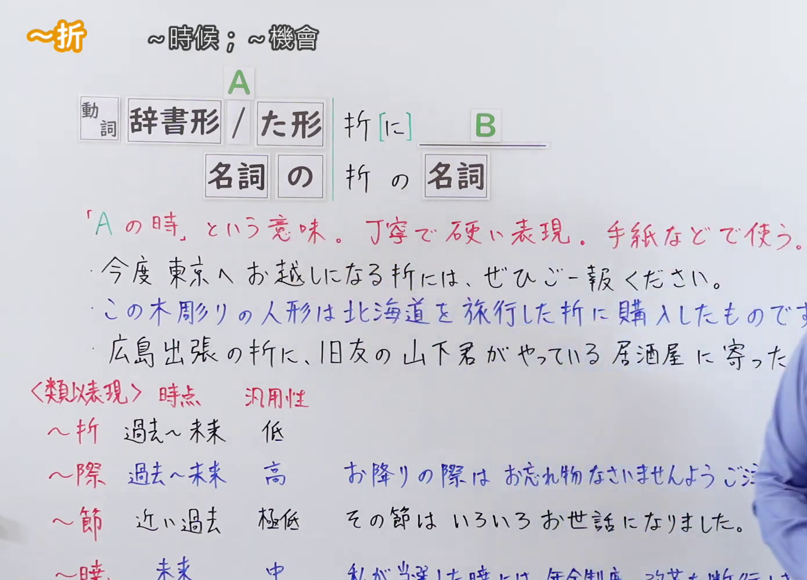
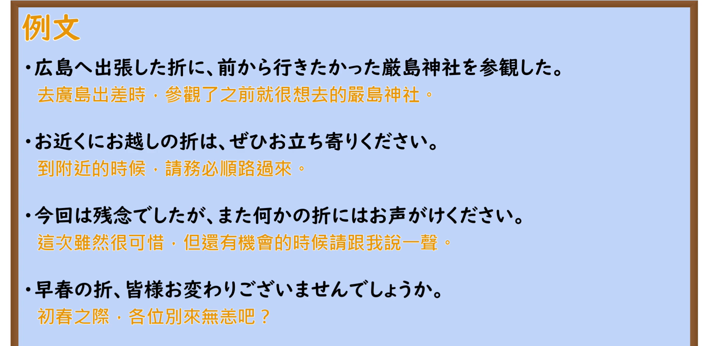

---
{
  "id": "N2-G-0113",
  "kind": "grammar",
  "level": "N2",
  "title": "～折（に／は）：……的时候／趁着……之际",
  "card_revision": 1,
  "schema_version": 1,
  "source": {
    "lesson": "N2 第113个语法",
    "material": "出口日語原视频板书、日语自动字幕与Hagoromo正文",
    "video": "https://www.youtube.com/watch?v=2i-F3Ed1IRM",
    "screenshot": "assets/grammar/n2/N2-G-0113-connection.png",
    "screenshot_seconds": 50,
    "screenshot_crop": {
      "x": 0,
      "y": 0,
      "width": 1390,
      "height": 1000
    }
  },
  "tags": [
    "折に",
    "折",
    "時間的前後",
    "N2"
  ],
  "confusions": [
    "～際（に／は）（同样表示“在……的时候/之际”，但适用范围更广，可用于公用广播、指示文与日常正式场合；而～折语气更加郑重、多见于书信或庄重致意，偏向过去或既定机缘）",
    "～節（に／は）（通常以“その節は”等形式固定使用，侧重“在那个时候/当时”，指不久前的过去）",
    "～暁に（は）（表示“在将来……实现/成功之际”，专门用于未来大事件或目标达成之后，不能用于过去）",
    "～際して（表示“在面临/正值……重要节点之际”，多用于婚礼、开业、签约等重大仪式性场合的前置动作）"
  ]
}
---

# N2 第113个语法：～折（に／は）

# 视频学习资料整理

- 原视频：[出口日語「【Ｎ２文法】～折（に／は）」](https://www.youtube.com/watch?v=2i-F3Ed1IRM)
- 接续图：00:50.11；原图 1920×1080；裁切区域 `x=0, y=0, width=1390, height=1000`。0:01 老师鞠躬且头部位于黑板右侧，选取第50秒老师站立于右侧边缘且板书全部写完的清晰画面；固定左上角 (0, 0)，裁去右侧人物身体大部分及底部空白，完整保留标题「～折」、接续模块（動詞辞書形/た形 折[に]、名詞の 折の 名詞）、红色语义说明与完整板书例句。
- 例句图：06:13.43（373.43秒）；原图 1920×1080；裁切区域 `x=0, y=0, width=1920, height=940`。固定左上角，裁去黑板底部粉笔槽多余边框与杂物，完整保留4条例句及中文翻译。

# 核心

## 功能一：表示“在 A 的时候”（礼貌郑重的硬体表达，多用于书信等场合）

**最上位意味カテゴリー：**

- **おりに：** 場所・時間（场所与时间）

**中位意味カテゴリー：**

- **おりに：** 時間的前後（时间的前后）

**意味：**

- **おりに：** 後（之后／发生时）

**くわしい意味記述：**

- **おりに：** 「ときに」と同じ意味を表す。（与「ときに」表示相同含义。）

**派生語：** のおり

### 例句

1. 広島へ出張した折に、前から行きたかった厳島神社を参観した。

   （去广岛出差之际，参观了之前就一直想去的严岛神社。）

2. お近くにお越しの折は、ぜひお立ち寄りください。

   （来到附近之际，请务必顺道光临。）

3. 帰国したおりに恩師を訪ねた。

   （回国之际拜访了恩师。）

4. この件は、次回の会議のおりに相談しましょう。

   （这件事，在下次开会之际再商量吧。）

5. 今回は残念でしたが、また何かの折にはお声がけください。

   （这次虽然很遗憾，但改日另有机会时还请随时向我打招呼。）

# 来源

- [出口日語原视频「【Ｎ２文法】～折（に／は）」](https://www.youtube.com/watch?v=2i-F3Ed1IRM)
- [Hagoromo 文型检索「おりに」](https://www.hagoromo-text.work/)（查询日期：2026-09-23，用于最上位・中位意味カテゴリー、意味、くわしい意味記述、派生語及用例）
