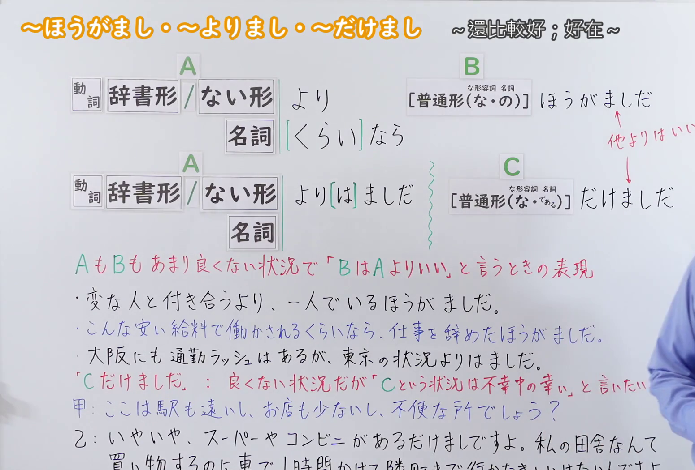
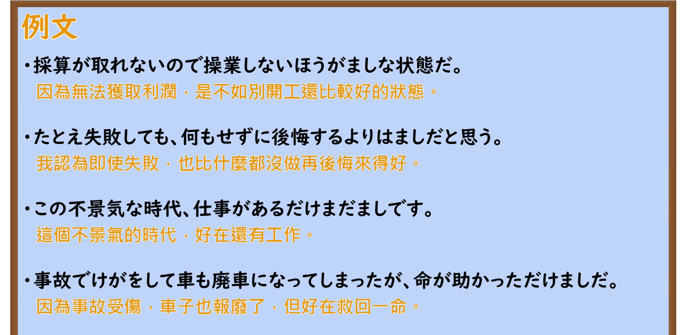

---
{
  "id": "N2-G-0114",
  "kind": "grammar",
  "level": "N2",
  "title": "～ほうがまし・～よりまし・～だけまし：与其……不如……／好在……",
  "card_revision": 1,
  "schema_version": 1,
  "source": {
    "lesson": "N2 第114个语法",
    "material": "出口日語原视频板书、日语自动字幕与毎日のんびり日本語教師正文",
    "video": "https://www.youtube.com/watch?v=l-HQ5pVianc",
    "screenshot": "assets/grammar/n2/N2-G-0114-connection.png",
    "screenshot_seconds": 320,
    "screenshot_crop": {
      "x": 0,
      "y": 0,
      "width": 1550,
      "height": 1050
    }
  },
  "tags": [
    "ほうがまし",
    "よりまし",
    "だけまし",
    "まし",
    "比較",
    "N2"
  ],
  "confusions": [
    "～ほうがいい（表示积极的建议或劝告“最好做某事”；而～ほうがまし是在两者都不理想的前提下做出的消极妥协“与其……不如……”）",
    "～くらいなら～ほうがいい／ほうがまし（“与其……倒不如……”；～くらいなら后项常与～ほうがまし搭配，强调对前项极度反感）",
    "～に越したことはない（表示“自然是……再好不过”，追求最优状态；而～だけまし表示“虽然不尽人意，但好在还能维持当前底线”）"
  ]
}
---

# N2 第114个语法：～ほうがまし・～よりまし・～だけまし

# 视频学习资料整理

- 原视频：[出口日語「【Ｎ２文法】～ほうがまし・～よりまし・～だけまし」](https://www.youtube.com/watch?v=l-HQ5pVianc)
- 接续图：05:20.00（320.00秒）；原图 1920×1080；裁切区域 `x=0, y=0, width=1550, height=1050`。0:01 老师鞠躬且头部遮挡右侧句型尾部，第320秒老师退至画面右侧边缘，且板书全部写完并补全红色补充说明；固定左上角 (0, 0)，裁去右侧人物身体大部分及底部空白，完整保留标题、两组接续形式（～より……ほうがましだ、～より[は]ましだ、～だけましだ）、红色语义说明与全部板书例句。
- 例句图：07:10.55（430.55秒）；原图 1920×1080；裁切区域 `x=0, y=0, width=1920, height=940`。固定左上角，裁去黑板底部边框与杂物，完整保留4条例句及中文翻译。

# 核心

## 功能一：在 A 和 B 都不算好的状况下，表示“与其 A，不如 B 相对更好”的表达

**くわしい意味記述：**

- **～ほうがましだ／～よりましだ：** ２つの対立する選択肢にはっきりとした優劣をつけ、そのうち比較的まだ良いと思われるものを選ぶときに使う文法です。話者の主観による選択です。話者の強い不満や反発的な感情が含まれることもあります。稀に動詞辞書形にも接続することもありますが、動詞の場合は基本的に動た形あるいは動ない形に接続されます。前にはよく比較の「～より」や「～くらいなら」が呼応します。「まし」はもともとナ形容詞です。（在两个对立的选项之间明确区分优劣，用于选择其中相对而言还算更好的一方。这是说话人主观上的选择，有时也包含说话人强烈的不满或反感情绪。虽偶有接动词辞书形的情况，但接动词时基本上接动词た形或ない形。前面常与表示比较的“～より”或“～くらいなら”相呼应。“まし”原本为形容动词（な形容词）。）

### 例句

1. 何もしないで後悔するくらいなら行動して後悔したほうがましだ。

   （与其什么都不做而后悔，倒不如行动了再后悔要好得多。）

2. こんな安い給料で働かされるくらいなら、仕事を辞めたほうがましだ。

   （与其拿这么微薄的工资被使唤，倒不如把工作辞了更好。）

3. 大阪にも通勤ラッシュはあるが、東京の状況よりはましだ。

   （大阪也有早晚通勤高峰，但比起东京的状况还是要好一些。）

4. 下手な言い訳をするくらいなら、黙っていたほうがましだ。

   （与其拙劣地找借口辩解，倒不如老实沉默更好。）

## 功能二：表示虽然处于不良状况，但“C 这种状况是不幸中的万幸／还算好在有 C”的时候使用

**くわしい意味記述：**

- **～だけましだ：** 既に良くない状況であることは認めつつも、前項で述べられた程度にとどまって良かった（最小限の被害で済んだ）という意味を表します。（在承认现状确实已经不算好的同时，表示好在仅仅停留在前项所述的程度、没有造成更大损害（不幸中的万幸）。）

### 例句

1. 確かに暑いが、湿度が高くないだけまだましだ。

   （虽然确实很热，但好在湿度不算高，还算好受些。）

2. 残業時間は長いが、残業代がしっかり出るだけましだ。

   （加班时间虽然很长，但好在加班费一分不少地发下来了。）

3. この不景気な時代、仕事があるだけましです。

   （在如今这样不景气的时代，好在还有份工作做。）

4. 怪我はしたものの、大事にならなかっただけましです。

   （虽然受了伤，但好在没出什么大事，已算不幸中的万幸。）

5. 事故でけがをして車も廃車になってしまったが、命が助かっただけましだ。

   （因车祸受了伤且车子也报废了，但好在捡回了一条命。）

# 来源

- [出口日語原视频「【Ｎ２文法】～ほうがまし・～よりまし・～だけまし」](https://www.youtube.com/watch?v=l-HQ5pVianc)
- [毎日のんびり日本語教師「【Ｎ０文法】～ほうがましだ」](https://mainichi-nonbiri.com/grammar/n0-hougamashida/)（查询日期：2026-09-23，用于機能一「～ほうがましだ／～よりましだ」の解説及び用例）
- [毎日のんびり日本語教師「【Ｎ１文法】～だけましだ／だけまだましだ」](https://mainichi-nonbiri.com/grammar/n1-dakemashida/)（查询日期：2026-09-23，用于機能二「～だけましだ」の解説及び用例）
