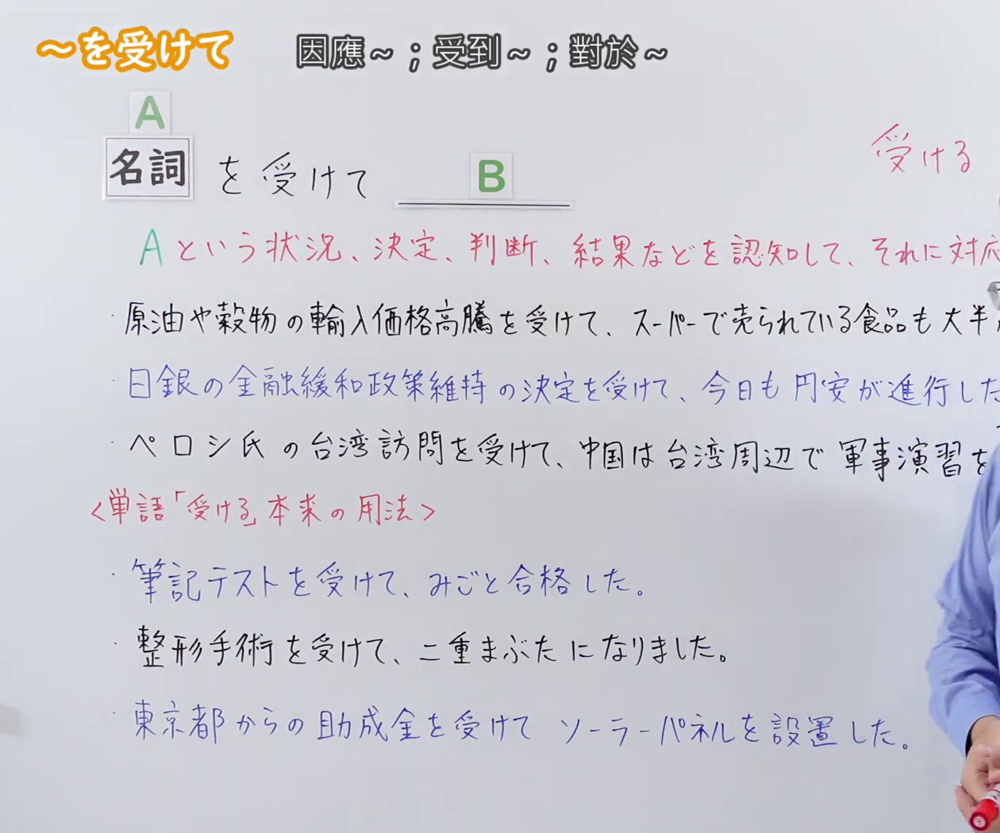
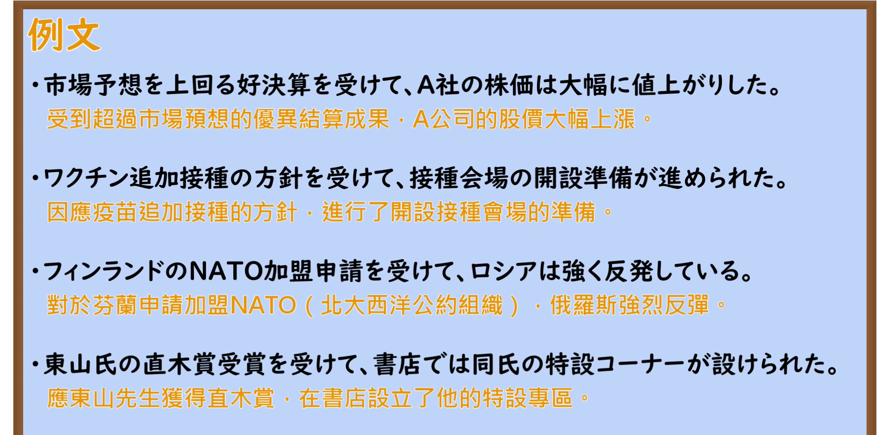

---
{
  "id": "N2-G-0115",
  "kind": "grammar",
  "level": "N2",
  "title": "～を受けて：鉴于……／响应……／在……之后采取对应行动",
  "card_revision": 1,
  "schema_version": 1,
  "source": {
    "lesson": "N2 第115个语法",
    "material": "出口日語原视频板书、日语自动字幕与Iku老師日文教学正文",
    "video": "https://www.youtube.com/watch?v=d56IX0I4gAU",
    "screenshot": "assets/grammar/n2/N2-G-0115-connection.png",
    "screenshot_seconds": 63,
    "screenshot_crop": {
      "x": 0,
      "y": 0,
      "width": 1260,
      "height": 1050
    }
  },
  "tags": [
    "を受けて",
    "受けて",
    "対応",
    "契機",
    "N2"
  ],
  "confusions": [
    "～に応じて（表示“根据……的不同而相应改变”，侧重后项随前项条件而灵活调整或比例变化；而～を受けて侧重“将前项事实作为契机，组织或主体做出正式应对措施”）",
    "～を踏まえて（表示“以……为基础／立足于……”，侧重以前项经验、教训、调研数据为推演基石；而～を受けて侧重对前项外部事态、呼声、结果的因应反应）",
    "～を契機に／～を契機として（表示“以……为转机／契机，事态发生了巨大转变”，重在客观事件成为转折点；而～を受けて侧重主动采取相应对策）"
  ]
}
---

# N2 第115个语法：～を受けて

# 视频学习资料整理

- 原视频：[出口日語「【Ｎ２文法】～を受けて」](https://www.youtube.com/watch?v=d56IX0I4gAU)
- 接续图：01:03.03（63.03秒）；原图 1920×1080；裁切区域 `x=0, y=0, width=1260, height=1050`。0:01 老师鞠躬且头部位于黑板右侧，选取第63秒老师站立于右侧边缘且板书全部写完的清晰画面；固定左上角 (0, 0)，裁去右侧人物身体大部分及底部空白，完整保留标题「～を受けて」、接续模块（名詞 を受けて B）、红色语义说明与全部板书例句。
- 例句图：03:40.50（220.50秒）；原图 1920×1080；裁切区域 `x=0, y=0, width=1920, height=940`。固定左上角，裁去黑板底部多余边框与杂物，完整保留4条例句及中文翻译。

# 核心

## 功能一：认识到 A 这一状况、决定、判断、结果等，并采取与其相对应的 B 这一行动

**くわしい意味記述：**

- **～を受けて：** 前項の事態・要求・結果などを踏まえて、それに対応した行動をとることを表す。後句は通常、前述の事態に対して組織や主体が行う対応措置・反応・決定を表し、前項が後項の契機・根拠となる因果関係を強調する。公的な文書やニュース報道などでよく使われる硬い表現。（表示鉴于或响应前项发生的事态、要求、结果等，从而采取相应的后续行动。后半句通常表示组织或主体针对前述事态做出的应对措施、反应或决定，强调前项作为后项契机或依据的因果关系。常用于公文、新闻报道等庄重郑重的硬体书面语中。）

### 例句

1. 原油や穀物の輸入価格高騰を受けて、スーパーで売られている食品も大半が値上げされた。

   （鉴于原油与谷物的进口价格暴涨，超市售卖的食品大半都上调了价格。）

2. 市場予想を上回る好決算を受けて、A社の株価は大幅に値上がりした。

   （受超出市场预期的高业绩提振，A公司的股价大幅上涨。）

3. 住民からの要請を受けて、市は道路の改修工事を進めることを決定した。

   （鉴于居民提出的请求，市政府决定推进道路整修工程。）

4. ワクチン追加接種の方针を受けて、接種会場の開設準備が進められた。

   （响应追加接种疫苗的方针，接种场地的开设筹备工作得以推进。）

5. 東山氏の直木賞受賞を受けて、書店では同氏の特設コーナーが設けられた。

   （为庆祝东山先生荣获直木奖，书店特设了专门的专区展位。）

# 来源

- [出口日語原视频「【Ｎ２文法】～を受けて」](https://www.youtube.com/watch?v=d56IX0I4gAU)
- [Iku老師日文「N ＋ を受けて ＋ 因應的措施」](https://jp.ikuchannel.com/grammar/pattern-wo-ukete)（查询日期：2026-09-23，用于语法含义、解説及补充例句）
