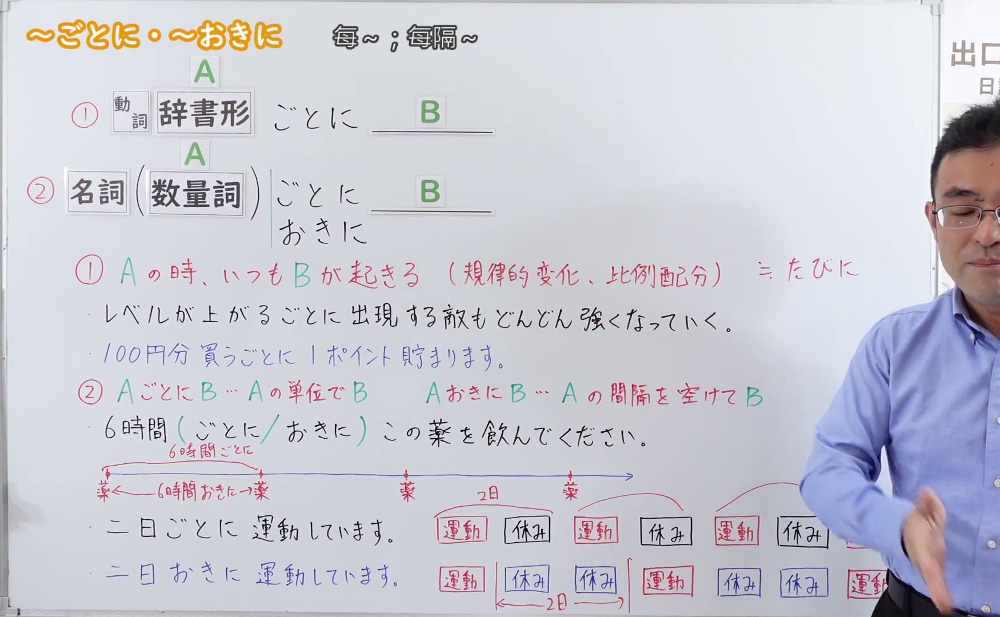
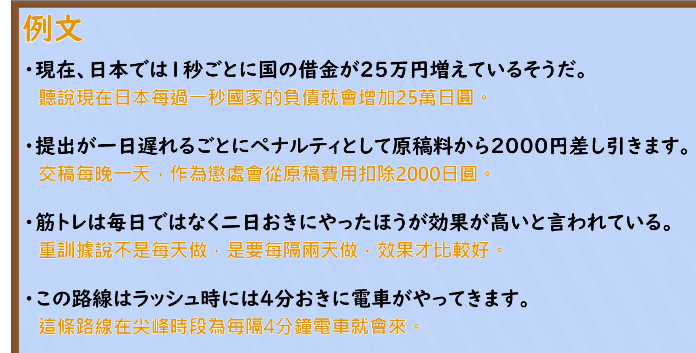

---
{
  "id": "N2-G-0116",
  "kind": "grammar",
  "level": "N2",
  "title": "～ごとに・～おきに：每次、按单位与间隔",
  "card_revision": 1,
  "schema_version": 1,
  "source": {
    "lesson": "N2 第116个语法",
    "material": "出口日語原视频板书、日语自动字幕与絵でわかる日本語、毎日のんびり日本語教師正文",
    "video": "https://www.youtube.com/watch?v=m5KVJ0yFF_o",
    "screenshot": "assets/grammar/n2/N2-G-0116-connection.png",
    "screenshot_seconds": 360.23,
    "screenshot_crop": {
      "x": 0,
      "y": 0,
      "width": 1750,
      "height": 1080
    }
  },
  "tags": [
    "ごとに",
    "おきに",
    "反复",
    "间隔",
    "N2"
  ],
  "confusions": [
    "ごとに与おきに在按天数计间隔时的差别",
    "动词接ごとに与数量词接ごとに的用法"
  ]
}
---

# 第116课：～ごとに・～おきに

# 视频学习资料整理

课程视频：[出口日語「【Ｎ２文法】～ごとに・～おきに」](https://www.youtube.com/watch?v=m5KVJ0yFF_o)。

- 接续图：视频 6:00.23；原图 1920 × 1080；从左上角裁切至 1750 × 1080（x=0，y=0）。选用教师移至右侧后的板书，保留语法形式、红色意义说明、示例和间隔示意。

  

- 例句图：视频 6:48.25；原图 1920 × 1080；从左上角裁切至 1830 × 930（x=0，y=0）。保留原视频的四条日语例句及其中文字幕。

  

视频板书以「二日ごとに」和「二日おきに」展示按日计算时的差别；对于秒、分、时间与距离等单位，实际间隔的理解须结合语境。

# 核心

## 功能一：每当发生 A 时，B 总会发生

**くわしい意味記述：**

- **动词辞书形＋ごとに：** 「〜ごとに」は【変化（へんか）】を表（あらわ）す文型（ぶんけい）で「ますます〜になる」と言（い）いたい時（とき）に使（つか）われます。（「～ごとに」是表示变化的句型，用于表达“越来越……”。）

### 例句

1. 彼女（かのじょ）は会（あ）うごとに日本語（にほんご）が上手（じょうず）になっている。

   （每次见到她，她的日语都比上次更熟练。）

2. 料理（りょうり）は作（つく）るごとにうまくなっていくものだよ。

   （做菜是每做一次就会更拿手的。）

3. 彼（かれ）は試合（しあい）をするごとに強（つよ）くなっていった。

   （他每打一场比赛，就变得更强。）

## 功能二：以 A 为单位发生 B，或空出 A 的间隔后发生 B

**くわしい意味記述：**

- **名词・数量词＋ごとに：** ②数詞に接続する時は「そのいずれも～」。（接数量词时，表示该单位中的每一个都如此。）
- **数量词＋おきに：** 数詞に接続して「その間隔を空けて～」という意味を表します。（接数量词，表示“空出该单位所指的间隔后再……”。）

### 例句

1. このシステムは一年毎に更新される。

   （这个系统每年更新一次。）

2. 山間部の天気は一時間ごとにでも一変する。

   （山区的天气甚至每隔一小时就可能骤变。）

3. ２日おきにしかシャワーを浴びない。

   （我每隔两天才洗一次澡。）

4. 多くのマラソン大会では５ｋｍおきに給水ポイントが設けられている。

   （许多马拉松赛事每隔五公里设一个补水站。）

5. ５メートルおきに植樹する。

   （每隔五米种一棵树。）

# 来源

- [出口日語原视频「【Ｎ２文法】～ごとに・～おきに」](https://www.youtube.com/watch?v=m5KVJ0yFF_o)
- [絵でわかる日本語「〜ごとに③（変化）」](https://edewakarunihongo.com/%E3%80%9C%E3%81%94%E3%81%A8%E3%81%AB%E2%91%A2%EF%BC%88%E5%A4%89%E5%8C%96%EF%BC%89%E3%80%80jlpt%E3%81%AB%E3%81%AA%E3%81%84%E6%96%87%E5%9E%8B/)（功能一的说明与例句；查询日期：2026-09-23）
- [毎日のんびり日本語教師「～毎に（ごとに）」](https://mainichi-nonbiri.com/grammar/n3-gotoni/)（功能二的说明与例句；查询日期：2026-09-23）
- [毎日のんびり日本語教師「～おきに」](https://mainichi-nonbiri.com/grammar/n3-okini/)（功能二中「おきに」的说明与例句；查询日期：2026-09-23）
