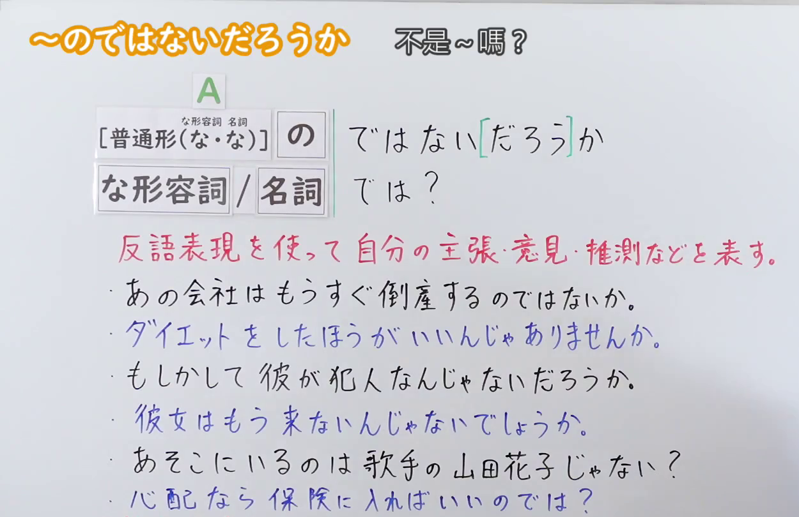
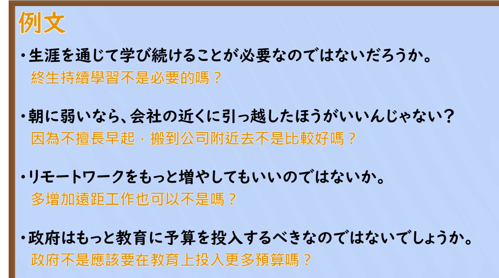

---
{
  "id": "N2-G-0117",
  "kind": "grammar",
  "level": "N2",
  "title": "～のではないだろうか：以反问表达主张与推测",
  "card_revision": 1,
  "schema_version": 1,
  "source": {
    "lesson": "N2 第117个语法",
    "material": "出口日語原视频板书、日语自动字幕、Hagoromo「じゃないだろうか（主張）」「のではないだろうか（推量）」及Japanese Exercises正文",
    "video": "https://www.youtube.com/watch?v=aS7Gfn6enEI",
    "screenshot": "assets/grammar/n2/N2-G-0117-connection.png",
    "screenshot_seconds": 1.0,
    "screenshot_crop": {
      "x": 0,
      "y": 0,
      "width": 1250,
      "height": 810
    }
  },
  "tags": [
    "のではないだろうか",
    "反问",
    "主张",
    "推测",
    "N2"
  ],
  "confusions": [
    "普通疑问句与反问式主张的区别",
    "のではないだろうか与のではあるまいか"
  ]
}
---

# 第117课：～のではないだろうか

# 视频学习资料整理

课程视频：[出口日語「～のではないだろうか」](https://www.youtube.com/watch?v=aS7Gfn6enEI)。

- 接续图：视频 0:01.00；原图 1920 × 1080；从左上角裁切至 1250 × 810（x=0，y=0）。保留接续、红色意义说明和课程示例。

  

- 例句图：视频 6:58.03；原图 1920 × 1080；从左上角裁切至 1650 × 920（x=0，y=0）。保留四条日语例句及原视频中文字幕。

  

视频板书以疑问形式表达说话人自己的判断；「～のではあるまいか」作为相近表达出现，另以「～じゃないか／～じゃん」提示不同的同意要求或惊讶用法。

# 核心

## 功能一：用反问表达自己的主张、意见或推测

**最上位意味カテゴリー：**

- **じゃないだろうか（主張）：** 考え・感情（想法与情感）
- **のではないだろうか（推量）：** 考え・感情（想法与情感）

**中位意味カテゴリー：**

- **じゃないだろうか（主張）：** 主張・断定的評価（主张与断定性评价）
- **のではないだろうか（推量）：** 推量（推测）

**意味：**

- **じゃないだろうか（主張）：** 主張（主张）
- **のではないだろうか（推量）：** 推量（推测）

**くわしい意味記述：**

- **じゃないだろうか（主張）：** 「〜なのではないだろうか」という意味。根拠に基づいて，「おそらく〜だろう」と推測する話し手の判断を表す。（意为“难道不是～吗”；表示说话人根据依据推测“恐怕是～吧”而作出的判断。）
- **のではないだろうか（推量）：** 話し手の推量を表す。（表示说话人的推测。）

**派生語：** じゃないだろうか（主張）：のではないだろうか，のではなかろうか；のではないだろうか（推量）：ではないだろうか

### 例句

1. 落とし物を拾ってもらったら、お礼をするのは当然のことじゃないだろうか。

   （别人帮忙捡到了失物，表示感谢难道不是理所当然的吗？）

2. がんを減らすためには、健康診断の受診率を高めるべきではないだろうか。

   （为了减少癌症病例，难道不应该提高接受健康体检的比例吗？）

3. 少子化は労働環境が悪いことが原因なのではないだろうか。

   （少子化的原因，会不会是工作环境不好呢？）

4. 最近の若者は、仕事よりも生活を重視しているのではないだろうか。

   （现在的年轻人或许比起工作更重视生活。）

5. リモートワークは、今後さらに広がっていくのではないだろうか。

   （远程办公今后或许还会进一步普及。）

# 来源

- [出口日語原视频「～のではないだろうか」](https://www.youtube.com/watch?v=aS7Gfn6enEI)
- [Hagoromo「じゃないだろうか（主張）」「のではないだろうか（推量）」站内条目](https://www.hagoromo-text.work/)（站内检索词：のではないだろうか；分类、意义、派生語及例句 1～3；查询日期：2026-09-23）
- [Japanese Exercises「～のではないだろうか／んじゃないでしょうか」](https://japaneseexercises.com/2025/12/20/%E3%81%BF%E3%82%93%E3%81%AA%E3%81%AE%E6%97%A5%E6%9C%AC%E8%AA%9E%E4%B8%AD%E7%B4%9A%EF%BC%92%E3%80%80%E7%AC%AC14%E8%AA%B2%E3%80%80%E6%96%87%E6%B3%95%E8%A7%A3%E8%AA%AC%E3%83%BB%E7%B7%B4%E7%BF%92/)（例句 4～5；查询日期：2026-09-23）
