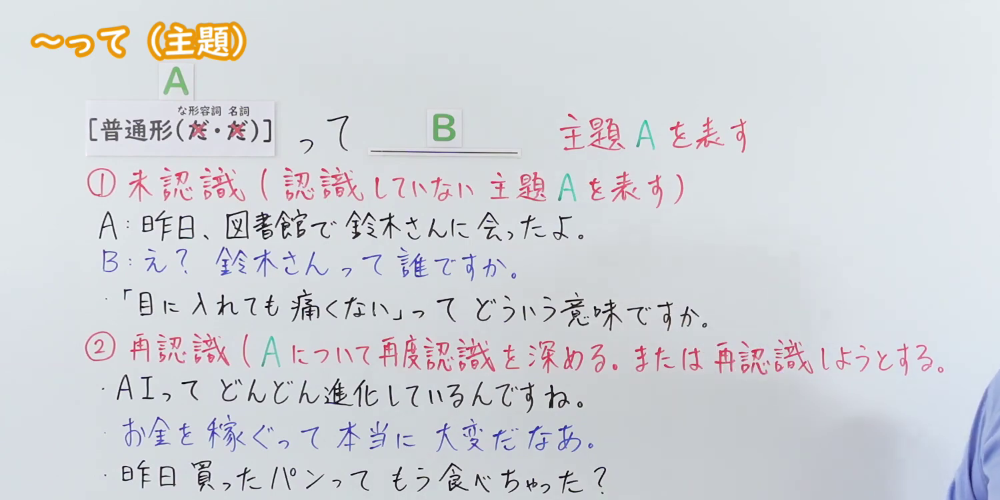
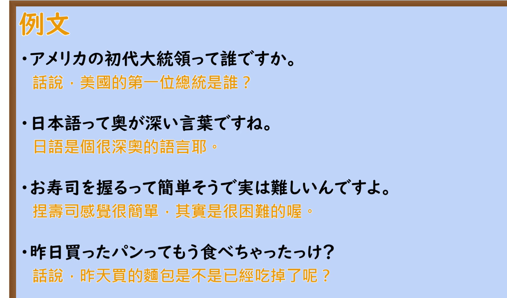

---
{
  "id": "N2-G-0118",
  "kind": "grammar",
  "level": "N2",
  "title": "～って（主題）：口语话题提示与重新认识",
  "card_revision": 1,
  "schema_version": 1,
  "source": {
    "lesson": "N2 第118个语法",
    "material": "出口日語原视频板书、日语自动字幕、Hagoromo「って（主題）」及Japanese Exercises正文",
    "video": "https://www.youtube.com/watch?v=l0BwAF-nRiQ",
    "screenshot": "assets/grammar/n2/N2-G-0118-connection.png",
    "screenshot_seconds": 72.3,
    "screenshot_crop": {
      "x": 0,
      "y": 0,
      "width": 1500,
      "height": 750
    }
  },
  "tags": [
    "って",
    "主題",
    "口语",
    "N2"
  ],
  "confusions": [
    "って（主題）与って（引用・传闻）",
    "って与は在口语主題提示中的差别"
  ]
}
---

# 第118课：～って（主題）

# 视频学习资料整理

课程视频：[出口日語「【Ｎ２文法】～って（主題）」](https://www.youtube.com/watch?v=l0BwAF-nRiQ)。

- 接续图：视频 1:12.30；原图 1920 × 1080；从左上角裁切至 1500 × 750（x=0，y=0）。0:01 的教师遮挡较多，因此选用两组红色说明和例句更清晰的时点。

  

- 例句图：视频 7:40.60；原图 1920 × 1080；从左上角裁切至 1580 × 930（x=0，y=0）。保留四条日语例句及原视频中文字幕。

  

视频板书将主題用法分为「未認識」与「再認識」；同形的引用或传闻用法不属于本课范围。

# 核心

## 功能一：表示尚未认识的主題 A

**最上位意味カテゴリー：**

- **って（主題）：** ものごとの関係（事物之间的关系）

**中位意味カテゴリー：**

- **って（主題）：** 説明（说明）

**意味：**

- **って（主題）：** 主題（主題）

**くわしい意味記述：**

- **って（主題）：** 定義や意味を説明する時に使う。話し言葉で使う。書き言葉では「〜とは」を使う。（用于说明定义或意义，使用于口语；书面语中用「～とは」。）

**派生語：** 未列出

### 例句

1. エアコンって、なんのことですか。

   （“空调”是什么意思？）

2. これってどういう意味？

   （这个是什么意思？）

3. あの人って誰？

   （那个人是谁？）

## 功能二：加深对 A 的认识，或尝试重新认识 A

**くわしい意味記述：**

- **って（主題）：** ～は（相当于提示主題的「～は」。）

### 例句

1. 日本の夏って暑いね。

   （日本的夏天真热啊。）

2. 日本語って難しいね。

   （日语真难啊。）

3. 英語って、発音が難しいよね。

   （英语的发音挺难的，对吧？）

# 来源

- [出口日語原视频「【Ｎ２文法】～って（主題）」](https://www.youtube.com/watch?v=l0BwAF-nRiQ)
- [Hagoromo「って（主題）」定义说明条目](https://www.hagoromo-text.work/)（站内检索词：って；功能一的分类、意义、派生語及例句 1；查询日期：2026-09-23）
- [Japanese Exercises「～って（主題）」](https://japaneseexercises.com/2024/12/09/%E3%80%90jlpt-n3-%EF%BD%9E%E3%81%A3%E3%81%A6%EF%BC%88%E4%B8%BB%E9%A1%8C%EF%BC%89%E3%80%80%E6%96%87%E6%B3%95%E8%A7%A3%E8%AA%AC%E3%83%BB%E5%95%8F%E9%A1%8C%E3%80%91/)（功能一的例句 2～3、功能二的说明与例句；查询日期：2026-09-23）
