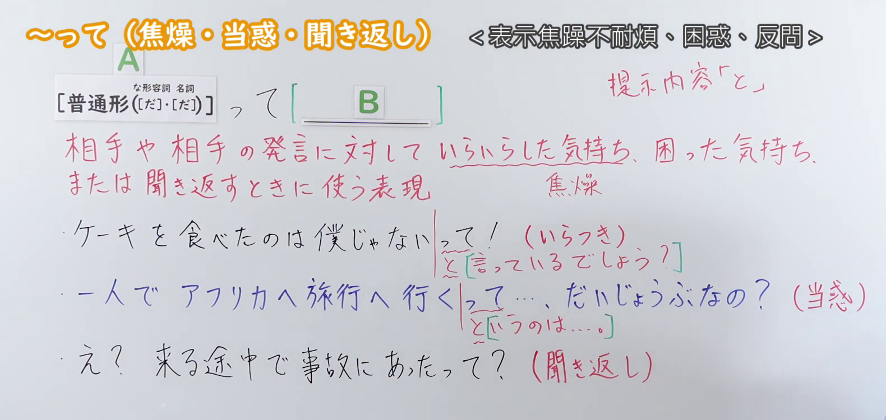
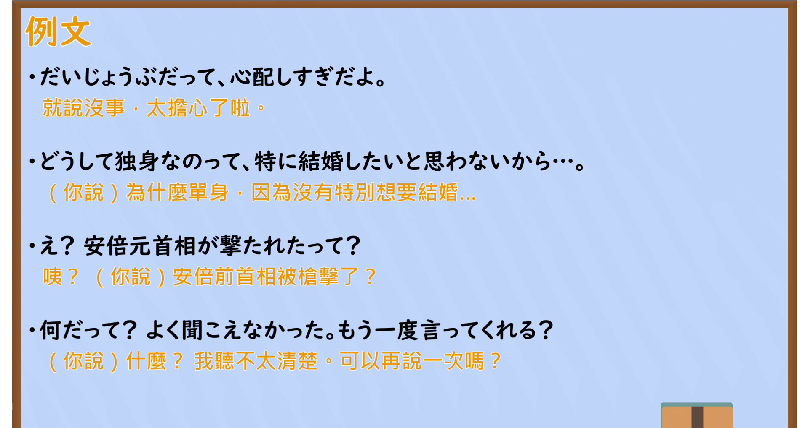

---
{
  "id": "N2-G-0119",
  "kind": "grammar",
  "level": "N2",
  "title": "～って：焦躁、困惑与反问",
  "card_revision": 1,
  "schema_version": 1,
  "source": {
    "lesson": "N2 第119个语法",
    "material": "出口日語原视频板书、日语自动字幕、《「って」で終わる文について》摘要与 Maggie Sensei 教学页",
    "video": "https://www.youtube.com/watch?v=3lkoUGnLXE4",
    "screenshot": "assets/grammar/n2/N2-G-0119-connection.png",
    "screenshot_seconds": 220.0,
    "screenshot_crop": {
      "x": 0,
      "y": 0,
      "width": 1580,
      "height": 750
    }
  },
  "tags": [
    "句末引用",
    "情绪表达",
    "N2"
  ],
  "confusions": [
    "～って（主題）",
    "～って（伝聞）"
  ]
}
---

# ～って（焦燥・当惑・聞き返し）

# 视频学习资料整理

- [出口日語第119课原视频](https://www.youtube.com/watch?v=3lkoUGnLXE4)。
- 接续图：原视频 3:40（220.00 秒）；原图 1920×1080，固定左上角裁切区域 `(0, 0, 1580, 750)`，保留接续、红字含义及三种语气的板书例句。片头 0:01 有教师遮挡，改用此时点。

- 例句图：原视频约 5:35（335.10 秒）；原图 1920×1080，固定左上角裁切区域 `(0, 0, 1900, 1020)`，保留四条例句及视频自带译文。

# 核心

## 功能一：对对方或其发言感到焦躁、困惑时使用

**くわしい意味記述：**

- **句末「って」（《「って」で終わる文について》）：** 「話し手の心的態度を表すグループ」には，「話し手の強い主張を表現する（強調）」「話し手の感情や主張を表現する」という2つの用法がある。（“表达说话者心理态度”的一类，包括“表达说话者的强烈主张，即强调”和“表达说话者的感情及主张”两种用法。）

### 例句

1. だから今、忙しいって

   （都说了我现在很忙！）

2. やめてって！

   （都说了别这样！）

3. 本当だって

   （都说了是真的！）

4. そんなことできないって

   （都说了那种事我做不到！）

## 功能二：听到对方发言后反问时使用

**くわしい意味記述：**

- **句末「って」（《「って」で終わる文について》）：** 「確認する」（确认。）

### 例句

1. ですって？

   （您说什么？）

2. なんですって？

   （您说什么？）

3. なんだって？

   （你说什么？）

4. 吟遊詩人が村に来てるって？

   （你说有吟游诗人来到村里了？）

# 来源

- [出口日語第119课原视频](https://www.youtube.com/watch?v=3lkoUGnLXE4)
- [深尾圓《「って」で終わる文について》](https://www.airitilibrary.com/Article/Detail/10271155-201809-201904250010-201904250010-57-86)（日文摘要中的功能划分与意义原文；查询日期：2026-09-23）
- [Maggie Sensei「Direct & Indirect Speech ＆って」](https://maggiesensei.com/2012/05/07/direct-indirect-speech-%EF%BC%86%E3%81%A3%E3%81%A6tte/)（两组日语例句与句末语气讲解；查询日期：2026-09-23）
