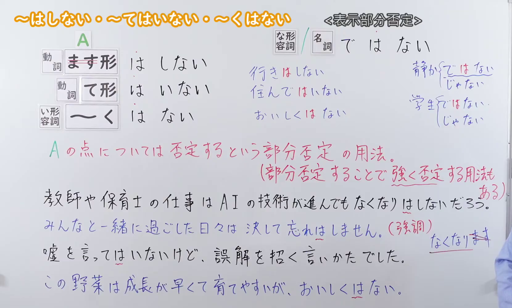
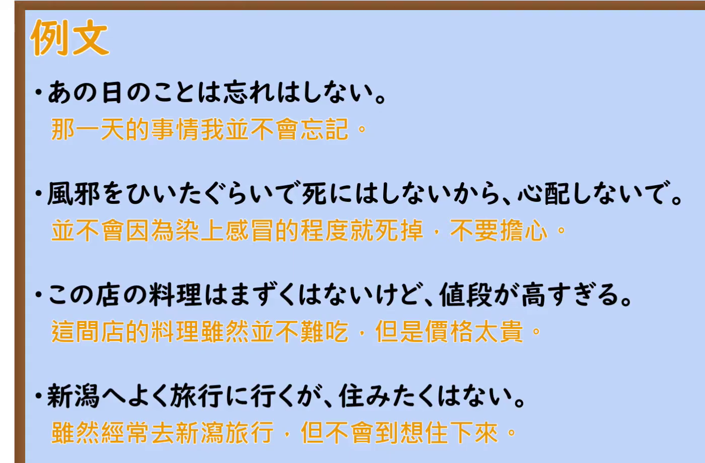

---
{
  "id": "N2-G-0120",
  "kind": "grammar",
  "level": "N2",
  "title": "～はしない・～てはいない・～くはない：就某一点加以否定",
  "card_revision": 1,
  "schema_version": 1,
  "source": {
    "lesson": "N2 第120个语法",
    "material": "出口日語原视频板书、日语自动字幕与 HackMD「【N2文法】～はしない / ～てはいない / ～くはない」正文",
    "video": "https://www.youtube.com/watch?v=sQC29Izh51c",
    "screenshot": "assets/grammar/n2/N2-G-0120-connection.png",
    "screenshot_seconds": 314.73,
    "screenshot_crop": {
      "x": 0,
      "y": 0,
      "width": 1660,
      "height": 1000
    }
  },
  "tags": [
    "部分否定",
    "对比强调",
    "N2"
  ],
  "confusions": [
    "普通否定しない・ていない・くない不一定突出被否定的那一点；插入は后，要结合上下文判断是保留余地还是加强否定。"
  ]
}
---

# ～はしない・～てはいない・～くはない

# 视频学习资料整理

- [出口日語原视频](https://www.youtube.com/watch?v=sQC29Izh51c)：第120课，板书标题为「～はしない・～てはいない・～くはない」。
- 接续图：原视频实际时间 **05:14.73**，原图 **1920×1080**；从左上角裁取 **(0, 0, 1660, 1000)**，保留接续、红字含义说明及板书例句。开头约 0:01 的画面有教师遮挡，因此改用此时点。

  

- 例句图：原视频实际时间 **05:44.45**，原图 **1920×1080**；从左上角裁取 **(0, 0, 1400, 920)**，保留四条例句与视频中的中文翻译。

  

# 核心

## 功能一：对 A 这一点加以否定的部分否定用法；也可通过部分否定来加强否定

**くわしい意味記述：**

- **～はしない／～てはいない／～くはない：** 普通の否定（「しない」「ていない」「くない」）に助詞「は」を挟むことで、「他はともかく、それについては強く否定する」または「100%否定するわけではなく、含みを持たせる（部分否定）」というニュアンスが生まれます。（在普通否定「しない」「ていない」「くない」中加入助词「は」，会带出“其他方面暂且不论，唯独这一点予以强烈否定”，或“不作百分之百的否定，而留有余地（部分否定）”的语感。）

### 例句

1. どれほど失敗を重ねても、途中で投げ出しはしない。

   （无论经历多少次失败，我也绝不会半途放弃。）

2. 一度決めた約束を、途中で破りはしないつもりだ。

   （既然作出了承诺，我就不打算中途违约。）

3. 彼の言いたいことは理解できるが、完全に同意してはいない。

   （我能理解他想说什么，但并未完全赞同。）

4. この料理、まずくは無いけれど、特別美味しいわけでもないね。

   （这道菜倒不难吃，不过也谈不上特别好吃。）

5. 彼の提案も悪くは無いが、もう少しコストを抑えたいところだ。

   （他的提议也不差，但我还是希望能再降低一点成本。）

# 来源

- [出口日語原视频](https://www.youtube.com/watch?v=sQC29Izh51c)
- [HackMD「【N2文法】～はしない / ～てはいない / ～くはない」](https://hackmd.io/@eCG42u40TZ6s-_a7l15ZlQ/HyehshA8Mg)（采用「意味・ニュアンス」总述及「例文」中的五句；查询日期：2026-09-23）
