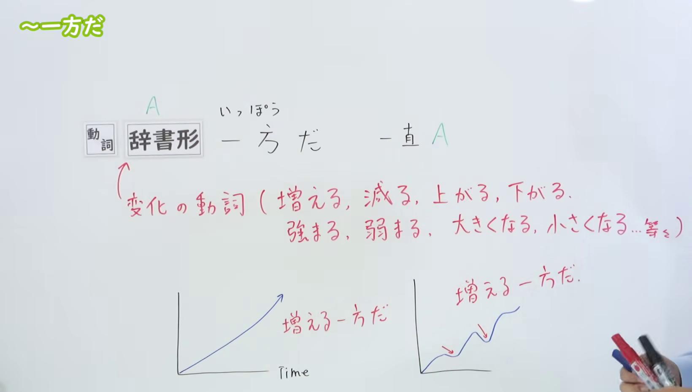
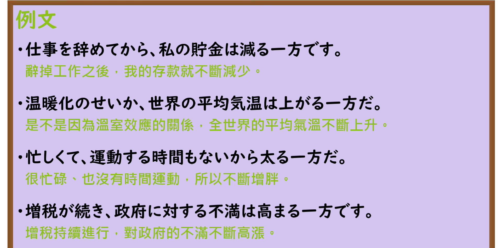

---
{
  "id": "N3-G-0001",
  "kind": "grammar",
  "level": "N3",
  "title": "〜一方だ（一直……、越来越……）",
  "card_revision": 1,
  "schema_version": 1,
  "source": {
    "lesson": "N3 第1个语法",
    "material": "出口日語原视频板书、日语自动字幕与Hagoromo文型检索正文",
    "video": "https://www.youtube.com/watch?v=eGxvduVsfJo",
    "screenshot": "assets/grammar/n3/N3-G-0001-connection.png",
    "screenshot_seconds": 180,
    "screenshot_crop": {
      "x": 0,
      "y": 0,
      "width": 1640,
      "height": 930
    }
  },
  "tags": [
    "一方だ",
    "N3"
  ],
  "confusions": [
    "ばかりだ",
    "一方で"
  ]
}
---

# N3 第1个语法：〜一方だ

# 视频学习资料整理

本课讲解 N3 语法形式「〜一方だ」。

## 接续图（板书与讲解）

- 视频链接：[出口日語 N3 第1个语法](https://www.youtube.com/watch?v=eGxvduVsfJo)
- 真实时间：03:00（180秒）
- 原图尺寸：1920×1080
- 裁切说明：原视频 00:01 画面中老师站立于板书中央偏右，遮挡了动词列表右侧文字，且尚未绘制区分持续变化与波动变化的说明图示。故选用 03:00 画面，此时板书已完整书写接续、变化动词列表及对比图示，老师侧身让出板书区域。固定左上角（0, 0），裁切区域为宽 1640、高 930，去除右侧人物与底部空白，完整保留接续形式、动词示例与对比图示。
- 图片：

## 例句图（视频例句）

- 视频链接：[出口日語 N3 第1个语法](https://www.youtube.com/watch?v=eGxvduVsfJo)
- 真实时间：04:24（264.63秒）
- 原图尺寸：1920×1080
- 裁切说明：提取自视频 04:24 处的例句黑板页面。固定左上角（0, 0），裁切区域为宽 1920、高 950，裁去底部黑板槽与粉笔盒多余画面，完整保留四条例句及中文翻译。
- 图片：

# 核心

## 功能一：一直 A

**最上位意味カテゴリー：**

- **いっぽうだ(一方だ)：** ものごとの様子（事物的状态与样貌）

**中位意味カテゴリー：**

- **いっぽうだ(一方だ)：** 変化・不変化（变化与不变化）

**意味：**

- **いっぽうだ(一方だ)：** 経過（过程）

**くわしい意味記述：**

- **いっぽうだ(一方だ)：** 物事の状況の変化がある方向に進んでいることを表す。（表示事物状况的变化朝着某一个方向发展。）

**派生語：** 未列出

### 例句

1. 事故は増える一方だ。

   （事故只是在不断增加。）

2. あとはもう治る一方だし。

   （接下来身体就只会越来越好转了。）

3. 現に、貿易摩擦が随所で起き、輸出環境は悪くなる一方である。

   （事实上，到处都在发生贸易摩擦，出口环境变得越来越糟糕。）

4. しかも、物価は（相対的には）安定し、生産性上昇率は高く、輸出競争力は強くなる一方である。

   （而且物价（相对来说）很稳定，生产率提高的速度也快，出口竞争力正越来越强。）

# 来源

- [出口日語原视频](https://www.youtube.com/watch?v=eGxvduVsfJo)
- [Hagoromo 文型検索「いっぽうだ」](https://hagoromo-text.work/lookup?vid=1843)（查询日期：2026-09-24）
