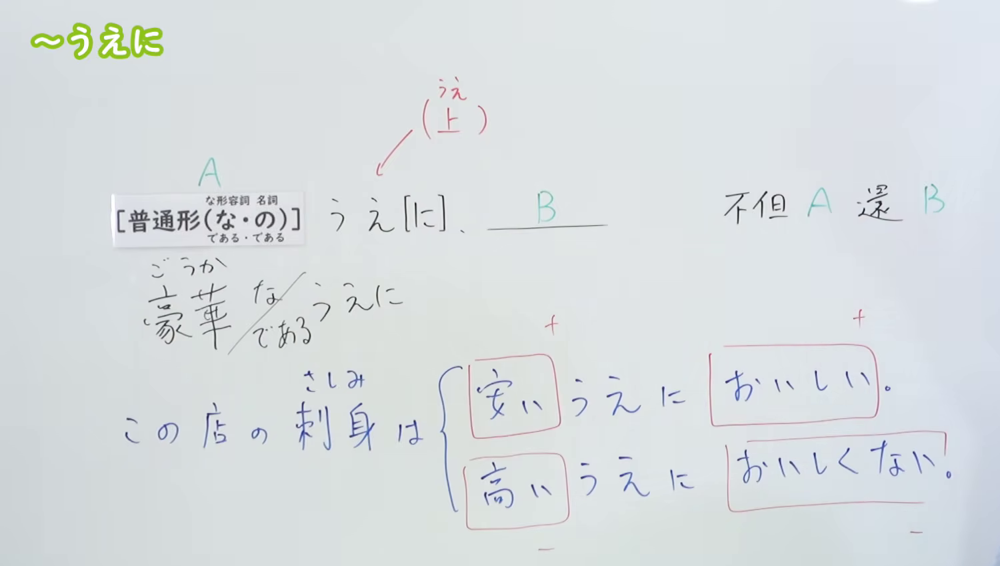
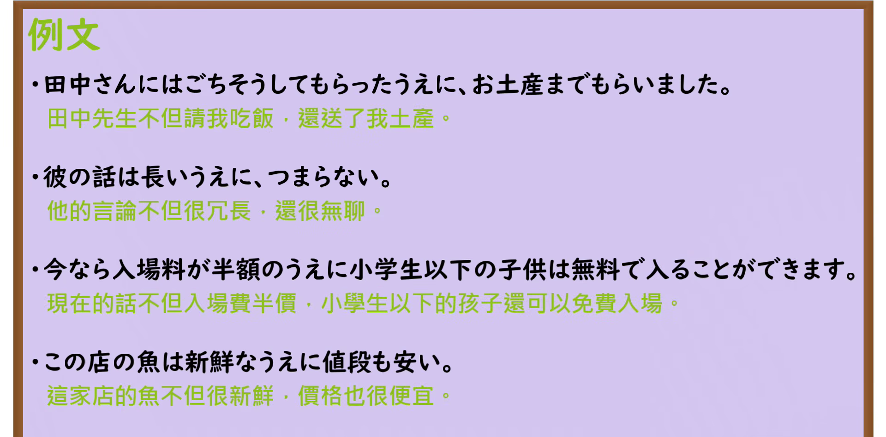

---
{
  "id": "N3-G-0002",
  "kind": "grammar",
  "level": "N3",
  "title": "〜上に（不但……而且……、加上……）",
  "card_revision": 1,
  "schema_version": 1,
  "source": {
    "lesson": "N3 第2个语法",
    "material": "出口日語原视频板书、日语自动字幕与Hagoromo文型检索正文",
    "video": "https://www.youtube.com/watch?v=a9ZikIHE2l4",
    "screenshot": "assets/grammar/n3/N3-G-0002-connection.png",
    "screenshot_seconds": 200,
    "screenshot_crop": {
      "x": 0,
      "y": 0,
      "width": 1500,
      "height": 850
    }
  },
  "tags": [
    "上に",
    "N3"
  ],
  "confusions": [
    "上は",
    "ばかりか"
  ]
}
---

# N3 第2个语法：〜上に

# 视频学习资料整理

本课讲解 N3 语法形式「〜上に」。

## 接续图（板书与讲解）

- 视频链接：[出口日語 N3 第2个语法](https://www.youtube.com/watch?v=a9ZikIHE2l4)
- 真实时间：03:20（200秒）
- 原图尺寸：1920×1080
- 裁切说明：原视频 00:01 画面中下方的辨析例句尚未书写完整。选用 03:20 画面，此时板书已完整书写接续、词性变化（普通形、豪华な/である、名词の/である）以及「＋/＋」（安い＋おいしい）与「－/－」（高い＋おいしくない）的同方向评价例句，老师侧身让出板书区域。固定左上角（0, 0），裁切区域为宽 1500、高 850，去除右侧人像与底部多余空白，完整保留全部板书。
- 图片：

## 例句图（视频例句）

- 视频链接：[出口日語 N3 第2个语法](https://www.youtube.com/watch?v=a9ZikIHE2l4)
- 真实时间：03:43（223.77秒）
- 原图尺寸：1920×1080
- 裁切说明：提取自视频 03:43 处的例句黑板页面。固定左上角（0, 0），裁切区域为宽 1920、高 950，裁去底部黑板槽与粉笔盒多余杂物，完整保留四条例句及中文翻译。
- 图片：

# 核心

## 功能一：不但 A 还 B

**最上位意味カテゴリー：**

- **うえに：** ものごとの関係（事物之间的关系）

**中位意味カテゴリー：**

- **うえに：** 関連・対応（关联与对应）

**意味：**

- **うえに：** 関連（关联・累加）

**くわしい意味記述：**

- **うえに：** 「ＡうえにＢ」のＡとＢは同じ評価を（プラスとプラス、マイナスとマイナス）を表し，「Ａだ、それにＢだ」という気持ちで言いたい時に使う。（在「AうえにB」中，A与B表示相同方向的评价（正向与正向、负向与负向），用于表达「既是A，而且还是B」的心情。）

**派生語：** 未列出

### 例句

1. このあたりは静かな上に、駅にも近く、とても住みやすい。

   （这一带不仅安静，而且离车站也很近，非常宜居。）

2. この水は安いうえにおいしいので、通常の飲料水としてのほかに、私が自分でつけた梅酒を薄めるのにも使用している。

   （这水不仅便宜而且好喝，因此除了作为日常饮用水之外，我也用它来兑自己酿的梅酒。）

3. 混んでいてやたらと待たされるうえに、蕎麦の一杯や定食の一人前が８００円から１０００円もする。

   （店里不仅拥挤且让人等了很久，一碗荞麦面或一份套餐还要花上800到1000日元。）

4. 携帯型ミサイルは安価で１人でも取り扱えるうえに、それが民間航空機に対して使用された場合には人的損害が大きくなるという特徴を持っている。

   （便携式导弹不仅价格低廉、单人即可操作，而且一旦被用于针对民用航空器，还会造成极其严重的人员伤亡。）

# 来源

- [出口日語原视频](https://www.youtube.com/watch?v=a9ZikIHE2l4)
- [Hagoromo 文型検索「うえに」](https://hagoromo-text.work/lookup?vid=317)（查询日期：2026-09-24）
