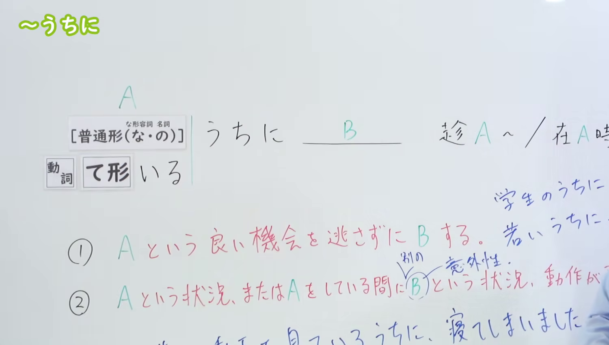
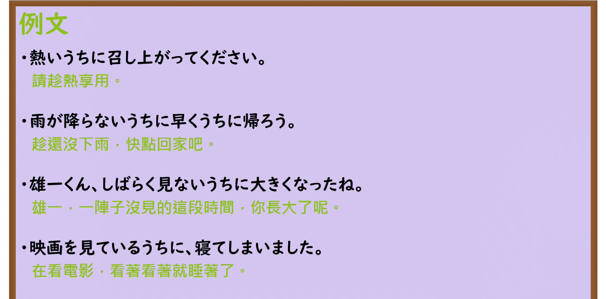

---
{
  "id": "N3-G-0003",
  "kind": "grammar",
  "level": "N3",
  "title": "〜うちに（趁着……／在……过程中不知不觉……）",
  "card_revision": 1,
  "schema_version": 1,
  "source": {
    "lesson": "N3 第3个语法",
    "material": "出口日語原视频板书、日语自动字幕与Hagoromo文型检索正文",
    "video": "https://www.youtube.com/watch?v=zRDINPcshiM",
    "screenshot": "assets/grammar/n3/N3-G-0003-connection.png",
    "screenshot_seconds": 200,
    "screenshot_crop": {
      "x": 0,
      "y": 0,
      "width": 1500,
      "height": 850
    }
  },
  "tags": [
    "うちに",
    "N3"
  ],
  "confusions": [
    "あいだに",
    "うちに"
  ]
}
---

# N3 第3个语法：〜うちに

# 视频学习资料整理

本课讲解 N3 语法形式「〜うちに」。

## 接续图（板书与讲解）

- 视频链接：[出口日語 N3 第3个语法](https://www.youtube.com/watch?v=zRDINPcshiM)
- 真实时间：03:20（200秒）
- 原图尺寸：1920×1080
- 裁切说明：原视频 00:01 画面中功能二的板书例句与讲解标记尚未书写完整。选用 03:20 画面，此时板书已完整书写接续、词性变化（普通形、て形いる）、功能①与功能②的日文解释，以及各功能的典型例句，老师侧身让出板书区域。固定左上角（0, 0），裁切区域为宽 1500、高 850，去除右侧人像与底部空白，完整保留全部板书。
- 图片：

## 例句图（视频例句）

- 视频链接：[出口日語 N3 第3个语法](https://www.youtube.com/watch?v=zRDINPcshiM)
- 真实时间：03:35（215.05秒）
- 原图尺寸：1920×1080
- 裁切说明：提取自视频 03:35 处的例句黑板页面。固定左上角（0, 0），裁切区域为宽 1920、高 950，裁去底部黑板槽与粉笔盒多余杂物，完整保留四条例句及中文翻译。
- 图片：

# 核心

## 功能一：不放过 A 这一好机会而做 B（趁着 A 做 B）

**最上位意味カテゴリー：**

- **ないうちに：** 場所・時間（场所与时间）

**中位意味カテゴリー：**

- **ないうちに：** 時間的前後（时间的前后）

**意味：**

- **ないうちに：** 継起（後）（相继发生（后））

**くわしい意味記述：**

- **ないうちに：** 「〜ない状態が続いている間に」という意味。（表示「在尚未处于……的状态持续期间」的意思。）

**派生語：** 未列出

### 例句

1. 雨が降らないうちに帰ろう。

   （趁着还没下雨，赶紧回家吧。）

2. 事務室の窓口が開いているうちに、相談に行ったほうがいい。

   （趁着办公室窗口还开着，最好去咨询一下。）

3. 伸びないうちに、パスタ、あったかいうちにどうぞ。

   （趁着面条还没坨、还热乎着，请快趁热吃吧。）

## 功能二：在处于 A 这种状况或做 A 期间，发生了 B 这种状况或动作

**最上位意味カテゴリー：**

- **Vるうちに：** 場所・時間（场所与时间）
- **Vているうちに：** 場所・時間（场所与时间）

**中位意味カテゴリー：**

- **Vるうちに：** 時点・場面（时间点与场面）
- **Vているうちに：** 時点・場面（时间点与场面）

**意味：**

- **Vるうちに：** 期間（期间）
- **Vているうちに：** 期間（期间）

**くわしい意味記述：**

- **Vるうちに：** 継続することを表す動詞や名詞に続き，その状態の間にある変化が起こることを表す。後には変化を表す文が続くことが多い。（接在表示持续的动词或名词后，表示在该状态期间发生某种变化。后项多接表示变化的句子。）
- **Vているうちに：** 継続することを表す動詞や名詞に続き，その状態の間にある変化が起こることを表す。後には変化を表す文が続くことが多い。（接在表示持续的动词或名词后，表示在该状态期间发生某种变化。后项多接表示变化的句子。）

**派生語：** うちに

### 例句

1. いくつか資料を読むうちに、だんだん真相がわかってきた。

   （在阅读几份资料的过程中，真相逐渐浮出水面。）

2. バスに乗り遅れて田舎道を一人で歩いているうちに日が暮れちまってね、暗い夜道を心細く歩いていると……

   （错过了公交车，一个人走在乡间小路上，走着走着天就黑了，在昏暗的夜路上走得心里直发慌……）

3. 今夜さくらさん達と話し合ってるうちにね、とってもはっきり決心がついたの。

   （今晚和小樱她们聊着聊着，我就下定了非常坚决的决心。）

4. 家族で何度か訪れるうちに、次第にトリコになりました。

   （随着和家人多次探访，不知不觉就深深迷上了这里。）

# 来源

- [出口日語原视频](https://www.youtube.com/watch?v=zRDINPcshiM)
- [Hagoromo 文型検索「ないうちに」](https://hagoromo-text.work/lookup?vid=1087)（查询日期：2026-09-24）
- [Hagoromo 文型検索「Vるうちに」](https://hagoromo-text.work/lookup?vid=44)（查询日期：2026-09-24）
- [Hagoromo 文型検索「Vているうちに」](https://hagoromo-text.work/lookup?vid=803)（查询日期：2026-09-24）
