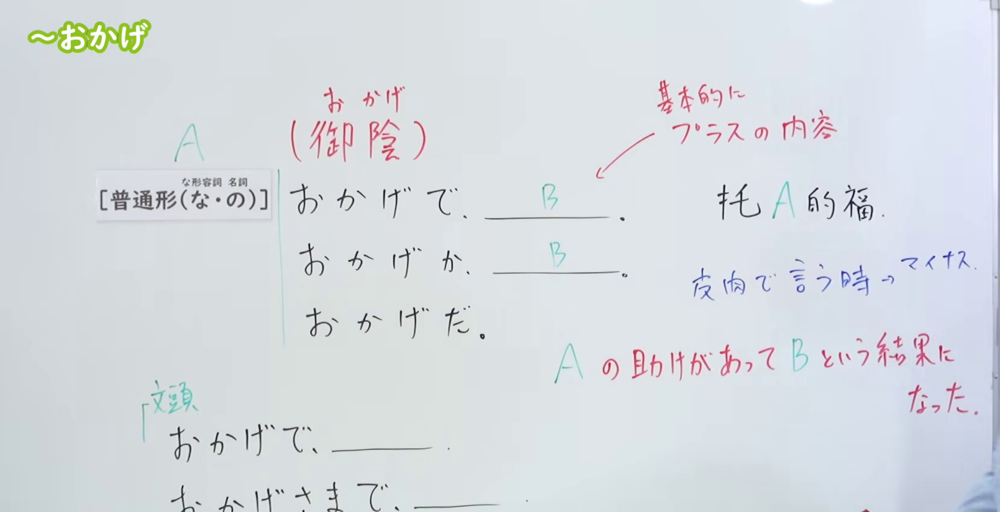
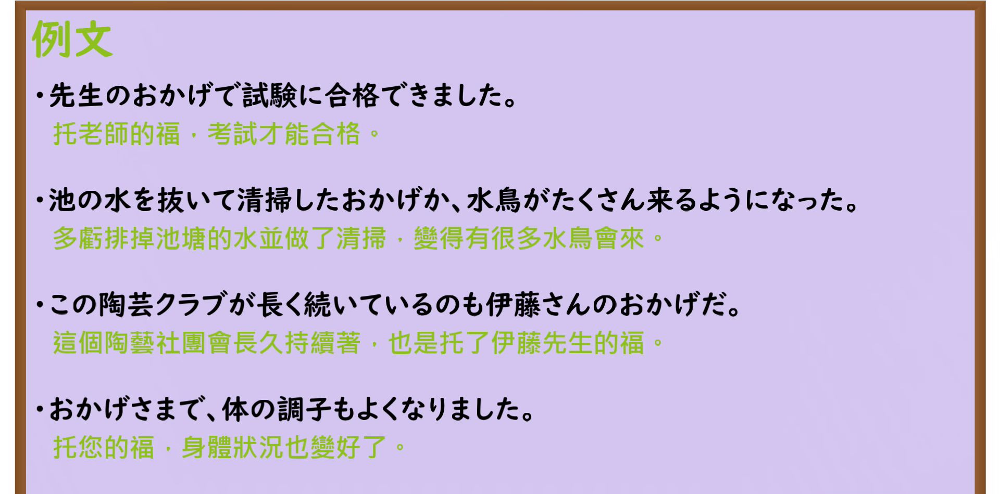

---
{
  "id": "N3-G-0004",
  "kind": "grammar",
  "level": "N3",
  "title": "〜おかげで／おかげだ（托……的福、多亏……）",
  "card_revision": 1,
  "schema_version": 1,
  "source": {
    "lesson": "N3 第4个语法",
    "material": "出口日語原视频板书、日语自动字幕与Hagoromo文型检索正文",
    "video": "https://www.youtube.com/watch?v=zNwGvXmd378",
    "screenshot": "assets/grammar/n3/N3-G-0004-connection.png",
    "screenshot_seconds": 60,
    "screenshot_crop": {
      "x": 0,
      "y": 0,
      "width": 1660,
      "height": 850
    }
  },
  "tags": [
    "おかげで",
    "N3"
  ],
  "confusions": [
    "せいで",
    "おかげで"
  ]
}
---

# N3 第4个语法：〜おかげで／おかげだ

# 视频学习资料整理

本课讲解 N3 语法形式「〜おかげで／おかげだ」。

## 接续图（板书与讲解）

- 视频链接：[出口日語 N3 第4个语法](https://www.youtube.com/watch?v=zNwGvXmd378)
- 真实时间：01:00（60秒）
- 原图尺寸：1920×1080
- 裁切说明：原视频 00:01 画面中老师站立于板书中央偏右，遮挡了「托 A 的福」与红色核心意义解释。选用 01:00 画面，此时板书已完整书写句型变体（おかげで、おかげか、おかげだ）、接续、红色意义解释「A の助けがあって B という結果になった。」与句首用法，老师侧身让出板书区域。固定左上角（0, 0），裁切区域为宽 1660、高 850，去除右侧人像与底部空白，完整保留全部板书。
- 图片：

## 例句图（视频例句）

- 视频链接：[出口日語 N3 第4个语法](https://www.youtube.com/watch?v=zNwGvXmd378)
- 真实时间：04:21（261.20秒）
- 原图尺寸：1920×1080
- 裁切说明：提取自视频 04:21 处的例句黑板页面。固定左上角（0, 0），裁切区域为宽 1920、高 950，裁去底部黑板槽与粉笔盒多余杂物，完整保留四条例句及中文翻译。
- 图片：

# 核心

## 功能一：多亏有 A 的帮助，才有了 B 这一结果

**最上位意味カテゴリー：**

- **おかげだ：** ものごとの関係（事物之间的关系）

**中位意味カテゴリー：**

- **おかげだ：** 原因・理由（原因与理由）

**意味：**

- **おかげだ：** 原因・理由（原因与理由）

**くわしい意味記述：**

- **おかげだ：** Xということが原因・理由でYといういい結果になった。「おかげ」の前には「先生の・みなさんの」といった名詞や「XさんがVてくれた・Vてくださった」「XさんにVていただいた」という授受を表す動詞の過去形が現れ，「おかげ」の後には話し手が「することができた」といった可能動詞がよく使われる。（以X事项为原因・理由而带来了Y这一良好结果。「おかげ」前多接「老师的、大家的」等名词或表示授受动词的过去形（「某人为我做了……」），「おかげ」之后常接说话人「得以做到某事」等可能动词。）

**派生語：** おかげで

### 例句

1. 田中先生に教えてもらったおかげで、日本語が話せるようになりました。

   （多亏了田中老师的教导，我才变得能够说日语了。）

2. いつでも人とつながっていられるのは携帯電話のおかげだ。

   （无论何时都能与人保持联络，这都要归功于手机。）

3. 国鉄や郵便局が基本的には信頼できるおかげで、企業にしても、あるいは一般国民にしても、どれほど助かっていることだろうか。

   （多亏了国铁和邮局基本值得信赖，不论是对企业还是普通国民而言，都得到了极大的便利与帮助。）

4. 私は辛党なのでチゲの辛さが好きということもあるが、冬はカプサイシンのおかげか体が温まる。

   （虽然也有我嗜辣喜欢韩式火锅辣味的原因，但冬天或许是托了辣椒素的福，身体变得很暖和。）

# 来源

- [出口日語原视频](https://www.youtube.com/watch?v=zNwGvXmd378)
- [Hagoromo 文型検索「おかげだ」](https://hagoromo-text.work/lookup?vid=346)（查询日期：2026-09-24）
