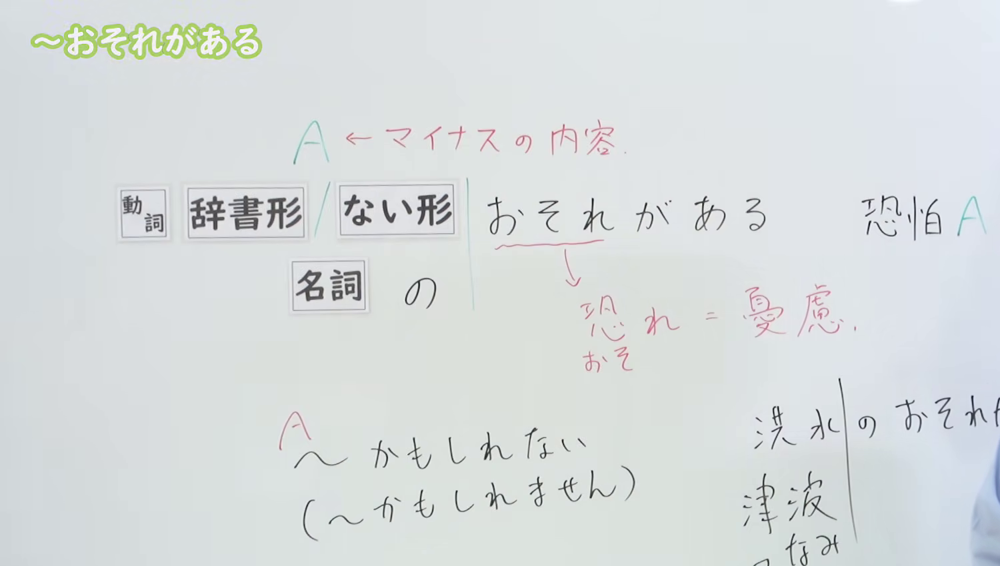
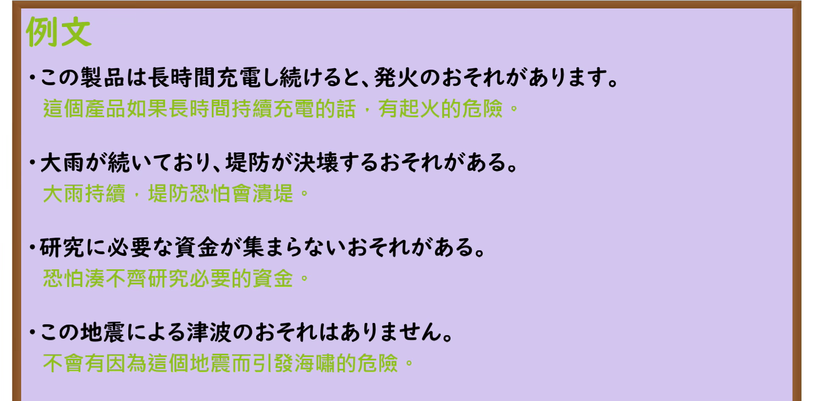

---
{
  "id": "N3-G-0005",
  "kind": "grammar",
  "level": "N3",
  "title": "〜おそれがある（恐怕……、有……的危险）",
  "card_revision": 1,
  "schema_version": 1,
  "source": {
    "lesson": "N3 第5个语法",
    "material": "出口日語原视频板书、日语自动字幕与Hagoromo文型检索正文",
    "video": "https://www.youtube.com/watch?v=8qo09quNcQY",
    "screenshot": "assets/grammar/n3/N3-G-0005-connection.png",
    "screenshot_seconds": 160,
    "screenshot_crop": {
      "x": 0,
      "y": 0,
      "width": 1500,
      "height": 850
    }
  },
  "tags": [
    "おそれがある",
    "N3"
  ],
  "confusions": [
    "かもしれない",
    "かねない"
  ]
}
---

# N3 第5个语法：〜おそれがある

# 视频学习资料整理

本课讲解 N3 语法形式「〜おそれがある」。

## 接续图（板书与讲解）

- 视频链接：[出口日語 N3 第5个语法](https://www.youtube.com/watch?v=8qo09quNcQY)
- 真实时间：02:40（160秒）
- 原图尺寸：1920×1080
- 裁切说明：原视频 00:01 画面中下方的汉字释义「恐れ＝憂慮」与具体灾害例词尚未书写完整。选用 02:40 画面，此时板书已完整书写接续（动词辞书形/ない形、名词の）、红色提示「A ← マイナスの内容」、汉字解说「恐れ＝憂慮」、口语替换表达以及「洪水・津波」等典型灾害用例，老师侧身让出板书区域。固定左上角（0, 0），裁切区域为宽 1500、高 850，去除右侧人像与底部空白，完整保留全部板书。
- 图片：

## 例句图（视频例句）

- 视频链接：[出口日語 N3 第5个语法](https://www.youtube.com/watch?v=8qo09quNcQY)
- 真实时间：03:12（192.85秒）
- 原图尺寸：1920×1080
- 裁切说明：提取自视频 03:12 处的例句黑板页面。固定左上角（0, 0），裁切区域为宽 1920、高 950，裁去底部黑板槽与粉笔盒多余杂物，完整保留四条例句及中文翻译。
- 图片：

# 核心

## 功能一：恐怕 A

**最上位意味カテゴリー：**

- **おそれがある：** 考え・感情（思考与感情）

**中位意味カテゴリー：**

- **おそれがある：** 推量（推量）

**意味：**

- **おそれがある：** 可能：可能性（悪いこと）（可能：不良可能性）

**くわしい意味記述：**

- **おそれがある：** Xという悪いことが起こる可能性があるという意味。ニュースなどで使われる硬い表現。（表示存在发生X这一不良负面事态的可能性之意。多用于新闻报道等正式书面语表达。）

**派生語：** 未列出

### 例句

1. 台風が上陸するおそれがある。

   （台风有可能登陆。）

2. 油断してサボれば、優位はたちまち失われるおそれがある。

   （如果掉以轻心、偷懒懈怠，优势恐怕转眼间就会丧失。）

3. 一方、比例代表制は、民意を公正に反映するが、小党分立に陥り、政治が不安定になるおそれがある。

   （另一方面，比例代表制虽能公正反映民意，却可能陷入小党林立的局面，有导致政治不稳定的危险。）

4. 救急隊員が感染症等に罹患した場合には救急業務を通して他の傷病者へ二次感染を引き起こすおそれがある。

   （急救队员一旦感染传染病等，恐有通过急救业务引发其他伤病员二次感染的危险。）

# 来源

- [出口日語原视频](https://www.youtube.com/watch?v=8qo09quNcQY)
- [Hagoromo 文型検索「おそれがある」](https://hagoromo-text.work/lookup?vid=352)（查询日期：2026-09-24）
