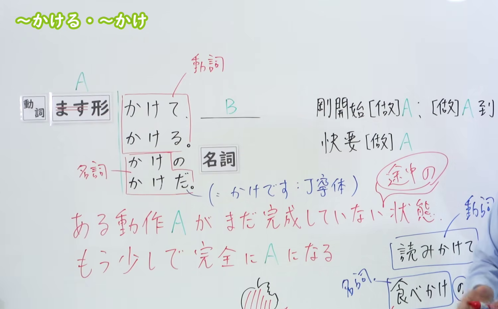
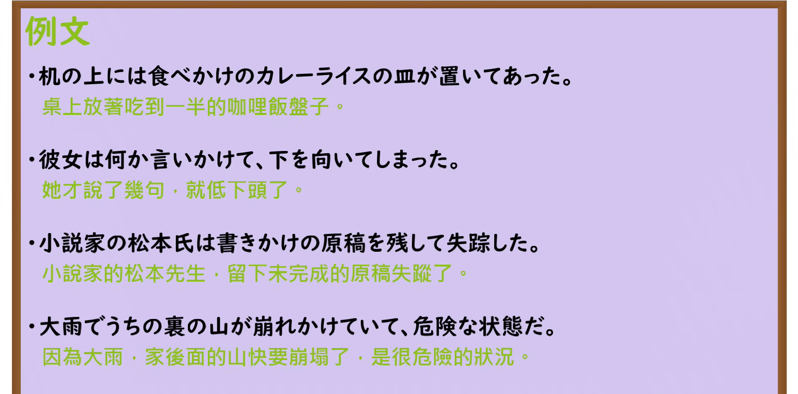

---
{
  "id": "N3-G-0006",
  "kind": "grammar",
  "level": "N3",
  "title": "〜かける／〜かけだ（做了一半、快要……）",
  "card_revision": 1,
  "schema_version": 1,
  "source": {
    "lesson": "N3 第6个语法",
    "material": "出口日語原视频板书、日语自动字幕与Hagoromo文型检索正文",
    "video": "https://www.youtube.com/watch?v=WmqsfDDLlW8",
    "screenshot": "assets/grammar/n3/N3-G-0006-connection.png",
    "screenshot_seconds": 200,
    "screenshot_crop": {
      "x": 0,
      "y": 0,
      "width": 1500,
      "height": 930
    }
  },
  "tags": [
    "かける",
    "かけだ",
    "N3"
  ],
  "confusions": [
    "切る",
    "かける"
  ]
}
---

# N3 第6个语法：〜かける／〜かけだ

# 视频学习资料整理

本课讲解 N3 语法形式「〜かける／〜かけだ／〜かけの」。

## 接续图（板书与讲解）

- 视频链接：[出口日語 N3 第6个语法](https://www.youtube.com/watch?v=WmqsfDDLlW8)
- 真实时间：03:20（200秒）
- 原图尺寸：1920×1080
- 裁切说明：原视频 00:01 画面中下方的动词与名词对比示意图（読みかけて／食べかけの苹果图）尚未书写绘制。选用 03:20 画面，此时板书已完整书写接续（动词ます形＋かけて/かける/かけの名词/かけだ）、词性区分、红色核心意义解释「ある動作 A がまだ完成していない状態／もう少しで完全に A になる」及苹果图例，老师侧身让出板书区域。固定左上角（0, 0），裁切区域为宽 1500、高 930，去除右侧人像与底部空白，完整保留全部板书。
- 图片：

## 例句图（视频例句）

- 视频链接：[出口日語 N3 第6个语法](https://www.youtube.com/watch?v=WmqsfDDLlW8)
- 真实时间：03:33（213.52秒）
- 原图尺寸：1920×1080
- 裁切说明：提取自视频 03:33 处的例句黑板页面。固定左上角（0, 0），裁切区域为宽 1920、高 950，裁去底部黑板槽与粉笔盒多余杂物，完整保留四条例句及中文翻译。
- 图片：

# 核心

## 功能一：某个动作 A 尚未完成的状态（差一点就要完全变成 A）

**最上位意味カテゴリー：**

- **Vかける：** 場所・時間（场所与时间）

**中位意味カテゴリー：**

- **Vかける：** 起点・終点（起点与终点）

**意味：**

- **Vかける：** 途中・未完了（途中与未完成）

**くわしい意味記述：**

- **Vかける：** ある動作・出来事が途中段階であることを表す。（表示某个动作或事件正处于中途进行阶段。）

**派生語：** 未列出

### 例句

1. 彼は何か言いかけて、止めてしまった。

   （他刚要说些什么，却又欲言又止了。）

2. ちょっとあれから時間たってるから少し忘れかけて来ちゃったけど。

   （从那时起过了一段时间，虽然我已经快要有点淡忘了。）

3. 記憶も冷えかけてしまってからでは、再び熱するための努力を浪費することになります。

   （如果等到记忆都快要冷却遗忘了再去温习，就会白白浪费重新加温的力气。）

4. 政治、経済が極度に混乱し、原子力をはじめとする巨大な産業や技術をコントロールする機能を失いかけている。

   （政经极度混乱，以核能为代表的庞大产业与技术的控制功能正处于濒临丧失的状态。）

# 来源

- [出口日語原视频](https://www.youtube.com/watch?v=WmqsfDDLlW8)
- [Hagoromo 文型検索「Vかける」](https://hagoromo-text.work/lookup?vid=141)（查询日期：2026-09-24）
