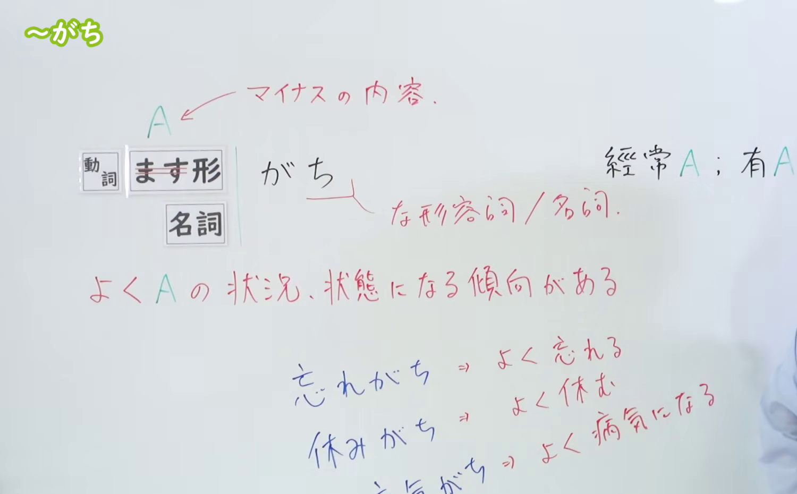
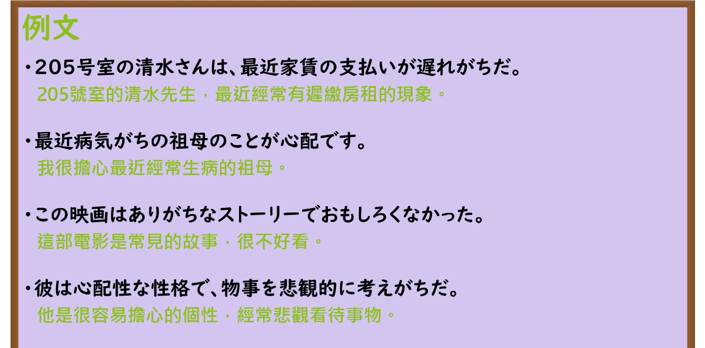

---
{
  "id": "N3-G-0007",
  "kind": "grammar",
  "level": "N3",
  "title": "〜がちだ／〜がち（动辄……、容易……）",
  "card_revision": 1,
  "schema_version": 1,
  "source": {
    "lesson": "N3 第7个语法",
    "material": "出口日語原视频板书、日语自动字幕与Hagoromo文型检索正文",
    "video": "https://www.youtube.com/watch?v=BFV1_8dMlSA",
    "screenshot": "assets/grammar/n3/N3-G-0007-connection.png",
    "screenshot_seconds": 180,
    "screenshot_crop": {
      "x": 0,
      "y": 0,
      "width": 1500,
      "height": 930
    }
  },
  "tags": [
    "がち",
    "がちだ",
    "N3"
  ],
  "confusions": [
    "っぽい",
    "気味",
    "がち"
  ]
}
---

# N3 第7个语法：〜がちだ／〜がち

# 视频学习资料整理

本课讲解 N3 语法形式「〜がちだ／〜がち」。

## 接续图（板书与讲解）

- 视频链接：[出口日語 N3 第7个语法](https://www.youtube.com/watch?v=BFV1_8dMlSA)
- 真实时间：03:00（180秒）
- 原图尺寸：1920×1080
- 裁切说明：原视频 00:01 画面中下方的动词与名词典型搭配词（忘れがち、休みがち、病気がち）尚未书写完整。选用 03:00 画面，此时板书已完整书写接续（动词ます形、名词）、品词说明（な形容词/名词）、红色提示「A ← マイナスの内容」、核心意义「よく A の状況、状態になる傾向がある」与右侧「经常 A；有 A 倾向」，老师侧身让出板书区域。固定左上角（0, 0），裁切区域为宽 1500、高 930，去除右侧人像与底部空白，完整保留全部板书。
- 图片：

## 例句图（视频例句）

- 视频链接：[出口日語 N3 第7个语法](https://www.youtube.com/watch?v=BFV1_8dMlSA)
- 真实时间：03:32（212.08秒）
- 原图尺寸：1920×1080
- 裁切说明：提取自视频 03:32 处的例句黑板页面。固定左上角（0, 0），裁切区域为宽 1920、高 950，裁去底部黑板槽与粉笔盒多余杂物，完整保留四条例句及中文翻译。
- 图片：

# 核心

## 功能一：容易处于 A 这种状况或状态的倾向（经常 A、有 A 倾向）

**最上位意味カテゴリー：**

- **Vがち：** ものごとの様子（事物的状态与样貌）

**中位意味カテゴリー：**

- **Vがち：** 傾向（倾向）

**意味：**

- **Vがち：** 傾向（倾向）

**くわしい意味記述：**

- **Vがち：** 「よく〜になる」の意味。よくないことに使うことが多い。動詞と接続することが多い。また，「遠慮がち」「伏し目がち」は「少し〜の様子で」という別の意味で用いられるコロケーション。（表示「经常变成……」之意。多用于不好的消极事态。常与动词接续。此外，「遠慮がち」「伏し目がち」属于表示「略带……神情」的特殊惯用搭配。）

**派生語：** Vがちの，Vがちで

### 例句

1. 冬は風邪をひきがちだ。

   （冬天容易感冒。）

2. この地方は、秋はくもりがちの日が続く。

   （这个地区在秋天多是阴沉多云的日子。）

3. 毎日車で移動していると、運動不足になりがちである。

   （如果每天都开车出行，很容易陷入运动不足的状态。）

4. 外食が多いと、野菜が不足しがちである。

   （经常在外就餐的话，往往容易缺乏蔬菜摄入。）

# 来源

- [出口日語原视频](https://www.youtube.com/watch?v=BFV1_8dMlSA)
- [Hagoromo 文型検索「Vがち」](https://hagoromo-text.work/lookup?vid=143)（查询日期：2026-09-24）
