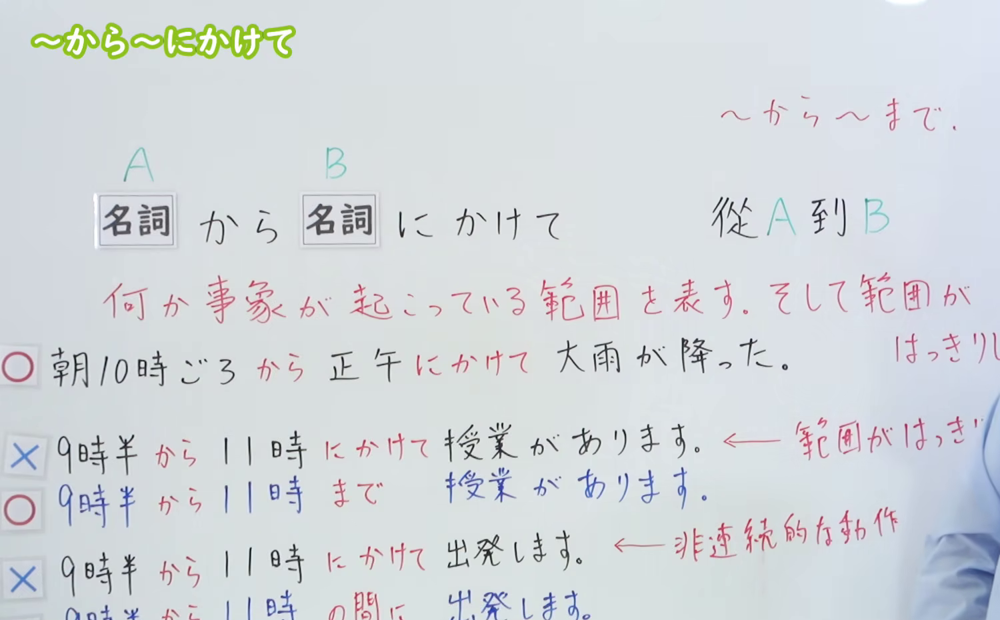
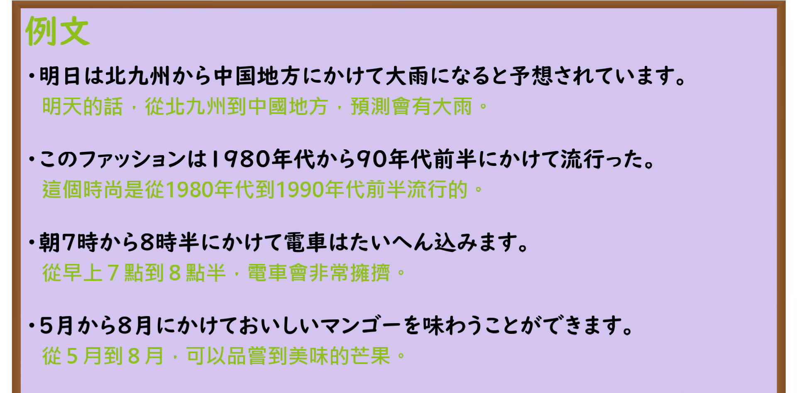

---
{
  "id": "N3-G-0008",
  "kind": "grammar",
  "level": "N3",
  "title": "〜から〜にかけて（从……到……）",
  "card_revision": 1,
  "schema_version": 1,
  "source": {
    "lesson": "N3 第8个语法",
    "material": "出口日語原视频板书、日语自动字幕与Hagoromo文型检索正文",
    "video": "https://www.youtube.com/watch?v=aGq2IHxhxSM",
    "screenshot": "assets/grammar/n3/N3-G-0008-connection.png",
    "screenshot_seconds": 312,
    "screenshot_crop": {
      "x": 0,
      "y": 0,
      "width": 1500,
      "height": 930
    }
  },
  "tags": [
    "から〜にかけて",
    "にかけて",
    "N3"
  ],
  "confusions": [
    "から〜まで",
    "にかけて"
  ]
}
---

# N3 第8个语法：〜から〜にかけて

# 视频学习资料整理

本课讲解 N3 语法形式「〜から〜にかけて」。

## 接续图（板书与讲解）

- 视频链接：[出口日語 N3 第8个语法](https://www.youtube.com/watch?v=aGq2IHxhxSM)
- 真实时间：05:12（312.40秒）
- 原图尺寸：1920×1080
- 裁切说明：原视频 00:01 画面中下方的辨析例句（与「〜まで」「〜の間に」的区别）尚未书写。选用 05:12 画面，此时板书已完整书写接续（名词から名词にかけて）、红色核心意义解释「何か事象が起こっている範囲を表す。そして範囲がはっきりしない」、典型例句以及与「まで」（范围明确）和「間に」（非连续动作）的正误对比例句，老师侧身让出板书区域。固定左上角（0, 0），裁切区域为宽 1500、高 930，去除右侧人像与底部空白，完整保留全部板书。
- 图片：

## 例句图（视频例句）

- 视频链接：[出口日語 N3 第8个语法](https://www.youtube.com/watch?v=aGq2IHxhxSM)
- 真实时间：05:21（321.90秒）
- 原图尺寸：1920×1080
- 裁切说明：提取自视频 05:21 处的例句黑板页面。固定左上角（0, 0），裁切区域为宽 1920、高 950，裁去底部黑板槽与粉笔盒多余杂物，完整保留四条例句及中文翻译。
- 图片：

# 核心

## 功能一：表示某种事象发生的范围，且范围边界不十分明确（从 A 到 B）

**最上位意味カテゴリー：**

- **（から）〜にかけ（て）：** 場所・時間（场所与时间）

**中位意味カテゴリー：**

- **（から）〜にかけ（て）：** 起点・終点（起点与终点）

**意味：**

- **（から）〜にかけ（て）：** 終点・範囲（终点与范围）

**くわしい意味記述：**

- **（から）〜にかけ（て）：** ある時点からある時点まで，その範囲内で動作や行為が続くことを表す。（表示从某一时间点到另一时间点，在该范围内动作或行为持续进行。）

**派生語：** （から）〜にかけ、にかけて，から〜にかけて

### 例句

1. 東海から関東にかけて雨になるでしょう。

   （从东海到关东一带大概会有雨吧。）

2. 1990年代から2000年にかけ、日本は不景気だった。

   （从1990年代到2000年期间，日本经济一直处于低迷状态。）

3. この岩木山の北麓には赤倉という台地がひろがり、そこから山の中腹にかけて行者小屋が点点と散在している。

   （在这座岩木山的北麓延展着名为赤仓的台地，从那里一直到山腰，点缀散布着不少修行者的茅舍。）

4. 一九五〇年代から六〇年代にかけて米ソの競合を反映した宇宙開発は、逆に地球そのものに何を迫ったのか。

   （从1950年代到60年代反映美苏竞争的太空探索，反过来向地球本身提出了怎样的课题？）

# 来源

- [出口日語原视频](https://www.youtube.com/watch?v=aGq2IHxhxSM)
- [Hagoromo 文型検索「（から）〜にかけ（て）」](https://hagoromo-text.work/lookup?vid=417)（查询日期：2026-09-24）
