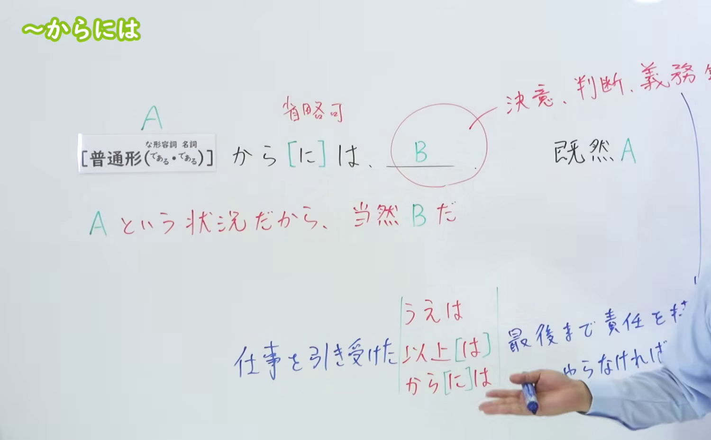
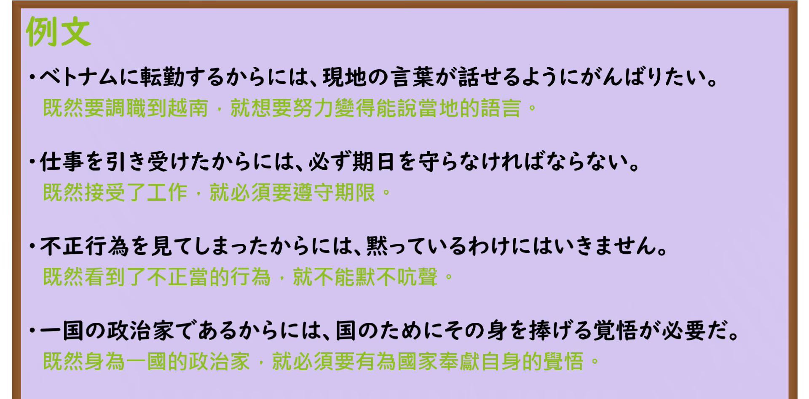

---
{
  "id": "N3-G-0009",
  "kind": "grammar",
  "level": "N3",
  "title": "〜からには（既然……就……）",
  "card_revision": 1,
  "schema_version": 1,
  "source": {
    "lesson": "N3 第9个语法",
    "material": "出口日語原视频板书、日语自动字幕与Hagoromo文型检索正文",
    "video": "https://www.youtube.com/watch?v=o4VfI3oJ9jI",
    "screenshot": "assets/grammar/n3/N3-G-0009-connection.png",
    "screenshot_seconds": 180,
    "screenshot_crop": {
      "x": 0,
      "y": 0,
      "width": 1500,
      "height": 930
    }
  },
  "tags": [
    "からには",
    "から",
    "N3"
  ],
  "confusions": [
    "以上は",
    "上は"
  ]
}
---

# N3 第9个语法：〜からには

# 视频学习资料整理

本课讲解 N3 语法形式「〜からには」。

## 接续图（板书与讲解）

- 视频链接：[出口日語 N3 第9个语法](https://www.youtube.com/watch?v=o4VfI3oJ9jI)
- 真实时间：03:00（180.00秒）
- 原图尺寸：1920×1080
- 裁切说明：选用 03:00 画面，此时板书已完整书写普通形接续规则（普通形（なA・Nである）＋から（には）），以及核心语义说明「Aという状況だから、当然Bだ（Bには、決意・判断・義務など）」，并注明与「〜上は」「〜以上は」基本同义。固定左上角（0, 0），裁切区域为宽 1500、高 930，去除右侧人像与底部空白，完整保留全部板书。
- 图片：

## 例句图（视频例句）

- 视频链接：[出口日語 N3 第9个语法](https://www.youtube.com/watch?v=o4VfI3oJ9jI)
- 真实时间：03:24（203.99秒）
- 原图尺寸：1920×1080
- 裁切说明：提取自视频 03:24 处的例句黑板页面。固定左上角（0, 0），裁切区域为宽 1920、高 950，裁去底部多余边框与杂物，完整保留四条例句及中文翻译。
- 图片：

# 核心

## 功能一：既然处于 A 这种状况，B 理所当然（既然……就……）

**最上位意味カテゴリー：**

- **からには：** ものごとの関係（事物的关系）

**中位意味カテゴリー：**

- **からには：** 原因・理由（原因与理由）

**意味：**

- **からには：** 理由：当然（理由：理所当然）

**くわしい意味記述：**

- **からには：** 「〜のだから」という意味を表す。「Vということをするから/Vということにしたから/Vという状態だから，〜しなければならない/〜をしたい/〜をするのは当然だ」という意味を表す。「V以上は」「仮にも〜以上は」，「Vたうえは」と同じ意味を表す。（表示“正因为如此”的含义。表示“既然要做V这回事/既然决定了做V/既然处于V的状态，就必须做～/想要做～/做～是理所当然的”。与“V以上は”“仮にも〜以上は”“Vたうえは”含义相同。）

### 例句

1. 約束したからには、彼は実行してくれるだろう。

   （既然已经做出了承诺，他想必会付诸实行的吧。）

2. アジアのハブ（拠点）空港をめざすからには、早急に解決すべき課題の一つである。

   （既然以成为亚洲枢纽机场为目标，这便是必须尽速解决的课题之一。）

3. 細川首相は、米国の要求に「ノー」と言うからには、そのあとの腹づもりがあったはずだ。

   （细川首相既然对美国的要求说“不”，事后必然另有盘算。）

4. 作法というからには、かならず何らかの規準があるはずである。

   （既然称之为礼法礼数，就必然存在着某种基准。）

# 来源

- [出口日語原视频](https://www.youtube.com/watch?v=o4VfI3oJ9jI)
- [Hagoromo 文型検索「からには」](https://hagoromo-text.work/lookup?vid=429)（查询日期：2026-09-24）
