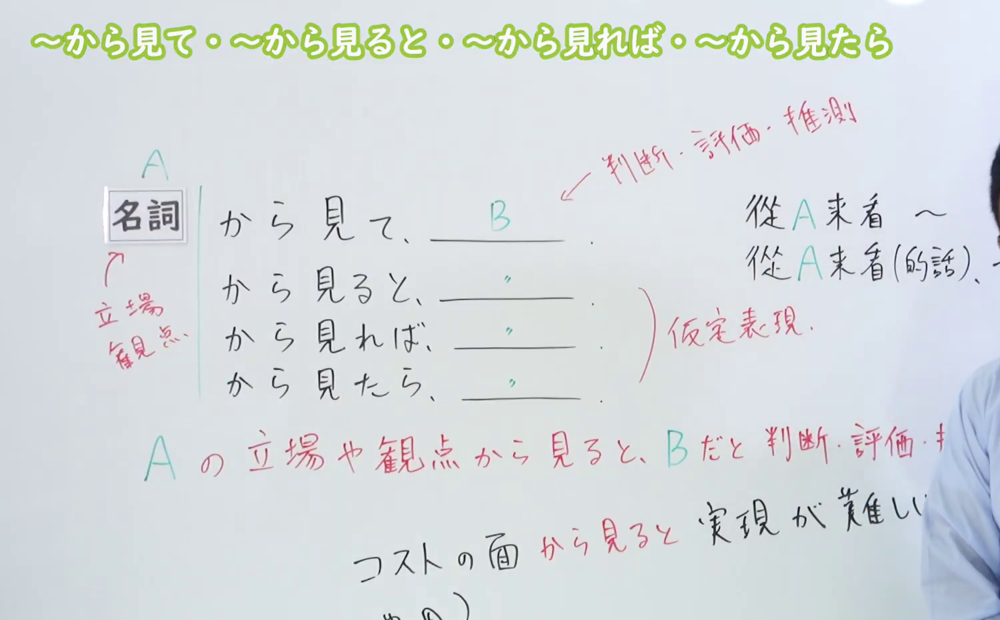
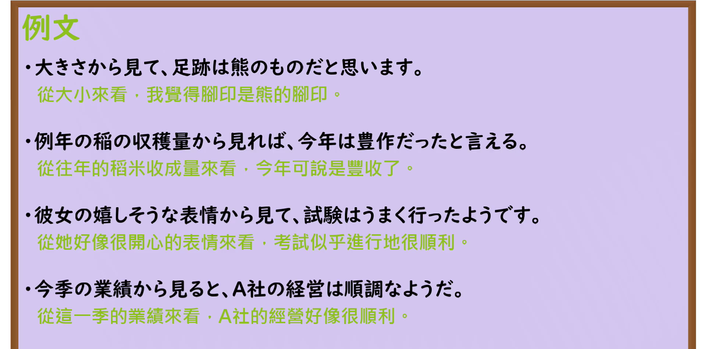

---
{
  "id": "N3-G-0010",
  "kind": "grammar",
  "level": "N3",
  "title": "〜から見ると／〜から見れば／〜から見て（从……来看）",
  "card_revision": 1,
  "schema_version": 1,
  "source": {
    "lesson": "N3 第10个语法",
    "material": "出口日語原视频板书、日语自动字幕与Hagoromo文型检索正文",
    "video": "https://www.youtube.com/watch?v=ZffwCVgPqHE",
    "screenshot": "assets/grammar/n3/N3-G-0010-connection.png",
    "screenshot_seconds": 270,
    "screenshot_crop": {
      "x": 0,
      "y": 0,
      "width": 1500,
      "height": 930
    }
  },
  "tags": [
    "から見ると",
    "から見れば",
    "から見て",
    "から見たら",
    "N3"
  ],
  "confusions": [
    "から言うと",
    "からすると",
    "にしては"
  ]
}
---

# N3 第10个语法：〜から見ると／〜から見れば／〜から見て

# 视频学习资料整理

本课讲解 N3 语法形式「〜から見ると／〜から見れば／〜から見て（〜から見たら）」。

## 接续图（板书与讲解）

- 视频链接：[出口日語 N3 第10个语法](https://www.youtube.com/watch?v=ZffwCVgPqHE)
- 真实时间：04:30（270.00秒）
- 原图尺寸：1920×1080
- 裁切说明：选用 04:30 画面，此时板书已完整书写接续规则「名詞（A）＋から見て／から見ると／から見れば／から見たら」以及语义说明「Aの立場や観点から見るとBだ（Bには判断・評価・推測などが入る）」，并补充说明了带假定色彩时的用法区别。固定左上角（0, 0），裁切区域为宽 1500、高 930，去除右侧人像与底部空白，完整保留全部板书。
- 图片：

## 例句图（视频例句）

- 视频链接：[出口日語 N3 第10个语法](https://www.youtube.com/watch?v=ZffwCVgPqHE)
- 真实时间：04:38（278.08秒）
- 原图尺寸：1920×1080
- 裁切说明：提取自视频 04:38 处的例句黑板页面。固定左上角（0, 0），裁切区域为宽 1920、高 950，裁去底部多余边框与杂物，完整保留四条例句及中文翻译。
- 图片：

# 核心

## 功能一：从某立场或观点的角度来看，做出判断、评价或推测（从……来看）

**最上位意味カテゴリー：**

- **からみると：** ものごとの関係（事物的关系）

**中位意味カテゴリー：**

- **からみると：** 判断の立場（判断的立场）

**意味：**

- **からみると：** 観点（观点、角度）

**くわしい意味記述：**

- **からみると：** ある状況・立場からどのように考えられるかを述べるときに使う。「私」「彼」といった人を表す名詞に直接付くことができる。（用于叙述从某种状况或立场出发该如何考虑。可直接接在“私”“彼”等表示人物的名词之后。）

### 例句

1. この記録から見ると、100人以上の社員が開発に関わったことが分かる。

   （从这份记录来看，可以得知有100名以上的员工参与了开发。）

2. ちょっと余談めくが、そういう面からみると、ヨーロッパ人は「馬を引く人種」であるが、日本人は「牛を追う人種」である。

   （虽然有点像题外话，但从那个方面来看，欧洲人是“引马的人种”，而日本人则是“赶牛的人种”。）

3. 部屋は実際にいくつかあっても、家族成員の動き方からみると、一つの家は一つの部屋という感じになりやすい。

   （即使房间实际上有几间，但从家庭成员的活动方式来看，整个家往往容易给人一种只有一个房间的感觉。）

4. カラーテレビ全体の出荷量からみると一％ほどだが、着実に伸びている。

   （虽然从彩电整体出货量来看仅占1%左右，但正在稳步增长。）

# 来源

- [出口日語原视频](https://www.youtube.com/watch?v=ZffwCVgPqHE)
- [Hagoromo 文型検索「からみると」](https://hagoromo-text.work/lookup?vid=435)（查询日期：2026-09-24）
