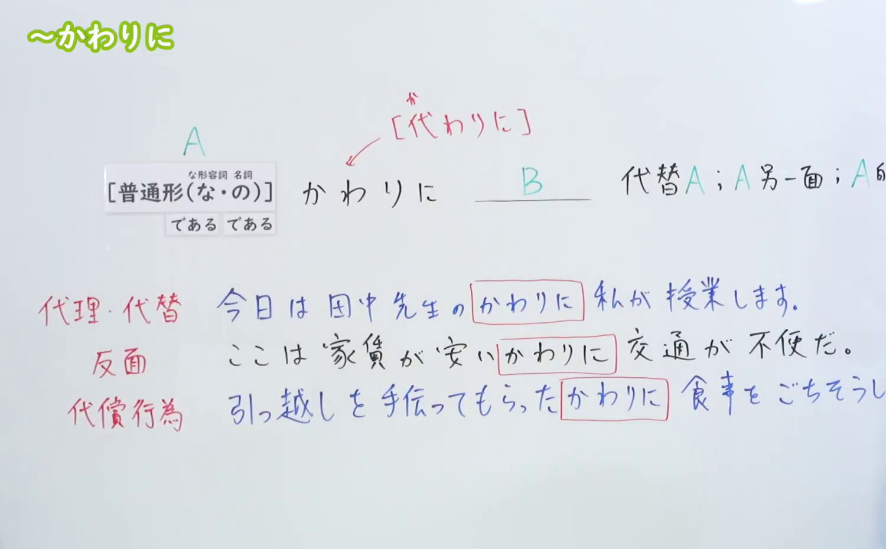
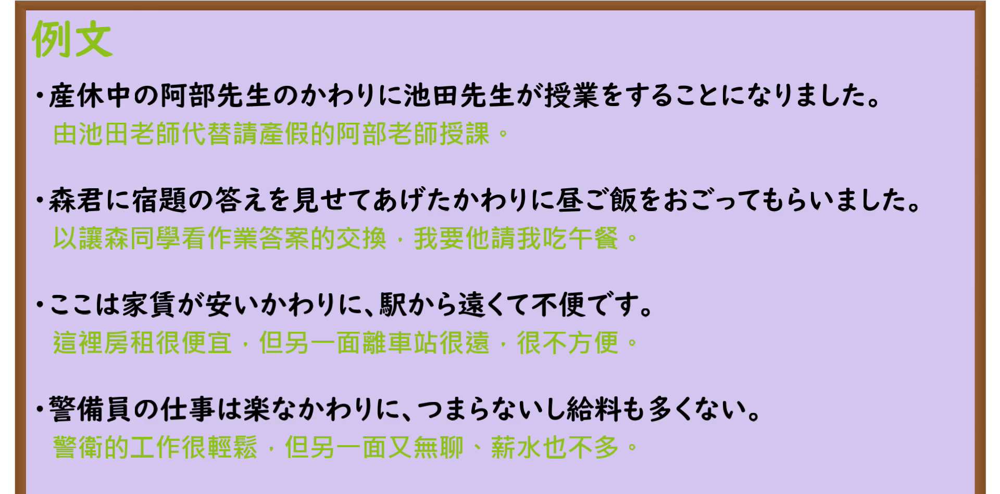

---
{
  "id": "N3-G-0011",
  "kind": "grammar",
  "level": "N3",
  "title": "〜かわりに／〜代わりに（代替／作为交换／一方面……另一方面……）",
  "card_revision": 1,
  "schema_version": 1,
  "source": {
    "lesson": "N3 第11个语法",
    "material": "出口日語原视频板书、日语自动字幕与Hagoromo文型检索正文",
    "video": "https://www.youtube.com/watch?v=YBObzpUsgiw",
    "screenshot": "assets/grammar/n3/N3-G-0011-connection.png",
    "screenshot_seconds": 255,
    "screenshot_crop": {
      "x": 0,
      "y": 0,
      "width": 1500,
      "height": 930
    }
  },
  "tags": [
    "かわりに",
    "代わりに",
    "そのかわり",
    "N3"
  ],
  "confusions": [
    "にかわって",
    "反面"
  ]
}
---

# N3 第11个语法：〜かわりに／〜代わりに

# 视频学习资料整理

本课讲解 N3 语法形式「〜かわりに／〜代わりに」。

## 接续图（板书与讲解）

- 视频链接：[出口日語 N3 第11个语法](https://www.youtube.com/watch?v=YBObzpUsgiw)
- 真实时间：04:15（255.00秒）
- 原图尺寸：1920×1080
- 裁切说明：选用 04:15 画面，此时板书已完整书写接续规则「普通形（なAな/である・Nの/である）＋かわりに（代わりに）」以及三大核心用法：①代理・代替（AをしないでBをする／Aの代理でB）、②交換・引き換え（Aをする見返りにBをする）、③表裏一体（一面ではプラスだが他面ではマイナス等、対比を表す）。固定左上角（0, 0），裁切区域为宽 1500、高 930，去除右侧人像与底部空白，完整保留全部板书。
- 图片：

## 例句图（视频例句）

- 视频链接：[出口日語 N3 第11个语法](https://www.youtube.com/watch?v=YBObzpUsgiw)
- 真实时间：04:34（274.34秒）
- 原图尺寸：1920×1080
- 裁切说明：提取自视频 04:34 处的例句黑板页面。固定左上角（0, 0），裁切区域为宽 1920、高 950，裁去底部多余边框与杂物，完整保留四条例句及中文翻译。
- 图片：

# 核心

## 功能一：代理、替代以及交换补偿（作为……的代替／作为交换）

**最上位意味カテゴリー：**

- **かわり（に）：** ものごとの関係（事物的关系）

**中位意味カテゴリー：**

- **かわり（に）：** 対比（对比）

**意味：**

- **かわり（に）：** 代理（代理、替代、补偿交换）

**くわしい意味記述：**

- **かわり（に）：** 〜の代替として。〜するのではなく。（作为某事物的替代；不做某事而做另一件事；或者作为做某事的回报与条件补偿。）

### 例句

1. 映画を見に行くかわりに、うちでテレビを見る。

   （不去电影院看电影，改为在家里看电视。）

2. 紙のマニュアルの代わりに本体に電子マニュアルを搭載することにより、紙の使用量の90％削減を達成できた。

   （通过在机器内置电子说明书来代替纸质说明书，实现了纸张使用量减少90%的目标。）

3. 日本語を教えてくれるかわりに、中国語を教えてあげる。

   （作为你教我日语的交换，我来教你中文。）

4. 二十代はショックも大きいかわりに、対応力、受容力も大きい。

   （二十多岁时受到的文化冲击虽然大，但作为相应的一面，适应力和接纳力也很强。）

# 来源

- [出口日語原视频](https://www.youtube.com/watch?v=YBObzpUsgiw)
- [Hagoromo 文型検索「かわり（に）」](https://hagoromo-text.work/lookup?vid=448)（查询日期：2026-09-25）
